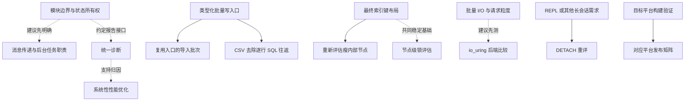

# 后续工作的优先级与依赖分析

> Snapshot: [SNAPSHOT](../docs/SNAPSHOT.md)
> Captured revision: e9cb9d3（工作区含既有未提交改动；代码观察针对采集时工作区）
> Captured at: 2026-10-27
> See also: [模块化历史分析](workspace-crate-modularization.md)

剩余候选按台账条目计为 **38 项：37 项改进方向，以及 1 项未关闭缺陷**。建议先明确模块边界和状态归属，再补引擎语义及资源生命周期，最后依据实测实施性能优化。底层实现中的空间、锁和 I/O 优化仍须证明必要性，不能仅凭所在层次自动前置。

本文落实用户本次会话的排序要求，只提供后续决策依据，不创建实施任务、不改变现有路线或条目状态。序号表示建议优先级；技术前置、建议先后和按需启动条件分别说明，不构成必须逐项完成的串行队列。

## 目标与范围

本次回答五个问题：

1. 排除已排期和已完成部分后，还剩多少候选？
2. 哪些工作提前完成能减少后续接口调整和重复实现？
3. 架构、引擎语义及性能优化分别怎样排序？
4. 哪些关系是技术前置，哪些只是收益或需求触发条件？
5. 排序依据确认到什么程度，立项前还需补查什么？

范围是[改进清单](../memory/improvements.md)和[缺陷台账](../issues/)中尚未承诺或尚未解决的工作。复用当前会话已读的项目规则、路线、模型、活跃变更及归档结果，并定向读取结果接口、导入、GC、索引写单元、刷盘、恢复和诊断实现。没有重新调查完整模块依赖图，没有测量新的性能收益。

## 统计口径与排除项

| 来源 | 计数方法 | 剩余 |
|---|---|---:|
| 改进清单正文 | 42 个条目，减去 7 个 promoted 条目，再加回其中 2 个未排期余项 | 37 |
| 缺陷台账，含归档目录 | 35 个带顶层 Status 的条目，34 个 closed、1 个 open | 1 |
| 合计 | 每个改进条目或其未完成余项计一次，不另计方向内部子任务 | 38 |

加回的两个余项是 I016 的完整代价模型与 JOIN 重排，以及 I077 的导入攒批与持锁窗口治理。I016 已承载的构建侧评估、I077 已交付的锁等待不重复安排。

整体排除 I015、I024、I045、I064、I085：连接算法补全和两项文档工作已收尾；键编码、字符串索引以及组合索引和范围访问已经进入既有路线。来源为[全局路线](../docs/tasks.md)、[连接变更任务](../../openspec/changes/archive/2026-10-26-ms40-join-smj-and-build-side/tasks.md)及[当前索引变更任务](../../openspec/changes/2026-10-27-ms38-index-key-encoding-and-string-index/tasks.md)。

改进文档中部分“尚未开始”文字早于归档结果，不能据此把已收尾范围再次计入。其 planned、P3、P5 等历史标签也不等于已进入当前路线；文档自身的状态说明保留了未承诺候选含义。

唯一 open 缺陷是 [ISS36](../issues/ISS36-fmt-clippy-gates-unsatisfiable.md)。正文保留历史承载指针，但[缺陷收口归档任务](../../openspec/changes/archive/2026-10-25-ms37-defect-ledger-closure/tasks.md)明确排除其修复；当前索引计划只记录其可能阻塞收尾，没有把修复列为任务。因此计入未排期工作。本次不重新确认其历史 fmt/lint 数量与当前工作区完全一致。

## 已确认事实与排序依据

以下为本次静态核对，不是性能或故障行为的新运行结论。

| 已确认事实 | 实际位置 | 对排序的影响 |
|---|---|---|
| 候选清单把完整诊断系统放在模块边界整理之后，必要诊断可随开发补齐 | [improvements](../memory/improvements.md)，后续发展方向、I074、I095、I096 | 模块与诊断前置于尚未排期的系统性性能优化，不改变已排期索引顺序 |
| Cargo.toml 为单包，没有 optional 依赖或 features 表；库入口重导出类型化结果 | [Cargo.toml](../../Cargo.toml)、[lib.rs](../../src/lib.rs) | 先评估接口和可选依赖，不以拆分 crate 数量为成果 |
| 公共入口返回 SqlOutcome，查询仍持有 Vec<Vec<Value>>；执行器已有 next 和默认 next_batch | [database.rs](../../src/database.rs)，execute_sql；[result.rs](../../src/result.rs)，SqlOutcome；[executor_trait.rs](../../src/executor/executor_trait.rs)，Executor | 核心结果与网络 Response 的解耦不重复安排；流式结果在现有类型化 API 上设计，不能用内部批量取行替代 |
| 导入收集全部 CSV 记录，自动建表按全输入推导类型，再逐行生成 INSERT 文本调用 execute_sql | [lifecycle.rs](../../src/cli/lifecycle.rs)，import_csv | 批量入口可被提交批次和 CSV 适配共同复用；有界读取须保留推导及失败合同 |
| 可选 GC 从主键索引 scan_all 条目出发遍历旧版本 | [table_manager.rs](../../src/storage/data/table_manager.rs)，TableMeta::gc_table | 无键行 GC 属资源生命周期覆盖问题，优先于换锁或分配器；本次没有复现空间增长 |
| flush_all 收集脏页后逐页 write_page，失败恢复未成功写出的脏状态；文件页写经 spawn_blocking，sync 独立 | [buffer_pool.rs](../../src/storage/buffer_pool.rs)，flush_all；[file_storage.rs](../../src/storage/file_storage.rs)，write_page、sync | 先考虑请求粒度再比较后端，不沿用“每页必然 fsync”假设 |
| 提交已有 append_commit_and_wait、后台 do_flush 与 write_batch | [manager.rs](../../src/transaction/manager.rs)，commit；[buffer.rs](../../src/wal/buffer.rs)，append_commit_and_wait、do_flush | 组提交是评估已有机制；消息传递重构须复用现有通知与后台任务 |
| 索引插入在同一 blocking 写单元中完成结构变更、根发布和反向映射，以 write_gate 串行化 | [index_manager.rs](../../src/storage/btree/index_manager.rs)，insert | 节点锁不能把取消与一致性边界拆成多个互不协调的写步骤 |
| 有数据重放时，恢复路径使用数据页派生信息，之后重建索引 | [recovery.rs](../../src/wal/recovery.rs)，恢复重放与 rebuild_pk_indexes 调用 | 撕裂树已有恢复处置，运行期根修先评估成本，不预设必须重写 |
| 已有按任务作用域记录阶段耗时的 profiling 模块与 RTSQL_PROFILING 开关 | [profiling.rs](../../src/profiling.rs)，record_time、with_profiling_scope、is_profiling_enabled | 统一诊断先调查复用已有能力，不重复建设孤立计时系统；全部等待、失败及取消覆盖尚未核对 |

[模块化历史分析](workspace-crate-modularization.md)提供候选边界及拆分思路。本次不沿用其中旧模块数量、依赖环数量、性能数字和全量测试结论作为当前依据。

## 建议优先级

### 架构边界与验证基础：7 项

| 顺序 | 条目 | 建议工作 | 前置价值与启动条件 |
|---:|---|---|---|
| 1 | ISS36 | 修复 fmt/clippy 检查基线 | 让验收可以明确判定；重新定位当前问题，不照历史清单全仓清理 |
| 2 | I074 | 明确模块接口、状态所有权与 feature 边界 | 先在模块内验证边界，有独立构建或替换收益时再拆 crate；不等所有 SQL 功能做完 |
| 3 | I012 | 整理生产者与消费者间的消息传递 | 逐处处理 WAL、提交通知和检查点协调，不统一替换全部锁；复用现有机制 |
| 4 | I095 | 核心依赖按需定制 | 贯穿工作，只有依赖阻碍实际需求时启动；不整批替换，也不阻塞后续项 |
| 5 | I093 | 依赖兼容与 feature 组合验证 | 配合实际模块及依赖调整，不为追新升级全部依赖；无对象时保持候选 |
| 6 | I096 | 统一诊断接口与分级采集 | 模块化时约定报告接口，随后完善阶段、等待及资源统计，再扩展详细追踪 |
| 7 | I073 | 补充目标平台构建验证 | 尽早发现接口、文件 I/O 和依赖的平台限制；无目标环境时不阻塞无关工作 |

本批建议顺序是模块边界 → 状态通信 → 诊断接口。依赖定制和兼容验证按实际改动穿插，不要求先完成一轮没有具体对象的“依赖工程”。必要诊断随开发补齐，完整系统衔接模块化结果。

### 引擎语义与资源生命周期：5 项

| 顺序 | 条目 | 建议工作 | 前置价值与启动条件 |
|---:|---|---|---|
| 8 | I038 | 补齐无键行版本链 GC | 先明确枚举、可见性及释放语义，再优化速度；不顺带扩大存量 GC 合同 |
| 9 | I065 | 设计结果增量消费与背压 | 先形成最小结果接口，减少导出、网络和大结果路径反复改接口；完整实现按需求展开 |
| 10 | I069 | 增加 DECIMAL/BLOB | 覆盖值表示、比较、序列化及输入输出；两种类型可独立规划 |
| 11 | I031 | 评估撕裂树与恢复重建成本 | 测量后再决定刷盘、驱逐或快照策略，不认定为必须重写的当前正确性缺口 |
| 12 | I084 | 评估跨进程一写多读 | 真实场景成立后明确快照、缓存失效和检查点协议，不只放宽文件锁 |

流式结果、值类型和跨进程协调分别可能改变接口、格式及状态归属，先闭合这些决定可减少性能重做。它们不是互相的硬前置；没有需求的分支可以保持未启动。

### 查询能力、安全覆盖与会话形态：5 项

| 顺序 | 条目 | 建议工作 | 前置价值与启动条件 |
|---:|---|---|---|
| 13 | I016 余项 | 完整代价模型与 JOIN 重排 | 利用已排期索引形成的访问路径，先补统计和估算；不重开已收尾构建侧评估 |
| 14 | I060 | WAL/checkpoint 加密覆盖 | 独立明确威胁模型、格式兼容及恢复结果；原非目标决定不自动变为授权 |
| 15 | I067 | REPL | 交互与持续会话需求成立才启动，不要求非交互用户先接受 REPL |
| 16 | I076 | DETACH | REPL 或其他长会话形成释放、换挂需求后启动，不要求所有会话形态先完成 |
| 17 | I071 | PG Extended Query 与 serve | 由长会话、生态接入或串行 CLI 吞吐需求触发；原暂缓决定保留 |

安全和会话方向彼此独立。本批不是优化已有非交互负载之前必须全部完成的功能清单。

### 实测驱动的性能优化：14 项

| 顺序 | 条目 | 建议工作 | 前置价值与启动条件 |
|---:|---|---|---|
| 18 | I021 | 类型化批量 INSERT | 先测逐行成本再建立可复用入口；已有参数绑定不等于批量写入 |
| 19 | I077 余项 | 导入提交批次与持锁窗口治理 | 复用入口并明确失败语义；减少同步次数不自动等于提前释放跨进程文件锁 |
| 20 | I083 | CSV 有界读取及减少文本往返 | 复用批量写入，保留全输入类型推导、错误定位及失败副作用合同 |
| 21 | I020 | 减少 clone，再评估 Value 表示 | profile 定位仍可达的复制，不沿用已被其他工作改变的旧热点 |
| 22 | I066 | 分配器评估 | 先减少不必要分配再比较，便于归因；已有直接瓶颈证据时可提前 |
| 23 | I050 | 行锁表优化 | 先测争用与访问成本，再决定 DashMap 化 |
| 24 | I025 | B+Tree 节点级锁 | 衔接最终键布局并确认写侧争用；保留原子写单元、根发布、取消和回滚 |
| 25 | I026 | 脏页批量写回 | 区分任务提交、写调用与同步；保留失败重试、释放耐久性及恢复约定 |
| 26 | I028 | io_uring 后端 | 请求粒度和批量 I/O 基线明确后比较；平台要求与缓冲区所有权须调查 |
| 27 | I029 | 瘦内部节点 | 依据最终键布局重评，不沿用历史变长键假设直接实施 |
| 28 | I030 | Tag 合并 | 空间收益须值得承担格式兼容成本，不为单字节提前改变全库格式 |
| 29 | I049 | 现有组提交收益评估 | 同实例并发提交与 fsync 瓶颈出现后启动；串行 one-shot 不提供前提 |
| 30 | I094 | CLI runtime 复评 | 负载或时延、RSS、吞吐目标变化后重启，不重复已验收取舍 |
| 31 | I057 | 正式加密性能基准 | 加密工作提前时随其建立基准，不因本序位靠后而省略必要测量 |

本批内部只有部分复用关系。减少分配后再测分配器、批量 I/O 后再比后端，属于便于归因的建议顺序；已确认瓶颈允许独立提前。评估可以以“无收益，保留原实现”完成，不默认必须采用候选方案。

### 便利功能与交付设施：7 项

| 顺序 | 条目 | 建议工作 | 前置价值与启动条件 |
|---:|---|---|---|
| 32 | I054 | TTL 密钥缓存 | 先确认场景与密钥存储方案；原暂缓决定保留 |
| 33 | I055 | key 管理子命令 | 衔接确定的状态模型，不先制造缺少管理方案的 CLI |
| 34 | I056 | password-file 通道 | 明确脚本需求时可独立提前，不依赖 TTL 缓存或 key 子命令 |
| 35 | I051 | CI | 自动化已有检查；模块化组合验证可先用等价本地流程，但不能省略 |
| 36 | I052 | 预编译发布矩阵 | 衔接真实分发对象与对应平台验证；可编译不等于已有发布设施 |
| 37 | I053 | crates.io 发布 | 按实际分发需求决定，不依赖先提供 GitHub Releases |
| 38 | I058 | man 页 | CLI 和分发形态稳定后提供，不阻塞功能文档与既有入口 |

五组共 7 + 5 + 5 + 14 + 7 = 38 项。后两组位置不撤销原有暂缓决定，也不限制需求已成立的独立小项提前处理。

## 依赖关系及跨模块路径

实线表示所述方案的技术或需求前置，虚线表示推荐顺序。最终键布局来自既有索引路线，不属新增候选。图没有把全部工作接成一条路径。

与排序直接相关的实际路径：

- **导入**：CSV 读取 → 既有表映射或全输入类型推导 → 字段转换 → INSERT 文本 → Database::execute_sql → 执行与提交。I021 提供写入口，I077 决定批次及失败结果，I083 改输入和适配；三者不各建写路径。
- **结果消费**：Database::execute_sql → 执行器 next/next_batch → SqlOutcome::Rows 完整行集合 → CLI 或协议转换。I065 面向公共消费、资源生命周期及背压，内部批量接口不能替代。
- **提交通知**：TransactionManager::commit → WALBuffer::append → append_commit_and_wait → 后台 do_flush → WalWriter::write_batch → 唤醒等待者 → 提交版本标记。后台任务与通知是动态边，I012 须明确所有权、取消和失败传播；静态路径不证明故障合同通过。
- **页写与恢复**：flush_all 收集脏页 → FileStorage::write_page → blocking 页写；失败恢复脏状态；重开遇到数据重放时进入恢复及索引重建。I026、I028、I031 不能绕过失败保留和恢复边界。
- **索引写单元**：IndexManager::insert → blocking 闭包内 write_gate → 树变更、根发布、反向映射 → 闭包外目录根同步。I025 必须重新证明细锁没有分离这些责任。

各路径的源文件及符号见“已确认事实与排序依据”。未重新绘制与排序无关的全部调用关系。

## 推断、边界与未确认项

“减少返工”“便于归因”和“适合作为公共基础”是工程判断。代码观察证明相关接口和路径存在，没有证明调整必然带来性能收益。

| 立项前问题 | 本次适用边界与后续检查 |
|---|---|
| 模块如何拆分 | 未重新统计全部依赖环；旧拓扑仅作候选。核对实际调用与共享类型后再决定拆分 |
| 消息传递改哪些点 | 已有 Notify 和后台任务，不默认全部 Mutex 改 channel；提交错误、取消、排队和退出需专项调查 |
| 诊断怎样可信 | 未核对全部接线、嵌套耗时、并发和取消；先定义口径，再决定复用范围 |
| 流式结果如何失败与取消 | 首行后报错、游标快照、消费中止及背压尚未设计，接口草图不能代替行为合同 |
| 新类型和跨进程读写何时启动 | DECIMAL 精度、BLOB 表达和具体并发场景未定，不隐含扩大支持面 |
| 性能候选是否值得实施 | 没有新 profile/benchmark；历史数字不能作为当前收益承诺 |
| 格式如何衔接 | 编码路线仍在评估，瘦节点、Tag、加密帧和新类型不得各自预定冲突格式 |
| 平台和交付如何启动 | 需要目标环境；CI、发布、密钥便利层和长会话的暂缓条件仍有效 |

失败路径按目标分别验收：批量写的部分成功或回滚选择，CSV 类型冲突的副作用，流式取消后的资源释放，页写失败后的重试状态，索引取消后的结构与键一致性，以及新格式的旧库打开和恢复。本文不替这些候选定义尚未批准的行为，不把诊断输出作为测试身份或行为判据。

## 测试、验证入口与影响面

本次实际执行只读清点、顶层状态检索、openspec list、源码读取和写入后的文档检查。**没有运行产品测试、fmt/clippy 或基准，没有产生新的性能或故障恢复结论。** ISS36 的失败记录及索引计划中的 6 项 Key、27 项二级索引测试均为来源文档的历史结果，不重复声明为本次运行。

下表只列已存在的后续调查入口，不是实施计划或完成判据：

| 方向 | 可复用入口 | 仍需补齐 |
|---|---|---|
| 公共 API 与流式结果 | tests/typed_api_test.rs、tests/param_binding_test.rs、tests/query_memory_test.rs；`cargo test --offline --test typed_api_test` | 中止、背压、首行后错误及快照持有 |
| GC 与无键行 | tests/gc_test.rs、tests/keyless_row_test.rs；`cargo test --offline --test gc_test` | 无键版本链覆盖、释放及可见性组合 |
| 导入与批量写 | tests/cli_test.rs；`cargo test --offline --test cli_test import` | 实际 stdin/文件输入、批次失败、类型推导与磁盘结果 |
| 阶段耗时与诊断 | src/profiling.rs、benches/pipeline_stages_bench.rs；`cargo bench --offline --bench pipeline_stages_bench` | 诊断正确性、开销、并发与取消；已有基准不自动证明这些行为 |
| WAL 与组提交 | tests/wal_buffer_test.rs、tests/wal_integration_test.rs、benches/wal_group_commit_bench.rs | 负载并发比例、同步成本与失败传播，存在基准不等于有收益 |
| 锁、刷盘与恢复 | tests/index_write_atomicity_test.rs、tests/write_failure_state_test.rs、tests/free_page_lifecycle_test.rs、tests/recovery_wal_convergence_test.rs、benches/buffer_pool_concurrency_bench.rs | 策略改变后的取消、失败、恢复与争用 |
| 检查基线 | `cargo fmt --check`、`cargo clippy --all-targets -- -D warnings` | 重新定位问题，以修复后实际结果判断 |

后续复用 Cargo 测试与基准，不新增框架外判定脚本。高开销全量回归仍遵循公共规则及所属计划预算，不照旧模块化分析中“每步全量”的文字重复执行。

## 关键文件与后续使用

- [improvements](../memory/improvements.md)：候选定义和原暂缓决定，本文不复制各项完整问题与方案。
- [issues](../issues/)：缺陷状态权威来源，历史事件中的 open 字样不作为现状。
- [tasks](../docs/tasks.md)：现有承诺和依赖；本文不增加承诺或覆盖索引路线。
- [project-model](../memory/project-model.md)：异步锁、索引分层、恢复及分批验证约束。
- [workspace-crate-modularization](workspace-crate-modularization.md)：历史模块化输入，使用前核对适用性。
- [Cargo.toml](../../Cargo.toml)、[result.rs](../../src/result.rs)、[profiling.rs](../../src/profiling.rs)：构建、结果与诊断接口。
- [lifecycle.rs](../../src/cli/lifecycle.rs)、[table_manager.rs](../../src/storage/data/table_manager.rs)：导入、表状态与 GC。
- [buffer_pool.rs](../../src/storage/buffer_pool.rs)、[file_storage.rs](../../src/storage/file_storage.rs)、[index_manager.rs](../../src/storage/btree/index_manager.rs)：页写、存储后端及索引写单元。
- [transaction/manager.rs](../../src/transaction/manager.rs)、[wal/buffer.rs](../../src/wal/buffer.rs)、[wal/recovery.rs](../../src/wal/recovery.rs)：提交、后台通知与恢复。

后续制定路线时可使用本分组与依赖，重新确认触发条件后再承诺工作。实施计划仍须补齐目标模块调查、场景和验收条件，本文没有替任何候选完成执行设计。
