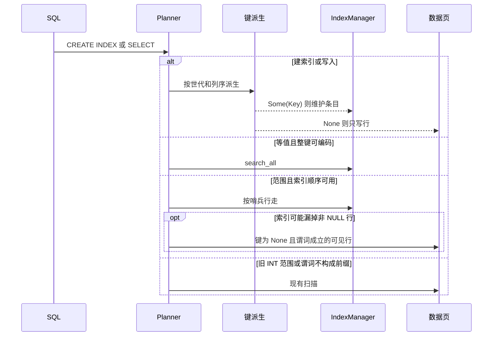

# 组合索引与范围访问设计

## Context

见 `proposal.md` 的动机。当前代码里的限制：

- `Key` 是 `[u8; 32]`，比较和相等都看填零后的 32 字节。叶条目 38 字节，内部分隔 36 字节。`FORMAT_VERSION` 不改。
- `Value::to_key` 只接受 INT，字节是 `i64::to_be_bytes()`。主键和唯一索引走这条路径。`Value::secondary_index_key` 对 INT 调用 `to_key`，对字符串做零转义加 `00 00` 终止符。2026-10-27 运行 `cargo test --offline --lib executor::value::tests::secondary_index_key_preserves_int_bytes -- --test-threads=1`，1 passed，0 failed。
- 大端有符号整数的字节序不是数值序：0 最小，正数居中，负数因为符号位而排在最后。`i64::MIN` 的大端首字节是 `0x80`，`-1` 是 `0xFF`。
- `build_create_index` 在修饰检查之后用 `columns.len() != 1` 拒绝，错误文本含 `MULTI-COLUMN INDEX`。类型门只允许 INT 和字符串。
- `CatalogSecondaryIndex` 只有名称、一个 `column_index` 和根页。`__tables` 行在 `explicit_primary_key` 字节结束。缺尾段时按已有规则读成空或默认值。
- `extract_secondary_index_equality` 只认单个裸列等值。范围、AND、OR、限定列和参数返回 `None`，随后走 DataScan 或 Filter。`BETWEEN` 在 `build_where` 里才拆成 `>=` 与 `<=`，路由看的是原始表达式。
- 二级索引的插入、删除、回填和 `recovery::extract_index_keys` 都按单个 `column_index` 调用 `secondary_index_key`。`delete_exact(key, row_id)` 用来区分重复键。
- `IndexManager` 有 `search_all` 和内部节点感知的 `scan_all`，没有按端点行走的范围接口。叶子链指针不能单独作为范围行走的依据，历史实现曾把该指针清零。
- `DROP COLUMN` 在 `TableManager::alter_drop_column` 里用单个 `column_index` 判断引用。

## Goals / Non-Goals

**Goals:**

- 组合索引、范围路由和唯一性边界按 `specs/sql-secondary-indexes/spec.md` 可观察。
- 旧单列 INT 索引的等值字节不变。主键和唯一索引的 `to_key` 不变。
- 超长值不截断。范围结果与全表扫描的多重集合相同。

**Non-Goals:**

- 见 proposal 的 Non-goals。不在本文件里把未发生的缺陷预写成任务。

## Decisions

### 1. 两种编码世代，页格式不变

世代 0 是今天的单列派生：`secondary_index_key`。已有 INT 索引和全部单列字符串索引使用它。字符串字节已经按 Rust 字符串序排列，所以字符串范围可以沿用这些字节。

世代 1 用于本变更之后新建的单列 INT 索引和全部组合索引。分量规则：

- INT：`to_be_bytes()` 后把首字节与 `0x80` 异或。`i64::MIN` 变成 8 个 0，`i64::MAX` 变成 8 个 `0xFF`，`-1` 排在 0 之前。
- 字符串：与世代 0 相同的转义，但不先填成 32 字节。
- 按列序拼接。总长超过 32 字节则整键为 `None`。任一 NULL 也是 `None`。

不采用 MS38 已否决的变长整数编码。不翻转主键和唯一索引的字节，否则旧库的点查会失败。

打开数据库时不重建旧树。只读打开不能写页。世代写在目录尾段里，查找、回填、DML 和恢复都读这个世代，禁止各调用点自己选择编码。

### 2. 目录尾段

`column_index` 继续表示第一列，这样世代 0 的单列记录与现在的字节相同：名称、`u32` 列号、`u32` 根页，行在 `explicit_primary_key` 结束。

只有存在世代非 0 或多于一列的索引时，才在该字节之后追加：

```text
u32 count
重复 count 次：u8 generation | u16 extra_count | extra_count 个 u32 列号
```

`count` 必须等于二级索引个数。尾段缺失或不完整时，每个索引按世代 0、仅第一列解释，并且不因此拒绝打开整行。第一列仍放在原 `column_index`。额外列号是第 2 列及以后。

降级到不认识尾段的旧程序后，新索引只会被看成第一列。这不作为支持目标。升级说明写明不要用旧程序维护这些树。

### 3. 范围端点用哨兵，不用解码后的行值

约束前缀编码为 P，长度为 n。包含的下界是 P 补零。不包含的下界在 n < 32 时是 P 补 `FF`，n = 32 时就是这 32 字节，比较为大于。包含的上界对称地使用补 `FF` 或这 32 字节本身。不包含的上界是 P 补零，比较为小于。

四列 INT 的整键正好 32 字节，没有空间再补 `FF`，所以上下界退回这 32 字节本身。

全键等值继续走现有 `search_all`，以保留多层树的等值下降。范围行走从内部节点下降到起始叶子，再按键序取后续条目，不单独依赖 `next_leaf_page_id`。

可能漏掉非 NULL 行的索引（含字符串，或拼接可能超过 32 字节）在范围结果里加上补扫：可见行的键派生为 `None`，且原谓词成立。NULL 的派生也是 `None`，但范围谓词对 NULL 不成立，所以不会被补扫返回。全 INT 且列数不超过 4 的世代 1 索引不补扫。

EXPLAIN 文本：

- 等值：保持 `IndexScanAll <table> (key=..., index=<name>, columns=...)`。
- 范围：`IndexRangeScan <table> (index=<name>, columns=...)`。需要补扫时追加 `omitted=scan`。

`columns` 的渲染沿用 `IndexScanAll`：基表全列经投影裁剪后的输出形状。EXPLAIN 不执行内层查询。

索引选择：更长的被约束前缀优先；同样长度时，不需要补扫的优先；仍相同则取创建顺序更早的。谓词必须被一个索引的前缀完全解释。不能解释的额外谓词、OR、参数、限定列和 `NOT BETWEEN` 不路由。

同一列上的两个下界取更严的一个，两个上界同样取更严的一个。收紧后区间为空时，路由到一个空的范围结果，它与扫描同样为空。

### 4. 调用顺序



建索引的拒绝顺序保持为：既有修饰、名字、表、列是否存在、类型、重复列、全 INT 超过 4 列，最后才是重名。这样类型错误不会被容量或重名盖住。

`ALTER TABLE DROP COLUMN` 在任一列号等于被删列时拒绝，文本保持现有的「referenced by a secondary index」。其他索引的每个列号在大于被删位置时减一。

恢复重建和事务回滚通过同一个派生函数取二级键。`extract_index_keys` 的主键和唯一分支继续用 `to_key`。

## Risks / Trade-offs

- [字符串范围要读树再补扫数据页] → 结果与扫描相等是验收条件。全 INT 范围不补扫，避免无谓的全表读。
- [旧 INT 索引没有范围计划] → 删除后重建才会使用世代 1。打开时不迁移，避免只读库写页。
- [哨兵在 32 字节边界上容易差一字节] → 首轮用纯函数测试四列 INT、`(1, MAX)` 与 `(2, MIN)`、字符串内部零字节。范围执行器只消费这个函数的结果。
- [目录尾段写错会把旧行读成新世代] → 世代 0 的单列记录不写尾段，并用字节长度锁住。不完整尾段回退为世代 0。
- [ISS36 使全局 fmt/clippy 在未改文件上失败] → 本变更只保证自己编辑的文件。全局命令的失败按 ISS36 记录，不扩大成格式整理。
- [实施中发现的实质缺陷] → 不在当前任务里顺手改。登记后由后续计划在本变更增加一轮。初始任务不含这类轮次。

## Migration Plan

没有全库重写。新代码按尾段识别世代。回退代码后，世代 1 的树不再被维护；页类型没有变，但键的含义已经不同。发布说明需要这句话。回退不删除用户已经创建的索引页。

## Open Questions

无。会改变查询结果或计划的选择已在 proposal「已关闭的行为选择」中闭合。局部函数拆分和与哨兵规则等价的控制流留给实施。
