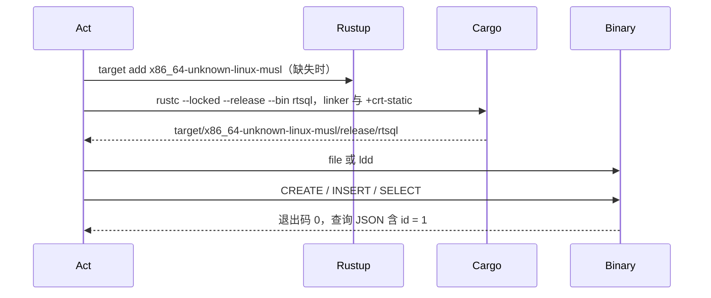

## Context

见 proposal.md 的 Why 与需求。这里只记录实现选择所依赖的当前事实。测量日为 2026-10-28，产品代码基点为 `a69fe86bbf08a04b0d0cc62d9183da4ae8a5008b`，工具链为 rustc 1.99.1、rustfmt 1.10.0-stable、clippy 0.1.99。仓库没有 `rust-toolchain.toml`。

`cargo fmt --check` 退出码 1。6 处差异位于 `tests/hash_join_build_side_test.rs`（1 处）和 `tests/sort_merge_join_test.rs`（5 处），都是空白与换行。ISS36 在 2026-10-25 记录的 9 个文件、50 处差异已经对不上当前树。

`cargo clippy --offline --lib -- -D warnings` 退出码 101，lib 共 15 条：

| lint | 位置 | 条数 |
|---|---|---|
| `clippy::single_match` | `src/cli/lifecycle.rs:637` | 1 |
| `clippy::let_underscore_future` | `src/executor/alter_table.rs:77` | 1 |
| `clippy::double_must_use` | `src/executor/executor_trait.rs`、`src/network/protocol.rs`、`src/storage/async_storage.rs` 的 `#[async_trait]` | 9 |
| `clippy::needless_range_loop` | `src/executor/sort_merge_join.rs:204`、`:205` | 2 |
| `clippy::explicit_counter_loop` | `src/storage/buffer_pool.rs:278`、`:362` | 2 |

接着用命令行允许上述 5 个 lint，运行 `cargo clippy --offline --all-targets`。退出码 0。其余警告只有 6 条：`tests/dml_tombstone_abandon_window_test.rs` 2 条 `unnecessary_cast`，`tests/ddl_rewrite_consistency_test.rs` 3 条 `unnecessary_cast`，`tests/sql_differential_test.rs:244` 1 条 `vec_init_then_push`。bench 没有警告。`~/.cargo/config` 的弃用提示出现在输出里，但该次命令仍退出码 0，它不是 rustc lint。

`x86_64-unknown-linux-musl` 未安装。链接器存在：`/opt/musl/x86_64-linux-musl-cross/bin/x86_64-linux-musl-gcc`。已安装 target 里没有 Apple 目标，PATH 中没有 Darwin 链接器。本机是 Linux x86_64。产品依赖不包含 C 库；`rusqlite` 0.31 / `libsqlite3-sys` 0.28 是 dev-dependency，链接系统 sqlite，没有 `bundled`。

`tests/*.rs` 当前 157 个。这只是测量时的数量。全量批次以执行当时的文件清单重算。

## Goals / Non-Goals

**Goals:**

- 两条项目门在当前 stable 上退出码为 0。
- Linux gnu 与 musl 静态二进制各自完成一次可观察的 CLI 运行。
- 代码改动结束后，按 M19 做一次分批全量。
- README 只记录已经发生的结果。

**Non-Goals:**

- 见 proposal 的「不做」。设计不再把那些项收成可选实现。

## Decisions

### 1. 用当前 rustfmt 写回差异，不新增工具链文件

当前门禁失败是因为这两个测试文件还没按 rustfmt 排版。ISS36 已经对过 stable 与 `nightly-2026-02-25`，两份 diff 逐字节相同，所以固定到另一个已安装 rustfmt 不能让现有排版通过。项目上下文使用 latest stable。新增 `rust-toolchain.toml` 不使这次门禁变得可满足，反而把工具链版本写成新的开发约束。

备选：维持文档声明门禁不可满足。MS41 的结果是质量检查可通过，因此不选。备选：全仓再跑一次无差异的 `cargo fmt`。只写回检查命令报告的差异。

### 2. lint 逐条保持现有行为，不升级依赖

`double_must_use` 指向 `#[async_trait]` 展开出的无说明 `must_use`，而 async fn 的 future 本身已经是 `must_use`。在三个 trait 的 `#[async_trait]` 上方加 `#[allow(clippy::double_must_use)]`。不删除宏，不升级 `async-trait` 0.1.89，也不改成原生 async trait。调用方仍然必须使用返回的 future。

备选：升级 `async-trait`。当前没有该 crate 阻碍构建或运行的证据，属于无理由升级。备选：去掉 `async-trait`。这会碰到 `dyn` 对象兼容，属于后续模块边界，不是这次门禁的必要步骤。

`let_underscore_future` 的对象是 `tokio::spawn` 返回的 `JoinHandle`。现有注释要求丢弃句柄以脱离任务，语句结果由 oneshot 的 `rx.await` 决定。改成 `std::mem::drop(tokio::spawn(...))`，与 clippy 给出的显式 drop 一致。不 await 这个 `JoinHandle`。

`needless_range_loop` 改为遍历切片 `&left_rows[left_index..left_end]` 与 `&right_rows[right_index..right_end]`，用行引用取 `.1`。不用从 0 开始的 `enumerate` 去索引完整向量。

`explicit_counter_loop` 改为 `to_write.iter().enumerate()`。传给 `restore_dirty_from` 的下标仍是写入失败的那一页，等于它前面已经写成功的页数。去掉手写的 `written += 1`。不把下标改成 `index + 1`，不修改 `restore_dirty_from`。

测试里的 `as i64` / `as u32` 在 lint 指出的位置两端类型相同，删除转型。`page_id as u64` 这种放宽转型不在警告里，保留。`seed_statements` 开头四条 `CREATE TABLE` 放进 `vec![]`，其后的循环 `push` 保持原文和顺序。随机数从循环才开始消耗，种子序列不变。

不运行 `cargo clippy --fix`。

### 3. musl 用已有链接器做静态产品二进制，并在本机执行

安装缺失的 `x86_64-unknown-linux-musl` target。构建只对这一次命令设置链接器，不写 `.cargo/config`，不新增打包脚本，不生成 `dist/` 归档：

```bash
CARGO_TARGET_X86_64_UNKNOWN_LINUX_MUSL_LINKER=/opt/musl/x86_64-linux-musl-cross/bin/x86_64-linux-musl-gcc \
cargo rustc --locked --offline --release --bin rtsql --target x86_64-unknown-linux-musl -- -C target-feature=+crt-static
```

同架构静态二进制可以在这台 Linux 上执行。执行结果才算该分支完成。`file` 含 `statically linked`，或 `ldd` 报告不是动态可执行文件，二者之一即可。

不为 musl 编译测试二进制，也不把 `rusqlite` 改成 `bundled`。系统 sqlite 只被差分测试和 sqlite bench 使用。全量行为回归在 gnu 宿主上按 M19 执行一次。

备选：复制 `build-riscv64-musl.sh` 做成发布归档。那是预编译产物，不在本里程碑内。备选：`cargo test --target x86_64-unknown-linux-musl`。它会把 dev-dependency 的系统 sqlite 带进 musl 链接，不能靠现有产品依赖解决。

链接或 target 安装失败时不改 `Cargo.toml`。环境缺失则该分支记未完成。若失败来自项目代码或依赖不兼容，停止并回到计划，由后续 Iteration 决定最小修改。

### 4. macOS 只做环境复查

实施时重复 `uname`、已安装 target 和 Darwin 链接器检查。仍然没有可执行环境就把该分支记为未完成。不安装 osxcross，不把交叉编译当成运行。

### 5. CLI 冒烟走真实二进制和临时路径

release 二进制对含 `/` 的临时库路径执行三条命令，显式 `--format json`，避免 TTY 与非 TTY 的默认格式差异。查询成功时 stdout 含 `{"columns":["id"],"rows":[[1]]}`。这个字符串来自 `src/cli/render.rs` 的 JSON 行集形状。不调用 `install.sh`，不写用户的 `~/.rtsql`。

### 6. 全量只在最后一轮做一次

M19 禁止一次无过滤全量，也禁止用默认并行度跑全量批次。定向测试可以用默认并行度。全量预算按公共规则整个 change 一次，放在最后一个 Iteration。通过条件是每一批退出码 0，且该批每一行 `test result:` 的 failed 为 0。缺一批不算通过。不把历史 passed 总数当作门槛。



## Risks / Trade-offs

- [枚举下标写错一位，失败页之后的脏位不再恢复] → 任务规定失败页下标等于此前成功页数，并在改写前后运行已有的 `write_page` 失败测试。
- [`#[allow]` 压不住宏展开的 `double_must_use`] → 停止，不升级 crate，也不改 trait 形态。
- [musl target 需要网络，安装失败] → 该分支记未完成，gnu 门禁和全量仍可完成。
- [全量中途失败] → 只复核失败的那一批一次。不重跑已经通过的批次，也不为此升级依赖。
- [`~/.cargo/config` 弃用提示继续出现] → 不修改用户主目录。它在警告模式的全目标 clippy 里没有把退出码变成非 0。

## Migration Plan

没有数据迁移，也没有安装前缀变更。回滚是撤销本分支的源码与文档改动，回到 `a69fe86`。若实施已经 `rustup target add`，该 target 留在本机工具链里，不随源码回滚卸载。

## Open Questions

无。平台环境缺失时的未完成记录、以及依赖不兼容时回到计划，都已经写进任务的停止条件。
