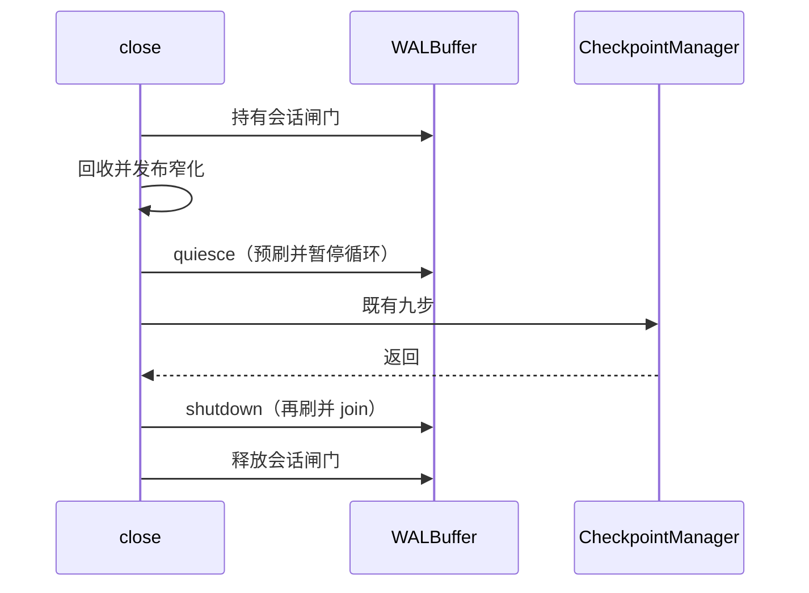

# 会话级后台服务的责任划分

## Context

读写打开时，`Database::open_internal` 创建 `WALBuffer::new(wal_writer, 100, 100)` 并 `start_flush_loop`（`src/database.rs`）。`WALBuffer` 的字段（`src/wal/buffer.rs`）包括：`buffer: Mutex<Vec<(u64, WalRecord)>>`、`flush_notify: Notify`、`pending_commits`、`commit_waiters: Mutex<HashMap<u64, Arc<Notify>>>`、`shutdown: AtomicBool`、`flush_handle: std::sync::Mutex<Option<JoinHandle<()>>>`。后台任务持有一份 `Arc<WALBuffer>`，只有 `shutdown` 把标志设为真才会退出循环。

`append` 在缓冲达到 `capacity` 时在调用方上直接 `do_flush`。`flush_loop` 在 `flush_notify` 或 `flush_interval_ms` 到期时 `do_flush`。`shutdown` 也直接 `do_flush`。三次进入在取走 `buffer` / `pending_commits` 之后才调用 `WalWriter::write_batch`，取走和写盘之间没有共同的执行者闸门。`do_flush` 用 `get_current_lsn()` 作批次起点。

`TransactionManager::commit`（`src/transaction/manager.rs`）在 WAL 存在时先 `append(CommitTxn)`，再 `append_commit_and_wait`。等待返回后才 `commit_mark_versions`。`append_commit_and_wait` 登记 `Notify`、把 `tx_id` 放入 `pending_commits`、`notify_one`，然后 `notified().await`，最后无条件 `Ok(())`。`do_flush` 在 `write_batch` 返回 `Err` 时仍唤醒已经取走的等待者。缓冲为空时只要取走了 `pending_commits`，也会唤醒。`begin` / `abort` 只 `append`，不等待。

执行器 `insert` / `update` / `delete` / `upsert`、`table_manager` 的删行、插入和列收窄，都只 `append`。`Database::checkpoint` 先回收被放弃的隐式事务、发布已提交的窄化，再调用 `CheckpointManager::checkpoint`。`close` 只调用 `checkpoint`。`CheckpointManager` 没有 `spawn`，也没有 `Notify`。`BufferPool` 的生产路径没有后台任务；`flush_all` 由调用方等待，写失败时把脏位交还。

`IoFailPoint::WalFsync` 只在 `WalWriter::fsync` 里消费。组提交走 `write_batch` 内部的 `sync_all`，不经过 `fsync`。

M21：`wal_buffer` 归 `Database`，会话级后台对象的生命周期随 `Database`。M22：诊断门面尚未存在；错误仍走 `Result`；本变更不增加用户可见输出。

## Goals / Non-Goals

**Goals:**

- 一次 `do_flush` 独占写盘，并完成它取走的那批提交等待。
- `shutdown` 仍刷盘并 join。循环退出后的 `append_commit_and_wait` 由调用方同步刷盘并返回 `Ok(())`。
- `checkpoint` 在九步期间暂停循环，九步前先刷出当时缓冲，九步后恢复循环。
- `close` 走同一段暂停和九步，然后 `shutdown`，不再恢复循环。
- 提交在 `CommitTxn` 与等待返回之间，和 `checkpoint` / `close` 的这段序列互斥。
- 取消、缓冲池、只读、内存、写盘失败时的 `Ok(())` 保持现状。

**Non-Goals:**

- 见 proposal「不做」。不改九步、不改 `WalWriter`、不改缓冲池结构、不把写盘失败改成 `Err`、不新增诊断模块。

## Decisions

### 1. 刷盘闸门，而不是 mpsc

`do_flush` 的取走和 `write_batch` 放在同一把 `tokio::sync::Mutex`（刷盘闸门）里。`append` 的容量刷盘、循环、`shutdown` 和停止后的 `append_commit_and_wait` 都走这把闸门。闸门在 `notified().await` 之前释放。

备选：按 I012 把缓冲改成 `mpsc`。现有结构已经是队列加 `Notify`，换通道不改变所有者，还要改全部 `append` 调用点。不采用。

### 2. 停止后的等待由调用方刷盘

`shutdown` 在持有刷盘闸门时把停止标志设为真，再 `do_flush`，释放闸门，唤醒循环，然后 join。`append_commit_and_wait` 在刷盘闸门内登记等待者并放入 `pending_commits`。标志已为真时，同一次持锁调用 `do_flush` 再释放，然后 `notified().await`（许可已记下，调用返回）。标志未真时释放闸门、`notify` 循环、再等待。

这样不会出现「最终一次 `do_flush` 已经取走 pending，循环又因停止标志直接退出，新等待者无人唤醒」。

`write_batch` 失败、缓冲为空但 pending 非空，这两种现有完成方式保持：已取走的等待者仍被 `notify_one`，函数仍返回 `Ok(())`。

备选：停止后的等待返回 `Err`。这会让 `commit` 的 `?` 失败并且不标记版本，属于新的事务错误合同。不采用。

### 3. 暂停只挡住后台循环和容量刷盘，不丢掉记录

`quiesce_for_checkpoint`（`pub(crate)`）：把状态设为暂停，唤醒循环，获取刷盘闸门（从而等到进行中的 `do_flush` 离开），再 `do_flush` 一次，释放闸门。循环在暂停期间不调用 `do_flush`，停在可被恢复或停止唤醒的等待上。`append` 因容量要刷盘时，若处于暂停且尚未停止，释放刷盘闸门并等待恢复或停止，然后重新取闸门再刷。不得在暂停等待期间占着刷盘闸门，否则 `shutdown` 无法刷盘。

`resume_after_checkpoint`：清除暂停并唤醒。已经 `shutdown` 之后调用它不得再 `spawn` 循环。

`close` 在九步之后调用现有 `shutdown`，不调用 `resume_after_checkpoint`。九步期间新 `append` 的记录留在缓冲里，由这次 `shutdown` 写入截断后的 WAL。安静路径上这次刷盘为空，最终文件仍是 checkpoint 后缀。

备选：九步之后丢掉剩余缓冲。同一句柄上随后成功的提交会失去九步期间的 `append`。不采用。

备选：九步之前不预刷，只暂停。未提交的 `AbortTxn`（回收路径刚 `append` 的）会留到 `shutdown`，写到截断之后，最终 WAL 比「定时器在捕获 LSN 之前触发」多出记录。预刷把这条顺序收成截断前缀。不采用「只暂停」。

### 4. 会话闸门与刷盘闸门分开

`WALBuffer` 提供 `pub(crate)` 的会话闸门，类型是 `tokio::sync::Mutex<()>`。

- `TransactionManager::commit` 只在 WAL 为 `Some` 时持有它，范围是 `append(CommitTxn)` 到 `append_commit_and_wait` 返回。`begin`、`abort` 和其他 `append` 不持有。
- `Database::checkpoint` 持有它，范围是：回收、发布窄化、`quiesce_for_checkpoint`、`CheckpointManager::checkpoint`、`resume_after_checkpoint`。
- `Database::close` 持有它，范围是：回收、发布窄化、`quiesce_for_checkpoint`、`CheckpointManager::checkpoint`、`shutdown`。不恢复循环。
- `quiesce_for_checkpoint`、`resume_after_checkpoint`、`shutdown`、`do_flush`、`append`、`append_commit_and_wait` 不得再获取会话闸门。

`close` 不得调用会恢复循环的公开 `checkpoint()`。公开 `checkpoint()` 与 `close()` 的签名不变。回收和发布窄化仍在预刷之前，这样刚追加的 `AbortTxn` 进入预刷。

只读和内存会话的 `wal_buffer` 为 `None`，两条路径都不取闸门，直接保持现在的早退。

备选：用 `oneshot` 做提交完成。现有 `Notify` 已经按 `tx_id` 唤醒，换成 `oneshot` 不改变所有者。不采用。

### 5. 缓冲池与诊断不动

缓冲池的请求完成者就是 `flush_all` / `flush_pages` / 驱逐的调用方。checkpoint 已经等待 `flush_all`。不为它加后台任务或 `watch`。

不新增 `rtsql::diagnostics`，不新增 `eprintln!`。写盘失败继续只走现有的「唤醒并返回 `Ok(())`」，没有新的用户可见文案。

### 6. 锁顺序

会话闸门不嵌套。刷盘闸门不在 `notified().await` 或暂停等待期间持有。`commit` 持有会话闸门并等待循环时，循环只需要刷盘闸门。`close` 先拿会话闸门，再在 `quiesce` / `shutdown` 里短暂拿刷盘闸门。

```mermaid
sequenceDiagram
    participant Commit as commit
    participant Buffer as WALBuffer
    participant Loop as flush_loop
    participant Writer as WalWriter

    Commit->>Buffer: 持有会话闸门
    Commit->>Buffer: append CommitTxn
    Commit->>Buffer: append_commit_and_wait 登记后释放刷盘闸门
    Buffer->>Loop: flush_notify
    Loop->>Buffer: 刷盘闸门内 do_flush
    Buffer->>Writer: write_batch
    Writer-->>Buffer: 返回
    Buffer-->>Commit: Notify
    Commit->>Commit: 释放会话闸门后标记版本
```



公开 `checkpoint` 的图与 `close` 相同，直到九步返回；之后是 `resume_after_checkpoint`，不 `shutdown`。

### 7. 关闭后未提交插入的可见性保持现行结果

父 Cycle 曾把「显式事务 `begin` 后插入、不 `commit` 就 `close`，默认打开后该行不可见」写成验收。接线之后该行仍被查到，与改前 `close` 只调用公开 `checkpoint()` 相同。要让该行不可见，得在 `close` 里回滚调用方仍持有的显式事务，或改 checkpoint 九步、恢复规则、无快照点查。前一条会让尚未写 `CommitTxn` 的并发 `commit` 返回错误。这些都不在本变更里做。

用户已批准把这条验收拿掉。规格只记录现行结果：这样 `close` 再打开，该行仍然可见。该句子属于已有合同，不新增持久化承诺，也不覆盖 `flushed_uncommitted_insert_does_not_resurrect`。不把这条可见性登记成要在本变更里修的缺陷。

父 Cycle 已经落地、且不改变事务结果的接线保留。

## 实现顺序

1. Iteration 000 只改 `WALBuffer` 和它的测试。先有失败测试，再加刷盘闸门、暂停/恢复、停止后的同步完成。
2. Iteration 001 把 `commit`、`checkpoint`、`close` 接到这些方法上，并补取消与既有关闭测试。原「关闭后未提交行不可见」的验收已撤回。剩余工作只把 `uncommitted_row_absent_after_reopen` 改成断言重开后仍查到该行，不改产品代码来藏行。
3. Iteration 002 按 M19 把全量分批跑一次。

顺序的原因：001 的暂停和停止依赖 000 的方法。全量放在行为稳定之后，整个 change 只跑一次。

## Risks / Trade-offs

- 写盘失败仍返回成功。这是现有 `do_flush` 的行为，本变更用约束保住它，不用新的失败注入去驱动。把 `WalFsync` 接进 `write_batch` 会改变 `tests/drop_persistence_test.rs` 里下一次失败落在哪一次 `sync_all`。
- 重叠 `do_flush` 的损坏窗口不一定能用一次并发调用稳定复现。单飞靠刷盘闸门，不靠一次碰巧失败的测试。
- 九步期间的 `append` 会在 `shutdown` 时写到截断后的 WAL。这和「定时器在截断之后触发」是同一种最终文件。安静的 `close`（CLI 单线程）不会产生这种追加。
- `get_current_lsn()` 失败时现有代码用 `unwrap_or(0)`。本变更不改这个回退。
