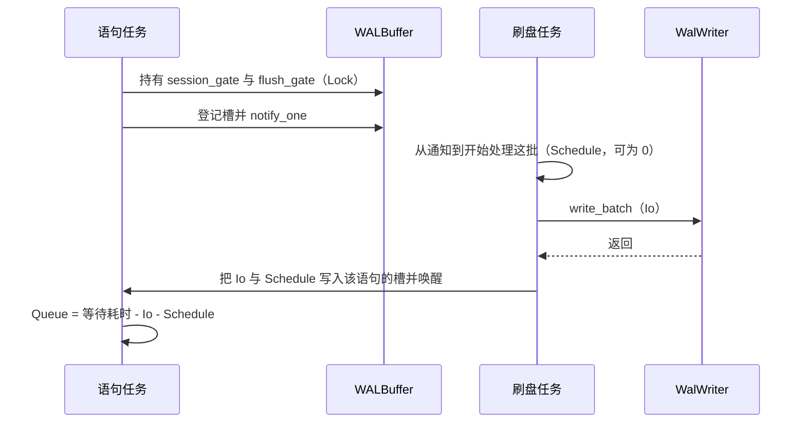

## Context

见 `proposal.md` 的 Why。这里只记实现所依赖的当前代码。

规划时读到的现状：

- `src/profiling.rs` 用 `task_local` 保存 `HashMap<&'static str, Duration>`。`is_profiling_enabled` 只判断 `RTSQL_PROFILING` 是否存在。`record_time` 在 scope 未设置时会 panic。`print_timings` 向 stderr 打表，总耗时是调用方传入的外层耗时，各行是同名覆盖后的阶段耗时，行与行可以重叠。
- `pipeline::execute_with_params` 在该开关为真时用 `with_profiling_scope` 包住 `execute_inner`。`execute_inner` 记录 `cache_hit_check`、`parse`、`plan`、`execute`，并在结束时 `print_timings`。缓存命中不记录 parse/plan。`plan_stage` / `execute_stage` 的 `profiling: bool` 为真时才记录 `table_metadata_lookup`、`executor_creation`、`executor_execution`。
- 另外两处产品接线：`src/executor/index_scan.rs` 的 `index_manager_search`，`src/executor/index_scan_all.rs` 的 `index_manager_search_all`。它们只在 `is_profiling_enabled()` 为真时 `record_time`。
- `Database` 派生 `Clone`，克隆共享会话状态。公开字段仍是现有那些；`mode`、`query_memory_limit`、`io_failpoint`、`implicit_transactions` 已是私有字段。
- `Database::commit` 调用 `TransactionManager::commit`，然后 `maybe_auto_checkpoint`。`TransactionManager::commit` 在 `CommitTxn` 与 `append_commit_and_wait` 之间持有 `session_gate`。`append_commit_and_wait` 在 `flush_gate` 下登记 `Notify`，再 `notified().await`。`flush_locked` 取走缓冲后调用 `WalWriter::write_batch`，失败也唤醒等待者。`FileStorage::read_page` 经 `spawn_blocking` 读页，函数体内有 `crypto` 条件编译。`MemoryStorage::read_page` 不读文件。
- 直接写 stderr 的产品调用点仍是 34 个（不含 `cfg(test)`，不计 `src/wal/recovery.rs` 注释里的那次形态引用）：table_manager 12、wal/recovery 6、profiling 5、btree/index_manager 4、network/server 3、executor/drop_index 2、data_page 1、database 1。
- 语句取消没有新的公共 API。放弃 future 由既有隐式事务守卫处理。`tests/recovery_bounded_read_test.rs` 断言 stderr 含 `[recovery]`。
- `openspec/specs/pipeline-stage-decomposition/spec.md` 要求 `RTSQL_PROFILING` 打开时 stderr 含 parse/plan/execute，关闭时不走计时路径。本设计不改该规格。
- 依赖里没有 `log` 或 `tracing`。`benches/pipeline_stages_bench.rs` 用 `SELECT * FROM bench WHERE id = 42` 测量三个阶段，调用时 `profiling` 参数为 `false`。

M21：诊断模块不得依赖 `database`、`pipeline`、`wal` 或 `storage`，以免新的跨层环。会话配置归 `Database`。M22：门面决定丢弃、缓冲和输出；模块不自持输出。错误仍走 `Result`。

## Goals / Non-Goals

**Goals:**

- 落地 `rtsql::diagnostics`，让语句阶段、提交等待和文件页读取按同一套摘要被读回。
- 三项配置、等待类别、上限、父子耗时和并发归属都有可观察结果。
- 默认配置和 `RTSQL_PROFILING` 的旧表与当前行为一致。

**Non-Goals:**

- 见 `proposal.md` 的「不做」。这里不重复迁出那 34 个告警，也不给未列出的锁加计时。

## Decisions

### 1. 门面自持记录，模块只提交样本

新建 `src/diagnostics.rs`，由 `src/lib.rs` 以 `pub mod diagnostics` 导出。模块内不引用数据库各层。

配置：

- `Detail`：`Off`、`Summary`、`Full`。
- `Collect`：`events`、`stats`、`trace` 三个布尔值。
- `ModuleSet`：`All`，或 `Only` 下列类别名：`pipeline`、`wal`、`storage`、`index`。
- `event_limit` 默认 64，`summary_limit` 默认 32，SQL 文本保留 80 个字符，超出截断。

`Severity` 为 `Error`、`Warn`、`Info`、`Debug`、`Trace`。`WaitClass` 为 `Compute`、`Lock`、`Io`、`Queue`、`Schedule`。

公开记录只有严重级别、类别、消息和 `(&'static str, u64)` 数据。摘要有截断后的 SQL、结束状态（成功、失败、取消）、`total_us`、`dropped` 和记录列表。没有操作标识、运行标识或内容哈希字段。

数值键固定为：`inclusive_us`、`exclusive_us`、`compute_us`、`lock_us`、`io_us`、`queue_us`、`schedule_us`、`pages`、`dropped`。`total_us` 在摘要上，不重复进某一条子记录。

`exclusive_us = inclusive_us - 直接子阶段 inclusive_us 之和`。`total_us` 等于名为 `statement` 的根阶段包含耗时。它不是各行相加。

备选：引入 `tracing`。不采用。I096 不预定依赖，现有树也没有这只 crate。备选：继续只扩 `profiling.rs` 的 HashMap。不采用。那张表没有类别、上限和跨任务归属，M22 要求的是门面而不是再增加 stderr 调用。

### 2. 会话持有配置，任务内持有当前语句

`Database` 增加私有字段，类型为 `Clone + Arc` 的会话槽，克隆后共享。`set_diagnostics` 替换配置。`diagnostic_summaries` 返回当前保留的已结束摘要。默认配置三项采集都关闭、`Detail::Off`。本 change 不改 `project-model.md`；私有字段不进入 M21 的公开字段清单，收尾时由维护者决定是否补记。

`diagnostics::bind` 把配置和会话槽装进当前任务。`scope(name)` 在已有语句上嵌套；没有语句且采集打开时创建根。采集全关时 `scope`、`report`、`wait` 不记录、不分配摘要。`report` 不写 stderr。

根 scope 在 `end(Success | Failure)` 或未 `end` 就被 Drop 时把摘要推进会话槽。Drop 且未 `end` 的状态是取消。已 `end` 的 Drop 不第二次推进。会话槽超过 `summary_limit` 时丢弃最旧摘要。单条语句的事件和追踪样本超过 `event_limit` 后不再追加，`dropped` 加一，已经计入的阶段汇总数继续更新。

渲染：`Detail::Off` 得到空字符串。`Summary` 只含阶段和等待汇总数。`Full` 在此之上追加事件行，行数受 `event_limit` 约束。新渲染文本以 `diagnostics ` 开头。管道只在 SQL 的 `Result` 已经确定之后，且渲染字符串非空时，把它 `eprintln`。不另建写出任务。

备选：进程全局 `configure`。不采用。集成测试默认可以并行，全局可变配置会串测试。备选：把摘要只放在任务局部变量里。不采用。future 被放弃后任务局部变量已经销毁，会话上读不到取消摘要。

### 3. 旧计时表保持原路径

`is_profiling_enabled`、`with_profiling_scope`、`record_time`、`print_timings` 仍留在 `profiling.rs`。`is_profiling_enabled` 仍只读环境变量。环境变量未设置时，管道不调用 `record_time` / `print_timings`。

环境变量已设置时，管道仍打开原来的 task-local，并用同一次 `Instant` 测量后调用 `record_time` 和 `print_timings`。表的列和 `Total` 行算法不改。会话上的新配置不关闭这张表，也不改它的算法。

新摘要使用诊断 scope。两边都打开时，同一 `Instant` 的耗时写进两处，不各测一次。`plan_stage` / `execute_stage` 的布尔参数保持。只有旧开关或新采集需要子指标时，管道才传入 `true`。索引两个算子在旧开关为真时行为不变；新采集且类别含 `index` 时，额外把同名耗时写入当前语句。

`record_time` 在旧 scope 之外仍 panic。诊断 API 在采集关闭时是空操作，不借用这个 panic。

### 4. 阶段挂在语句根上

`execute_with_params` 在进入 `execute_inner` 之前 `bind` 当前会话配置。`execute_inner` 打开根 scope `statement`，并把本次 SQL 文本交给它。

- 缓存未命中：子 scope `parse`、`plan`、`execute`。
- 缓存命中：只有 `cache_hit_check` 和 `execute`，不为这次执行打开 `parse` / `plan`。
- `Database::commit` 在调用事务提交前打开子 scope `commit`。查询不调用它，因此没有 `commit`。自动 checkpoint 仍在 `Database::commit` 返回前发生，算在这个子阶段里，不单独立项。
- 解析或规划返回错误时，根 scope `end(Failure)`，然后返回原来的 `SqlError`。成功路径 `end(Success)`。中途 Drop 就是取消。

子指标名称保持：`cache_hit_check`、`table_metadata_lookup`、`executor_creation`、`executor_execution`、`index_manager_search`、`index_manager_search_all`。

### 5. 等待只包已有的那几个 await

采集关闭时，下面的路径不调用 `wait`，也不做计时。采集打开时：

| 位置 | 类别 | 记入 |
|---|---|---|
| `TransactionManager::commit` 等待 `session_gate` | Lock | 当前语句 |
| `append_commit_and_wait` 等待 `flush_gate` | Lock | 当前语句 |
| 该函数里 `notified().await` 的剩余部分 | Queue | 当前语句 |
| `flush_locked` 里那次 `write_batch` | Io | 被这批唤醒的每个语句 |
| `notify_one` 到刷盘循环开始处理这批的间隔 | Schedule | 同上；循环当时不在空等则为 0 |
| `FileStorage::read_page` 的整次调用 | Io，并使 `pages` 加 1 | 当前语句 |

Queue 的耗时等于 `notified().await` 的耗时减去已经记入该语句的这次 Io 和 Schedule，小于 0 时记 0。Lock 只含两次 `.lock().await`，不包含 Queue。解析阶段没有这些等待，其 `compute_us` 等于该阶段 `exclusive_us`，`io_us` 为 0。

`write_batch` 的整段耗时写入本批每一个带槽的语句。摘要之间的 Io 不相加。`write_batch` 失败时仍唤醒，Io 照记，`append_commit_and_wait` 仍返回 `Ok(())`。

刷盘任务没有语句任务的 task-local。登记等待者时，若当前语句正在采集，把该语句的槽和登记时刻一起放进等待表；否则等待表里不放槽。`flush_locked` 只对有槽的等待者写 Io 和 Schedule。`MemoryStorage::read_page` 不包。`FileStorage::read_page` 的计时包在现有 `crypto` 分支外面，不复制函数体。

文件页测试使用重新打开的文件库，使缓冲池为空，再执行查询。内存库不作为 Io 的证明。

备选：给每个 Mutex 和每个 `read_page` 调用点统一包一层。不采用。Scope 要的是这几类等待能被区分，不是全库插桩。备选：用后台任务把样本送到进程外。不采用。那是独立监控。

### 6. 开销测量不设差值门槛

三种配置各用一个新的文件库，表和数据沿 `pipeline_stages_bench`：100 行，查询 `SELECT * FROM bench WHERE id = 42`。三次分开建库，避免计划缓存使后两次变成另一种路径。三次行集相同。只开统计的那次摘要有阶段耗时；详细追踪那次还有样本；关闭那次没有新摘要。三次调用都要在 30 秒内返回。30 秒只用来判定挂起，不比较三者谁更快，也不写进通过条件的差值。

不修改 `benches/pipeline_stages_bench.rs` 的测量门槛。criterion 不作为本 change 的通过命令。

### 7. 验证预算

定向测试用 `cargo test --offline --test <文件>`。会设置 `RTSQL_PROFILING` 的文件加上 `-- --test-threads=1`，因为该变量是进程级的。其余定向测试用默认并行度。

全量只在最后一个 Iteration 跑一次，算法见 `tasks.md`。禁止一次无过滤的 `cargo test`，禁止全量批次使用默认并行度。不新增脚本、哈希、运行标识或诊断字段来判定测试是否同一轮。

## Risks / Trade-offs

- [FileStorage 每次读页多一次任务局部标志读取] → 标志为假时不记录、不分配。这不是计时路径。开销测量的「关闭」配置会跑到这条读取。不把它解释成零开销。
- [组提交把整段 Io 写入每个等待者] → 单条语句能看到自己等待的那次刷盘。跨语句相加会放大。规格已禁止把该和当作进程级 I/O。
- [自动 checkpoint 算进 commit 子阶段] → 与 `Database::commit` 的现有返回点一致。不在本 change 里把 checkpoint 拆成第四个顶层阶段。
- [`RTSQL_PROFILING` 与新渲染同时打开会有两段 stderr] → 旧表算法不变，新文本有固定前缀。测试按前缀区分，不把两段混成一张表。
- [等待表多一个可选槽] → 采集关闭时槽为空，刷盘不调用诊断。不改变单飞、唤醒和 `Ok(())`。
- [全库 clippy 曾有独立基线问题] → 本 change 的通过条件不扩大成仓库级 clippy 清零。

## Migration Plan

无磁盘迁移。默认配置下不产生新 stderr。回滚是放弃 change 分支，见 `proposal.md`。

实施顺序：先门面和会话槽，再语句阶段和旧表，再等待归属与开销，最后一次分批全量。前一轮未通过时不开始下一轮。

## Open Questions

无。类别名、上限、等待点和总耗时口径已在上面写死。若实施发现某个等待点的现有控制流无法在不改变 `Result` 的前提下包住，停止并回到计划，不另选等待点。
