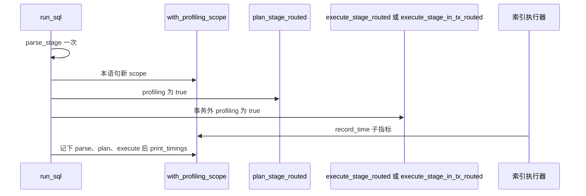

# 主命令只在开关打开时包住自己的执行分段

见 `proposal.md` 的 Why 与已批准裁定。这里只记录实现所依赖的代码事实和选择。

规划时的产品代码与 `eb84384`（旧表输出时机那次合并）相比，`src/cli/mod.rs`、`src/pipeline.rs`、`src/profiling.rs`、`src/cli/lifecycle.rs`、`src/executor/index_scan.rs`、`src/executor/index_scan_all.rs`、`src/database.rs`、`tests/diagnostics_statement_test.rs` 无差异。行号对应该合并之后的 `b1cec3c`。本计划没有重跑测试；import 旧表的通过记录留在已归档变更 `2026-10-30-diagnostics-legacy-table-error-path`。

## Context

`RTSQL_PROFILING` 是否存在由 `src/profiling.rs::is_profiling_enabled`（55–57 行）判定，空值也算已设置。`record_time`（21–25 行）直接访问 task-local；scope 未设置时，这次访问会让所在任务 panic。`print_timings`（33–52 行）把 map 里的行按耗时降序打到 stderr，表头含 `Time (µs)`，末行 `Total` 使用调用方传入的外层耗时。`with_profiling_scope`（60–65 行）用 `PROFILING_DATA.scope` 包住一个 future。

全仓库只有 `src/pipeline.rs::execute_with_params`（116–141 行）在变量已设置时调用 `with_profiling_scope`。`print_timings` 只有两处调用，都在 `execute_staged`：缓存命中后（1540 行）和未命中路径的 execute 返回后（1662 行）。执行阶段之前的返回不经过这两处。

主命令不走这条管道。`src/cli/mod.rs::run_sql`（846 行）先 `parse_stage`（854 行），再对每条语句分派：

- ATTACH 成功时渲染 `Affected(0)`，不计划、不执行。
- BEGIN / COMMIT / ROLLBACK 走 `TransactionSession`，不计划、不执行。
- 其余语句调用 `plan_stage_routed(..., false, ...)`（964–972 行）。失败则返回现有的计划错误。成功后，会话事务内调用 `execute_stage_in_tx_routed`（990 行，该函数没有 profiling 参数）；事务外调用 `execute_stage_routed(..., false, ...)`（991 行）。

`false` 使阶段函数自己不调用 `record_time`。索引执行器不看这个参数。`src/executor/index_scan.rs`（69–74 行）在变量已设置时，于 `search` 成功返回之后调用 `record_time("index_manager_search", ...)`。`src/executor/index_scan_all.rs`（86–90 行）对 `search_all` 做同样的事，名字是 `index_manager_search_all`。这两次调用发生在 `IndexScanExecutor::next` / `IndexScanAllExecutor::next` 里，和 `run_sql` 在同一个任务上。`search` 返回错误时，`record_time` 还没执行。

计划路由：整数主键的简单等值走 `PhysicalPlan::IndexScan`（`src/parser/planner/query.rs` 2266–2290 行）。非主键二级索引等值走 `IndexScanAll`（2302–2312 行）。没有 WHERE 的 `SELECT COUNT(*)` 先是 `Scan`，再包聚合，不经过这两处。

`PreparedStatement::execute`（`src/database.rs` 1074–1082 行）把 `is_profiling_enabled()` 传给 `execute_stage`，不建立 scope。`execute_in_tx`（1086–1100 行）调用没有 profiling 参数的 `execute_stage_in_tx`。CLI 主命令不使用这两个入口。

import（`src/cli/lifecycle.rs` 840、891 行）经 `Database::execute_sql` 进入 `execute_with_params`，所以已经有 scope 和旧表。统一诊断的摘要只在 `execute_inner`（1425 行起）里，在语句结果确定后按会话配置渲染；默认配置不写 stderr。主命令不进入 `execute_inner`。

解析失败在 `run_sql` 里直接返回 `Parse error:`，SQLSTATE 为 `None`（858 行）。语句管道上的解析失败才会带 `42601`。规划失败的展示是 `Plan error: Table not found: ...`，SQLSTATE `42P01`。执行期 `StorageError::DuplicateKey` 经 `execute_executor`（1827–1830 行）变成 `Execution error: Duplicate key`，`storage_error_sqlstate` 不给它 SQLSTATE。主命令再套上 `statement k of n failed`。JSON 格式下，错误对象在 `execute_command` 返回之后由 `emit_error_status` 写入 stderr；`print_timings` 若发生在 `run_sql` 内部，会先于这行错误出现。

`run_sql` 的调用点只有主命令闭包（545 行）。

## Goals / Non-Goals

**Goals**

- 变量已设置时，主命令里会进入执行阶段的语句在自己的 scope 内打出三段表，索引扫描不再因为缺 scope 而中止进程。
- 变量未设置时，不进入 scope，不打表，阶段函数仍收到 `false`。

**Non-Goals**

- 不改 `record_time`、`print_timings`、`is_profiling_enabled`。
- 不改两处索引执行器、预编译语句、`execute_stage_in_tx_routed` 的签名、import 的打印点、统一诊断渲染。
- 不把主命令改道到 `execute_with_params`。

## Decisions

### 1. scope 和打表只加在 `run_sql`

变量已设置时，对「非 ATTACH、非事务控制」的语句：进入 `with_profiling_scope`，再调用 plan 与 execute。scope 必须包住这两次 `.await`。不要 `tokio::spawn`，否则 task-local 到不了 `record_time`。

选择它的原因：中止发生在主命令这条调用链上；三段的边界也由 `run_sql` 持有。import 和预编译语句不经过这里。

| 方案 | 结果 | 不采用的原因 |
|---|---|---|
| `record_time` 在没有 scope 时直接返回 | 主命令不再中止 | 预编译语句今天会在同一调用上中止；这个改动会改变那条验收外的路径，而且仍然没有 parse / plan / execute 三行 |
| 主命令改调用 `execute_with_params` | 单条语句能复用现成的表 | 该入口拒绝多语句，不负责 `run_sql` 里的会话事务和 ATTACH，并且会走诊断摘要渲染 |
| 只在两个索引执行器里建 scope | 索引扫描不再中止 | 库路径上的预编译语句也会不再中止；主命令仍然没有三段行 |

### 2. 进入执行阶段才打表，并且一句一张

与 import 现在的规则相同：`print_timings` 发生在该语句的 execute 调用返回之后，成功和 `Err` 都打。plan 返回 `Err`、解析失败、ATTACH、BEGIN / COMMIT / ROLLBACK 不打。

一句一个 scope。下一条语句看不到上一条留下的子指标。`parse_stage` 仍对整段 SQL 只调用一次。每张表的 parse 行写入这一次解析的耗时，不按语句重解析。

`Total` 传给 `print_timings` 的值 = 这次解析的耗时 + 该语句从 `plan_stage_routed` 调用前到 execute 返回的墙钟。列、排序和百分比仍由现有的 `print_timings` 计算。测试不断言具体微秒数。

变量已设置时，`plan_stage_routed` 和事务外的 `execute_stage_routed` 收到 `true`，这样已有的 `table_metadata_lookup`、`executor_creation`、`executor_execution` 会记进这张表。事务内仍调用现在的 `execute_stage_in_tx_routed`，不增加参数；三段行由 `run_sql` 在调用外记下，索引子指标由执行器在 scope 里写下。

变量未设置时不调用 `Instant::now`，不进入 scope，两个阶段参数保持 `false`。

### 3. 用主命令子进程看 stderr

`eprintln!` 在库测试里进不了断言。新测试启动 `CARGO_BIN_EXE_rtsql`，在子进程上设置或去掉 `RTSQL_PROFILING`，并显式 `--format json`。准备步骤不设置该变量。判定用退出码、stdout 的 JSON 和 stderr 里的表头与行名，不新增判定程序。

`index_manager_search` 是 `index_manager_search_all` 的前缀。断言主键点查时，要同时确认没有更长的那个名字。

## 调用顺序

变量已设置、语句会进入执行阶段时：

plan 失败时，scope 结束，不调用 `print_timings`，错误文本仍走现有的 `sql_failure_status`。

## Risks / Trade-offs

- 索引子指标若改到另一个 task 里调用 `record_time`，`run_sql` 上的 scope 盖不住。当前代码在 `next` 里、`await` 返回之后调用。实施时若发现不是同一个 task，停止并回到计划。
- 多语句的每张表都带上同一次解析的耗时，`Total` 也含这段耗时。这和 import「每条 SQL 自己解析」的窗口不同。主命令今天就是整段解析一次，不改为每句重解析。
- `SELECT COUNT(*)` 今天不走索引点查。若它的表里出现 `index_manager_search`，「子指标不串」这个断言不再成立，停止并回到计划，不要改计划器去消掉这行。
- 测试必须在子进程上设置或移除变量。只漏设时，父进程的环境会混进来。

## Migration Plan

无数据迁移，无新的磁盘字段。回滚是放弃本分支。主分支在合并前保持现在的行为。

## 实现顺序

1. 先加 CLI 测试。新行为在改 `run_sql` 之前失败；未设置变量、解析失败、规划失败和单独的 ATTACH 在改之前就通过。
2. 再只改 `run_sql`。索引执行器已经会在变量存在时记子指标，缺的是 scope 和三段行。
3. 全量按 M19 放在后一个 Iteration，本轮不跑。
