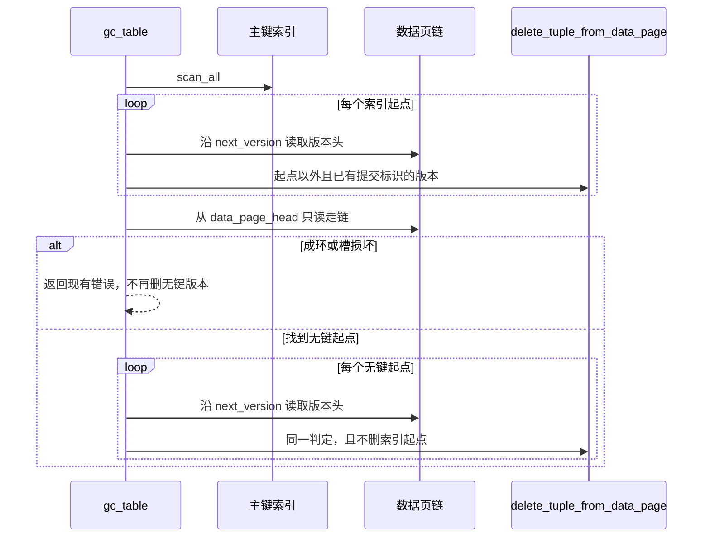

# 用数据页链补上无键行的 GC 起点

动机见 `proposal.md`。行为见 `specs/keyless-row-gc/spec.md`。实施以当前 Cycle 的 Task Definition 为准；这里只记录选择和它依赖的代码事实。

## Context

`TableMeta::gc_table`（`src/storage/data/table_manager.rs`，`gc_table`）对 `index_manager.scan_all()` 的每个条目，从该 `RowId` 沿 `VersionHeader::next_version` 向旧版本走。`commit_tx_id()` 有值且不是这条链的起点时，调用 `delete_tuple_from_data_page`。起点本身不删。`commit_tx_id()` 只把 `UNSET_TX_ID` 当成空；删除哨兵也算有值。

带键更新会把索引改到新版本，所以起点就是索引里的 `RowId`。无键插入不写主键索引。带键行 `SET` 主键为 `NULL` 时，新版本的 `next_version` 指向旧版本，主键索引条目被删掉。从此 `scan_all` 看不到这条链。

`gc_table` 没有生产调用者。测试入口是 `tests/gc_test.rs` 的三个用例，以及 `tests/overflow_page_test.rs` 的 `gc_releases_oversized_version_chain`。查询无键行走数据页链（`DataScanExecutor::build_superseded_map`，以及主键列类型不是 `Int` 时 `ScanExecutor` 的回退）。

已删除的带键行会写下墓碑并删掉索引条目。回滚把新版本标成 `create_tx_id = 0` 且带删除哨兵，索引指回仍存活的前驱。这两类槽都不在索引里，但它们不是本里程碑要回收的无键链。

## Goals / Non-Goals

**Goals:**

- 无键链头按与索引起点相同的判定回收旧版本。
- 索引那一遍的起点、判定和释放调用保持现在的写法。
- 释放仍只调用 `delete_tuple_from_data_page`。

**Non-Goals:**

- 不改查询可见性、写路径、恢复、索引格式、空闲页提升和刷盘。
- 不把 GC 接到新的调用点。
- 不追求少扫页。

## Decisions

### 1. 在 GC 时走数据页链，不建无键链登记

I038 给出两个做法：数据页链全扫，或单独登记无键链。采用数据页链全扫。

登记要在插入、更新、回滚和恢复重放里维持，重启后还得重建。已经写在盘上的无键链没有登记可查，重建仍然要扫数据页。持久化登记会变成新的磁盘结构，并带上崩溃窗口。里程碑不改索引格式、空闲页生命周期和刷盘。数据页链已经是无键行的读取来源，GC 时从 `data_page_head` 再走一遍，不增加写路径状态。

GC 变慢是接受的代价。里程碑明确不以提高速度为目的。`gc_table` 只在被调用时扫这张表自己的数据页。

| 方案 | 结果 | 不采用的原因 |
|---|---|---|
| 内存登记，GC 只走登记项 | 新写入的无键链能被看见 | 进程重启后登记丢失；旧数据仍要靠扫描补 |
| 落盘登记 | 重启后仍在 | 新的持久结构，写路径和恢复都要维护，超出「不改格式和刷盘」 |
| 把所有不在索引里的链头都当 GC 起点 | 无键链能被看见 | 已删除带键行的墓碑、回滚留下的废弃槽也不在索引里，会回收带键行今天不回收的版本 |

无键起点只取同时满足下面条件的槽：主键值 `to_key()` 为 `None`；不是墓碑；`create_tx_id != 0`；没有任何已读到版本头的槽把 `next_version` 指向它；不是本次索引 `scan_all` 返回的 `RowId`。反序列化失败的槽（墓碑的空元组）不是无键起点，也不因此让整个 GC 失败。

### 2. 索引一遍先做，判定式不拆成两套

先完成现在的索引循环，并记下这些起点 `RowId`。然后只读地走数据页链。走链失败就返回，此时还没有删除无键版本；索引一遍已经完成的删除保留，这与现在循环中途失败时前面的键已经删过的情况相同。走链成功后，对每个无键起点使用同一条判定：`commit_tx_id()` 有值，且当前 `RowId` 不是起点，才删除。另外，索引起点集合里的 `RowId` 在无键这一遍不删除。

`delete_tuple_from_data_page` 返回 `SlotNotFound` 时原样返回，不把第二次删除当成成功。

数据页链用 `data_page_head` 和页头 `next_page_id`。页已访问过则返回 `StorageError::Internal`，文案含 `data page chain cycle` 和表名，不继续转圈。页头槽数超出容量，或槽负载越界，分别使用 `corrupted_data_page_slot_count_error` 和 `corrupted_data_page_slot_error`。短于版本头的槽跳过，与 `build_superseded_map` 相同。

### 3. 溢出页释放不新增步骤

无键旧版本一旦进入 `delete_tuple_from_data_page`，槽先删，溢出链再按该函数现有的尽力释放进入待释放集合。`gc_table` 不调用 `promote_free_releases`，不改分配时清零。见证沿用 `gc_releases_oversized_version_chain` 的分配顺序：提升前分配不到这些页，提升后取回同一批页。差别只是链头不插入主键索引，并且链头元组的主键值 `to_key()` 为 `None`。

## Risks / Trade-offs

- 无键起点选宽了，会删掉回滚后仍在索引里的带键版本。收窄条件是「不是墓碑、不是 `create_tx_id == 0`、不在索引起点集合、没有被 `next_version` 指向」。S4 与 S5 在改动前后都要保持通过。
- 数据页很多时，一次 `gc_table` 会多扫整张表的数据页。这是选定扫描而不是登记的代价，不在本变更里加缓存或后台 GC。
- 本变更收尾前没有全量。合回主分支后的那一次全量若失败，排查范围同时包括 MS46 和尚未开始的 MS47。这是用户把全量留到两次里程碑都合并之后的结果。
- 损坏的数据页会让 `gc_table` 在索引一遍之后返回错误。健康表的带键回收顺序不变。

## Migration Plan

没有磁盘格式变化，没有数据迁移。回滚是放弃或还原变更分支上的 `gc_table` 与新增测试。已有库文件不需要重写。

## Open Questions

无。
