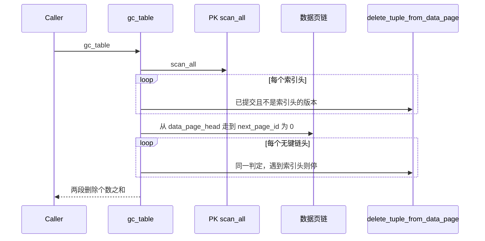

# 用数据页链补上无键链头

见 `proposal.md` 的 Why 与已批准需求。这里只记录实现所依赖的代码事实和选择。规格正文在 `specs/row-version-gc/spec.md`。

调查基点：`937463c7dfa8ab6bec400e2573b11bdd4b72103b`。`gc_table` 的现有三则测试在该基点通过，命令和结果见当前 Cycle 的 Current-State Evidence。

## Context

`TableMeta::gc_table`（`src/storage/data/table_manager.rs`，约 474–503 行）只做一件事：`index_manager.scan_all()`，对每个索引 `row_id` 沿 `VersionHeader::next_version` 向下，把 `commit_tx_id().is_some()` 且 `current_id != row_id` 的版本交给 `delete_tuple_from_data_page`。返回删除个数。没有调用 `Snapshot::is_visible`。

`commit_tx_id()` 为 `None` 只对应未写入提交号的版本（`version_chain.rs` 里 `UNSET_TX_ID`）。墓碑和已回滚版本的 `commit_tx_id()` 是 `Some(DELETED_TX_ID)`，`is_deleted()` 为真。已回滚版本另外把 `create_tx_id` 写成 0。

全仓库对 `gc_table` 的调用只有测试：`tests/gc_test.rs` 三则，以及 `tests/overflow_page_test.rs::gc_releases_oversized_version_chain`。没有 SQL 入口。

无键行的产生点：

- `InsertExecutor`（`insert.rs` 约 171–286 行）：`to_key()` 为 `None` 时写数据页，不插主键索引。
- `UpdateExecutor`（`update.rs` 约 366–369 行）：键列被赋成 `to_key()` 为 `None` 的值时删除旧主键条目。新版本的 `next_version` 指向旧 `row_id`（约 311 行）。
- 全表 `UPDATE` / `DELETE` 仍用 `scan_all` 枚举（`update.rs` 约 108 行，`delete.rs` 约 227 行删除主键条目）。已经无键的行走不到这两条路径。因此 SQL 上能形成的无键旧版本链，是「原先带键，随后已提交或未提交地把键改成 NULL」。非整数键列的插入只有一个版本。

`delete_tuple_from_data_page`（`data_page.rs` 约 351–414 行）先删槽，再对溢出 locator 调用 `free_overflow_chain`。链页进入待释放集合，不在这次调用里提升为空闲页。`gc_releases_oversized_version_chain` 的观察是：提升前 `allocate_page` 取不回这些页，`promote_free_releases` 之后可以。

数据页链的现成走法有两处，GC 不调用它们：

- `DataScanExecutor::build_superseded_map`（`data_scan.rs` 约 241–306 行）：从 `data_page_head` 沿 `next_page_id == 0` 结束；页头槽数越界返回 `corrupted_data_page_slot_count_error`；槽负载越界返回 `corrupted_data_page_slot_error`；短于版本头的槽跳过。
- `backfill_tree`（`create_index.rs` 约 119–174 行）：链尾是不被「`create_tx_id != 0` 的 `next_version`」指向的槽。已回滚版本不把前驱算作被指向。

`read_version_header` 就是 `read_tuple_from_data_page`。页头槽数越界时，带键链的第一段已经会返回 `corrupted data page ...`。损坏页测试的文件改写在 `tests/data_page_bounded_read_test.rs`：`checkpoint` 后 `close`，再改文件字节，重新 `open` 仍然成功。

## Goals / Non-Goals

**Goals**

- 无键链头的已提交旧版本进入同一次 `gc_table`，判定和删除函数与第一段相同。
- 第一段对主键索引链的判定保持现在的条件。
- 完好页上，带键最新槽、无键链头、未提交版本、带键墓碑链的去留与规格一致。

**Non-Goals**

- 不改 `delete_tuple_from_data_page`、读路径可见性、写路径索引维护、索引格式、空闲页提升和刷盘。
- 不新增 GC 的 SQL 或 CLI。
- 不让 `DELETE` 或全表 `UPDATE` 找到无键行。

## Decisions

### 1. 选用数据页链全扫

I038 的两个候选是数据页链全扫和无键链登记结构。选用全扫。

登记结构要在插入、更新、回滚和恢复时维护链头。进程重启后仍能回收，登记就必须落盘，那就是新的持久结构。只放内存的登记，在重新打开之后仍然要靠扫描才能看见旧链。`gc_table` 今天没有生产调用者，多一次数据页遍历是这次显式维护的开销，不在「提高 GC 速度」的目标里。

全扫复用已经存在的链尾定义，不改页格式。

### 2. 第一段保持索引遍历

无键链头并不是「不在索引里的所有链头」。已提交 `DELETE` 会删掉主键条目（`delete.rs` 约 227 行），墓碑槽的元组是空的（约 181–187 行），链头不在 `scan_all` 里。把所有不在索引里的链头都拿去回收，会删掉带键墓碑链的已提交前驱。规格要求这条链继续留着。

因此 `gc_table` 分成两段：

1. 现在的 `scan_all` 循环原样保留。判定仍是 `commit_tx_id().is_some() && current_id != 索引头`，删除仍是 `delete_tuple_from_data_page`。顺带记下这些索引头 `row_id`。
2. 从 `self.data_page_head` 沿 `next_page_id` 走到 0。收集被「`create_tx_id != 0` 且 `next_version` 有值」指向的 `row_id`。额外链头必须同时满足：不在该指向集合里，不在索引头集合里，`create_tx_id != 0`，`is_deleted()` 为假，`read_tuple_from_data_page` 加 `deserialize_row`（`tuple.rs` 的 `deserialize_row`，模式用 `self.columns` 与 `self.defaults`）之后 `values[self.pk_index].to_key()` 为 `None`。对每个这样的链头使用与第一段相同的判定和删除函数，链头换成这个无键槽。

第二段走到索引头 `row_id` 时不删除它，并停止这条链再往下的删除。更老的版本属于第一段已经走过的索引链。这样不会对同一槽删除两次，也不会把 `SlotNotFound` 变成成功。

页头槽数越界和槽负载越界的处理与 `build_superseded_map` 相同，使用 `table_manager.rs` 已经导入的 `corrupted_data_page_slot_count_error` 和 `corrupted_data_page_slot_error`。短于版本头或版本头解析失败的槽跳过，与该函数相同。`read_tuple_from_data_page` 或 `deserialize_row` 返回的错误原样向上返回，不把这个槽当成带键行跳过。

两段可以抽成同一个本地异步函数。第一段不得改成数据页扫描。

### 3. 删槽之后扫描仍按逻辑 id 识别版本

`delete_slot` 会把被删槽后面的目录项前移，槽里的 `logical_id` 跟着目录项走，不会改成新的下标。`DataScanExecutor::next`（`data_scan.rs` 约 418–423 行）在读槽之前用 `current_slot_index` 拼 `RowId`，再查 `build_superseded_map`。该 map 的键是 `slot.logical_id`（约 278 行）。页上还没有删过槽时，逻辑 id 与下标相同，两套身份重合。

`gc_table` 一旦删掉旧槽，幸存链头会滑到更小的下标，逻辑 id 不变。下标若碰巧等于某个已被 `next_version` 指向的旧逻辑 id，而指向者已提交，扫描会把链头当成旧版本跳过。无键行没有主键索引，`SELECT` 走这条扫描。不改这一点，规格里的 `SELECT` 会看不到仍然在页上的链头。

修正只发生在这次身份比较：读出该下标上的槽，用它的 `logical_id` 组成 `RowId` 再查 map。`build_superseded_map` 的键、`superseder_suppresses` 的提交号和墓碑规则不动。没有删过槽的页上，逻辑 id 仍等于下标，现有扫描结果不变。

这不改变可见性规则。规则仍然是「已提交的更新版本抑制它指向的旧版本」。变的是删槽之后「这个目录项是哪一个版本」。

### 4. 溢出页和损坏页不另做生命周期

无键旧版本的溢出链只通过现有的 `delete_tuple_from_data_page` 释放。测试观察复制 `gc_releases_oversized_version_chain`：GC 之后、`promote_free_releases` 之前分配不到这些页，提升后可以。不在这条测试里调用 `checkpoint`。

损坏页测试复制 `data_page_bounded_read_test.rs` 的文件改写：`checkpoint`、`close`、改字节、`open` 成功后再调用 `gc_table`。夹具使用无键行，使第一段的空索引不会先碰到损坏页。页头 `slot_count` 在页内偏移 1，文件偏移是 `HEADER_SIZE + page_id * PAGE_SIZE + 1`，写入 `700u16` 小端。槽 0 的 offset 字段在 `PAGE_SIZE - Slot::SIZE + 2`，写入 `0xFFFFu16`。错误文本来自 `StorageError::CorruptedDataPage` 的 `corrupted data page {page_id}: {detail}`。

## Risks / Trade-offs

- 每次 `gc_table` 都走完整数据页链。调用者只有测试和维护入口，接受这次遍历。
- 第一段已经删除了一些版本之后，第二段才返回错误时，已删版本不补回。这与第一段循环中途失败的现有行为相同。
- 数据页链成环时与 `build_superseded_map` 一样没有环检测。本次不加。`next_version` 成环也不另加与第一段不同的检测。
- 并发的两次 `gc_table` 仍无额外互斥。本次不加锁。

## Migration Plan

没有磁盘迁移。回滚是去掉 `gc_table` 的第二段，并把 `DataScanExecutor::next` 的查找恢复为目录下标。已回收的槽不会因为回滚代码而重新出现。

## Open Questions

无。
