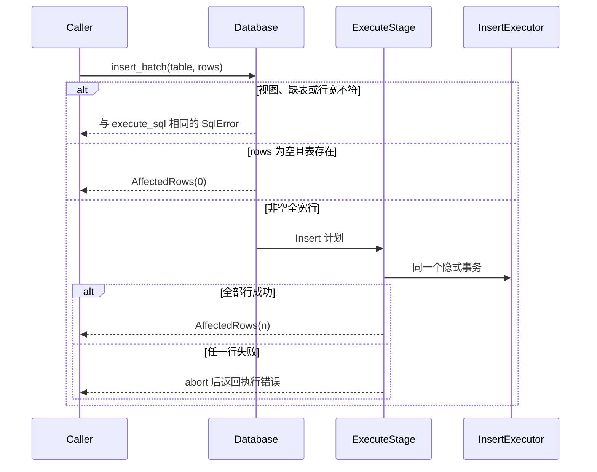

## 背景

MS47 要决定类型化批量写入入口是否存在。I021 的原方案写过 `bulk_insert` 和 `append_batch`，2026-10-18 的补充要求复用既有类型、约束、索引和回滚路径。本次只交付一个库入口，不交付存储层第二条写路径。

当前起点是 `937463c7dfa8ab6bec400e2573b11bdd4b72103b`。另一个进行中的变更与本次没有代码合同上的先后。

## 当前行为

`Database::execute_sql` 进入 `pipeline::execute`。未命中计划缓存的插入记录 parse、plan、execute。`Database::commit` 在 execute 仍打开时把 `commit` 记成它的子阶段。摘要的 `total` 是语句根阶段的包含时间。`StageStat.exclusive_total` 是包含时间减去直接子阶段的包含时间。

`InsertExecutor::next` 对 `values` 逐行做日期强制转换、FLOAT 列的整数升格、`NOT NULL`、整数键类型、主键重复、`UNIQUE`、一般类型门，然后写元组、WAL、主键索引、唯一索引和二级索引。多行 `INSERT` 在 `execute_stage` 里共用一个隐式事务：成功则 `commit`，失败则 `abort`。`execute_sql` 不加入 `Database::begin` 返回的显式事务。

计划期拒绝发生在 `begin` 之前。缺表是 `PlanError::ParseError`，文本为 `Table '{name}' does not exist`，经 `PlanFailure` 后消息是 `Parse error: Table '{name}' does not exist`，SQLSTATE `42601`。行宽不符使用 `insert_count_error`，消息是 `Parse error: INSERT INTO '{name}' expects {n} values, got {got}`，SQLSTATE `42601`。视图写入是 `PlanError::UnsupportedStatement("WRITE TO VIEW (views are read-only)")`，消息是 `Plan error: Unsupported statement type: WRITE TO VIEW (views are read-only)`，SQLSTATE `0A000`。这些名字在进入检查前已经按标识符小写化。

执行期错误经 `execute_executor` 变成 `Execution error: {StorageError}`。`DuplicateKey` 的存储文本是 `Duplicate key`。只读会话在 `execute_stage` 开头拒绝，消息是 `cannot execute INSERT in a read-only session`，SQLSTATE `25006`。

`get_table` 按目录里的名字精确查找。SQL 建表把表名小写后写入目录。视图登记在 `Database::views`，键是计划期的小写名。`InsertExecutor` 用 `zip` 把行和列模式对齐；行宽不符若进入执行器，短行会被截断而不是计划期那种点名拒绝。所以入口必须在 `execute_stage` 之前拒绝行宽。

现有插入基准里，`benches/sqlite_compare.rs` 的 `rtsql_insert_100` 和 `benches/common/mod.rs` 的 `insert_rows` 都是逐条 `execute_sql` 单行 `INSERT`。`scale_insert` 把打开数据库、建表和清理算进计时。`pipeline_stages_bench` 测的是 SELECT 的三个阶段，不是插入占比。

导入在 `src/cli/lifecycle.rs` 里为每一行拼一条 `INSERT` 并 `execute_sql`。本次不改这个循环。

变更前验证：在本工作目录执行

`cargo test --offline --test diagnostics_statement_test insert_commit_is_child_of_execute -- --test-threads=1`

结果：`insert_commit_is_child_of_execute ... ok`，`1 passed; 0 failed; 0 ignored; 0 measured; 8 filtered out`。这条测试锁定单条插入的执行阶段独占时间加上提交包含时间等于执行阶段包含时间。

## D1 测量口径

负载锁定为 100 条单行插入，表和 SQL 形状与 `insert_rows(db, 0, 100)` 相同。建表发生在打开诊断之前。诊断配置只开 `collect.stats`，`summary_limit` 为 100，观察类别保持 `ModuleSet::All`。

分母是 100 条摘要的 `Summary.total` 之和。分子是每条摘要里 `Module::Pipeline` / `execute` 的 `exclusive_total` 之和。提交不计入分子。解析和规划也不计入分子：它们不是行插入循环。

这样比较的是插入循环（类型、约束、索引、写元组）在整条写入语句里的占比。把这段时间降到零，语句里剩下的解析、规划和提交仍在。占比低于 10% 时，即使插入循环消失，语句也改善不到 10%。把 100 次提交合成 1 次能省下的时间不作为本次门槛；导入侧的攒批提交属于 I077，本次不做。

达到 10% 的判定是 `execute_exclusive_ns * 10 >= total_ns`。等于 10% 时建入口。使用 `u128` 纳秒。`total_ns` 为 0，或乘法溢出，测量无效，不记成未达标。

命令使用 `cargo test --release`。debug 断言会抬高执行阶段的 CPU 时间，不适合作为这个占比的口径。测试只打印两个整数，不断言大于或小于 10%。裁定写在执行记录里。只跑这一次，不因为接近门槛而重跑。

不采用的做法：

- 用解析加规划当分子。那是 SQL 文本开销，不是逐行插入。
- 用 `scale_insert` 的 criterion 墙钟当端到端。它包含打开数据库、建表和删文件。
- 测一条多行 `VALUES`。现有基准和导入都是一条语句一行。
- 在测试外写脚本计算占比或给出通过与否。

## D2 未达标

比例小于 10% 时，本变更的产品代码保持测量前的状态。`tests/typed_batch_write_test.rs` 里的测量测试留下。执行记录写明两个纳秒数和「不建入口」。下一轮不展开。

## D3 达标时的入口

公开方法只有：

```rust
impl Database {
    pub async fn insert_batch(
        &self,
        table: &str,
        rows: &[Vec<Value>],
    ) -> std::result::Result<SqlOutcome, SqlError>;
}
```

名字用 `insert_batch`。I021 里的两个存储层名字不单独公开，避免再出现一条绕过执行器的写路径。

`rows` 由调用方拥有，方法内克隆进 `InsertNode.values`。克隆不在本次消除。`columns` 与 `param_slots` 都是空向量，对应不带列清单的 `INSERT`。`table_name` 使用小写后的目录名。

前置检查的顺序和错误与 `build_insert` 对齐，并且发生在 `transaction_manager.begin` 之前：

1. `table.to_lowercase()`。
2. `self.views` 含该键：返回与 `execute_sql(INSERT INTO <view>)` 相同的 `SqlError`。
3. `table_manager.get_table` 失败：返回与 `execute_sql(INSERT INTO <missing>)` 相同的 `SqlError`，不用 `StorageError::TableNotFound` 的文本。
4. `rows.is_empty()`：`Ok(AffectedRows(0))`。不调用 `execute_stage`。只读会话也走这里。
5. 按行序找到第一行 `row.len() != meta.columns.len()`：返回与同个数 `VALUES` 的 `execute_sql` 相同的 `SqlError`。
6. 否则 `pipeline::execute_stage(self, PhysicalPlan::Insert(...), false).await`。`profiling` 固定为 `false`，不读取 `RTSQL_PROFILING`，不打印旧的三段计时表。路由表使用 `execute_stage` 内部的空表。

第 6 步复用隐式事务、`InsertExecutor`、只读拒绝和提交或中止。不在 `database.rs` 再写一套门。不把本方法接到 `execute_in_tx`。

空切片打到缺表或视图上时，仍停在第 2 或第 3 步，不返回 0。这是为了和 `INSERT` 一样点名拒绝，而不是把写错的名字报成成功。

诊断：`execute_stage` 自己不调用 `enter_statement`。本方法不补语句摘要，也不新增阶段名。`execute_sql` 的摘要行为不变。

查询内存预算沿用 `execute_stage` 对计划字面量插入的现有计费，不为本入口加新的计费点。



## D4 实现顺序

1. 先写测量测试并在 release 下跑通。产品代码不动。用打印的整数做一次比较，把裁定写进执行记录。
2. 只有裁定为建入口时，才展开下一轮。那一轮先写会失败的 `insert_batch` 测试，再实现方法，直到与 `execute_sql` 的对照通过。
3. 未达标则不再改产品代码。

下一轮依赖本轮的裁定。本轮不实现入口，避免在数字出来之前把入口当成必做工作。

## 不采用的方案

| 方案 | 不采用的原因 |
|---|---|
| 存储层 `append_batch` 直接写页 | 会绕过类型、约束、索引和回滚 |
| 只鼓励调用方拼一条多行 `INSERT` | 导入和 CSV 仍要生成 SQL 文本，没有可复用的类型化入口 |
| 入口支持部分成功或 `ON CONFLICT` | 失败语义已定为整批回滚；部分成功要先回到需求裁定 |
| 本次改 import 或 CSV 去调用入口 | 里程碑把适配划在外面 |
| 用提交时间当分子 | 那是把攒批提交算进本次门槛，属于 I077 |

## 风险

- 一次 release 测试靠近 10% 时，换一次运行可能落到另一侧。计划不重跑，也不改门槛。第一次打印的整数就是裁定。
- 分子不含提交。提交占了绝大部分时间时，即使插入循环很小，也会得到「不建入口」。这是 D1 的预定结果。
- 本变更每一轮都不跑全量。用户原话：「这次自动化把全量测试放到最后来限制全量的次数」。风险：本变更收尾前没有全量；合回主分支后那一次失败时，排查范围包含 MS46 与 MS47。
- 行宽若漏进 `InsertExecutor` 的 `zip`，短行会静默截断。前置检查是行为的一部分，不是可省略的校验。

## 回滚

见 `proposal.md`。无格式迁移。未达标时产品代码无差异。
