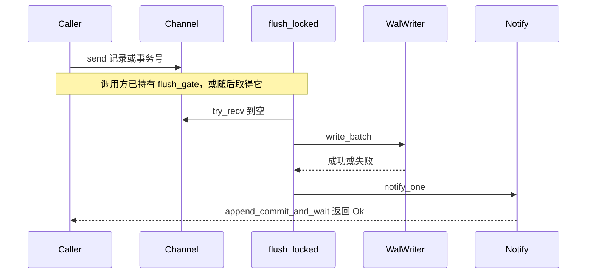

# 不拆包，两条会话队列改为无界通道

见 `proposal.md` 的 Why。本文只记录怎么做，以及为什么不拆包。

## Context

起点是 `56da53b`。包是单一的 `rtsql`（`Cargo.toml` 只有一个 `[package]`）。feature 为 `cli`、`network`、`crypto`，`default` 三者全开。`tokio` 1.52.3 已启用 `sync`，无界 `mpsc` 不需要新依赖。`UnboundedReceiver::len` 在该版本存在。

MS42 已经把入口层的可选构建做成 feature。MS43 已经把读写会话上的刷盘循环、提交等待、checkpoint 和 `close` 的归属定下来。当前代码里：

- `WALBuffer::buffer` 是 `Mutex<Vec<(u64, WalRecord)>>`。`append` 推入，`flush_locked` 整段取走。
- `pending_commits` 是 `Mutex<Vec<u64>>`。`append_commit_and_wait` 在刷盘闸门内推入，同一次 `flush_locked` 取走。
- 提交完成是 `CommitWaiter` 里的 `Arc<Notify>`。`write_batch` 之后 `notify_one`，失败也唤醒。等待返回 `Ok(())`。
- `flush_notify` 和 `state_notify` 已经是 `Notify`。后台循环用 `select` 等它们和定时器，不在通道上阻塞。
- `TransactionManager::commit` 在 `CommitTxn` 和 `append_commit_and_wait` 之间持有 `session_gate`。`Database::checkpoint` / `close` 经 `checkpoint_under_session_gate` 持有同一把闸门，先 `quiesce_for_checkpoint`，checkpoint 返回后恢复，`close` 则 `shutdown` 并不恢复。
- `CheckpointManager` 没有后台队列。`BufferPool` 没有生产者-消费者队列；其中的 `oneshot` 只存在于测试用的 `GatedWriteStorage`。

M21 的四条环仍在：

| 环 | 当前边 |
|---|---|
| 1a | `database` → `pipeline` → `executor` → `database`。执行器持有 `Database` 的文件：`join_related_config.rs`、`scalar_subquery_filter.rs`、`semi_join.rs`、`subquery_eval.rs`、`truncate.rs`、`alter_table.rs`、`anti_join.rs`、`create_index.rs`、`create_table.rs`、`create_view.rs`、`drop_index.rs`、`drop_table.rs`、`drop_view.rs` |
| 1b | `executor` 与 `pipeline` 互调。`scalar_subquery_filter.rs`、`semi_join.rs`、`subquery_eval.rs`、`anti_join.rs` 调用 `create_executor_from_plan`；这些文件和 `join_related_config.rs` 持有 `RoutedTables` |
| 1c | `transaction/session.rs` 引用 `Database` |
| 2 | 存储使用执行层的 `Value` / `ValueRef`（`storage/page_format/tuple.rs`、`storage/data/table_manager.rs`），并使用 `VersionHeader`（`data_page.rs`、`table_manager.rs`、`integrity.rs`、`buffer_pool.rs`、`wal/recovery.rs`）。`storage/error.rs` 引用 `TransactionError`。事务管理器使用存储和 WAL |

`AsyncStorage`（`src/storage/async_storage.rs`）已经是页后端的替换接缝，`FileStorage` 和内存存储都在同一个包里。

## Goals / Non-Goals

**Goals:**

- 把上述两条 `Mutex<Vec<_>>` 换成无界 `mpsc`，刷盘结果和职责归属不变。
- 把「不拆包」和理由留在本文件，作为本变更的结论。

**Non-Goals:**

- 不改 proposal「不做」里的文件和机制。
- 不新增诊断类别，不移动 Lock、Queue、Io、Schedule 的记时点。

## Decisions

### 1. 不拆 crate

不新增 package，不改 feature。

| 选定 | 备选 | 不选的理由 |
|---|---|---|
| 保持单一 package | 先解开四条环，再把六层拆成 crate | 解开之前任何一层都不能单独构建。解开本身就是接口重做，仓库里没有另一套存储、执行或规划在等这个边界。拆开不能从默认库里裁掉 SQL 必需的层 |
| 继续用现有 feature | 把 cli、network、crypto 再拆成 crate | 关闭对应 feature 已经能去掉 clap、csv、tokio-util、argon2、aes-gcm。crate 边界不会多出一种构建组合 |

这是本变更的结论。以后只有出现独立构建或替换对象时才重新考虑拆包。那不在本变更里。

### 2. 两条无界通道，接收端只在 `flush_locked` 取走

```text
records_tx / records_rx : (u64, WalRecord)
pending_tx / pending_rx : u64
```

发送端可克隆，放在 `WALBuffer` 上。接收端放在 `std::sync::Mutex` 里。`flush_locked` 的调用方已经持有 `flush_gate`。它锁住接收端，`try_recv` 到空，放开接收端锁，再做现有的 `write_batch` 和唤醒。接收端锁不跨越 `.await`。

`append` 先分配 LSN，再 `send`。发送失败说明接收端已被丢弃，按不变量 panic，不改成 `WalError`。发送之后读 `records_rx.len()`。长度达到 `capacity` 时，放开锁，再走现有的 `flush_after_pause`。不用有界通道的 `send().await`：暂停时后台循环不取走，调用方又堵在发送上，容量刷盘就无法开始。

`append_commit_and_wait` 仍先拿刷盘闸门，仍登记带诊断字段的 `Notify`，再 `pending_tx.send`。已经 `shutdown` 时，仍在同一把闸门里调用 `flush_locked`。未停止时仍 `flush_notify.notify_one()`，然后 `notified().await`。诊断的 Lock、Queue、Io、Schedule 仍记在现在的位置。

两条通道不合并不成一条消息。`commit` 先 `append(CommitTxn)`，再登记事务号。中间可以发生一次刷盘。合成消息会把这种配对改掉。



后台循环仍 `select` `flush_notify`、`state_notify` 和定时器，然后在刷盘闸门下调用 `flush_locked`。它不调用 `recv()`。否则暂停、关闭和容量路径上的调用方无法自己取走已经发送的条目。

### 3. 提交唤醒、检查点、缓冲池保持原机制

| 选定 | 备选 | 不选的理由 |
|---|---|---|
| 继续用按 `tx_id` 的 `Notify` | 换成 `oneshot` | `Notify` 已经是完成信号。队列是 `pending_commits` 那条 `Vec`。完成结果已经是 `Ok(())`，诊断读的是 `notified().await`。换成 `oneshot` 不改变归属 |
| 检查点不加通道 | 为检查点再做一条 `Notify` 队列 | `quiesce_for_checkpoint`、`resume_after_checkpoint` 和 `state_notify` 已经表达暂停和恢复。没有待传递的队列 |
| 缓冲池不加 `watch` 或任务 | 按 I012 原文加 `watch` | 缓冲池没有生产者-消费者队列。脏页由调用方 `flush_all` 等待 |

## Risks / Trade-offs

- 发送和读取 `len()` 之间，另一次 `flush_locked` 可能已经取走记录。长度因此小于容量，本次 `append` 不再自己刷。取走的那次刷盘负责写盘。单线程、没有别人取走时，长度达到容量，调用方照旧刷盘。
- 并发 `append` 的持久化顺序是通道接受顺序。今天的顺序是缓冲锁的取得顺序，二者都不是 LSN 数值顺序；写盘时逻辑 LSN 本来就会被忽略，文件偏移在 `flush_locked` 里重算。现有测试断言条数和指定事务号是否出现，不断言跨任务的锁顺序。
- `send` 失败即 panic。接收端和 `WALBuffer` 同寿，正常路径到不了。不把这个失败变成新的 `WalError`。

## Migration Plan

无数据迁移。回滚见 `proposal.md`。实施只改 `src/wal/buffer.rs`。先让新的通道测试因字段不存在而编译失败，再改队列，然后保持既有 WAL、会话和诊断测试通过。全量只在最后一轮跑一次。
