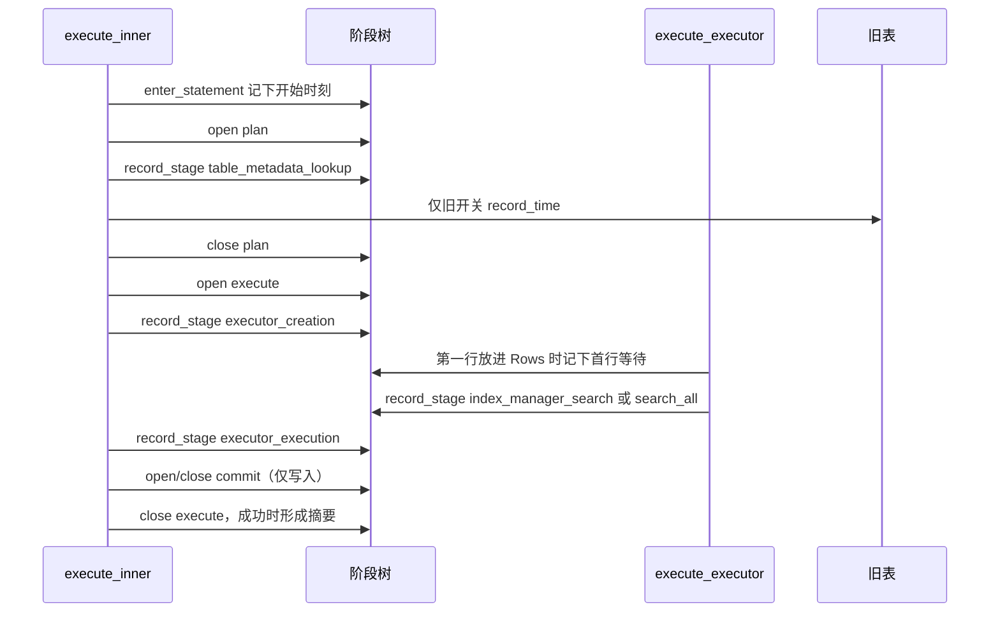

## Context

诊断门面在 `src/diagnostics.rs`。语句管道在 `execute_with_params` 里、采集打开时建立阶段绑定，`execute_inner` 用 `enter_statement` 开根。解析、规划、执行用 `open_stage` / `close_stage`，提交在 `Database::commit` 里作为执行阶段开着时的子阶段。`record_stage` 把一个已经测完的节点挂到当时最内层开着的阶段，不改变 open 栈。文件页读由 `PageReadTimer` 在析构时调用 `record_page_read`，记入当时最内层开着的阶段。

旧表在 `src/profiling.rs`。`RTSQL_PROFILING` 打开时，`record_time` 把阶段名写进任务局部表，`print_timings` 打到 stderr。五个子指标今天只走这条路径：

- `plan_stage_impl`：CTAS、`CREATE VIEW`、以及其余会 `register_table` 的语句，各有一处 `table_metadata_lookup`。普通 `CREATE TABLE` / `DROP TABLE` 分支不记。
- `execute_stage_routed` 的 DML 臂和查询臂：`executor_creation`、`executor_execution`。
- `execute_ctas_routed`：同样两段，包住源执行器的构造和 `next` 循环。
- `IndexScanExecutor::next`：`index_manager_search`。
- `IndexScanAllExecutor::next`：`index_manager_search_all`。

`execute_stage_in_tx_routed` 没有这五段的 `record_time`。显式事务路径因此不在本变更里新增测量。

`StageNode::exclusive` 已经是包含耗时减去直接子阶段之和，差为负则饱和为 0。`tests/diagnostics_statement_test.rs` 的 `insert_commit_is_child_of_execute` 和 `tests/typed_batch_write_test.rs` 的 `row_insert_share_of_hundred_inserts` 仍断言「执行独占 + 提交包含 = 执行包含」，前提是提交是执行的唯一直接子阶段。

比较指标还不存在。`Summary` 只有 SQL 文本、严重级别、总耗时、阶段汇总、追踪样本、事件和丢弃计数。`execute_executor` 是唯一把 `ExecResult::Row` 收成调用方 `SqlOutcome::Rows` 的地方。`materialize_insert_select_source`、CTAS 源循环和派生表物化里的行不会成为这条语句的结果。

`QueryBudget::charge` 在上限为 0 时直接返回，不计字节。`libc` 已是依赖。Linux 上 `getrusage(RUSAGE_SELF).ru_maxrss` 的单位是 KiB。

## Goals / Non-Goals

**Goals:**

- 五段旧耗时以同一次测量进入当前语句阶段树，旧表行为保持。
- 页读继续走 `record_page_read`。
- 从已保留的摘要读出首行等待、吞吐和 P95，并从进程读出内存峰值。
- SQL 结果、错误文本、SQLSTATE、提交等待的归属、告警原文保持不变。

**Non-Goals:**

- 新增 `diagnostics::report`，或用 `record_pre_measured` 再做一条语句摘要。
- 为这五段再开 open 阶段，或在显式事务路径上新加测量。
- 新造缓冲池计数、行数资源计数器、查询预算高水位或分配器统计。
- 把比较指标放进 SQL 结果列或诊断渲染文本。
- 替换门面、改旧表的列和 `Total` 算法、改查询预算上限为 0 时的短路。

## Decisions

### 一次测量，两个出口

每个现有 `record_time` 调用点只取一个起点。`profiling` 为真时用这个 `Instant`；否则只在阶段绑定存在时用 `stage_instant()`。测完后，旧开关打开才 `record_time`，并总是调用 `record_stage`（没有绑定时它自己是空操作）。

这样旧表和门面看到同一段时长。两个都关时不调用 `Instant::now()`。

备选是各取一个 `Instant`。那是第二套计时，不采用。

### 不新开阶段

索引查找发生在 `execute_executor` 里面，而 `executor_execution` 要到这次调用返回后才 `record_stage`。当时开着的阶段是 `execute`，所以查找和 `executor_execution` 都是 `execute` 的直接子阶段，区间重叠。独占耗时可能饱和为 0。这是既有减法的结果，不为此把 `executor_execution` 改成 open 阶段。

若把它改成 open 阶段，执行期间的页读和其他等待会从 `execute` 挪到这个新阶段，提交等待的「保持原样」就被改掉。不采用。

类别：三个流水线子指标是 `Module::Pipeline`，两个索引查找是 `Module::Index`。现有的类别过滤因此可以单独藏起索引阶段。阶段名字符串与旧表一致。

一次普通插入不走索引扫描执行器。`execute` 的直接子阶段是 `executor_creation`、`executor_execution` 和 `commit`，区间首尾相接且不重叠，独占加上这三者的包含耗时等于执行的包含耗时。`table_metadata_lookup` 是 `plan` 的直接子阶段，不进入这条等式。

### 比较指标读已有摘要

公开字段加在 `Summary` 上：

- `started_at: Instant`：语句作用域的开始时刻，与总耗时同一个起点。
- `first_row: Option<Duration>`：成功把第一行放进 `SqlOutcome::Rows` 时，从 `started_at` 起算的时长。
- `rows_delivered: u64`：成功交回的结果行数。

只有 `StatementScope` 以成功结束时才抄写后两个字段。失败和放弃写 `None` 和 0。`execute_executor` 在放进第一行时记下时长，并在最终结果不是非空 `Rows` 时清掉。插入、空结果、出错、被放弃因此没有首行等待。内部物化不调用这个记录。

`record_pre_measured` 不另起摘要。它的开始时刻取记录时刻减去根包含耗时，首行等待为空，交回行数为 0。

分段读出：

```text
pub struct SegmentMetrics {
    pub throughput_rows_per_sec: Option<f64>,
    pub slow_p95: Option<Duration>,
}

pub fn segment_metrics(summaries: &[Summary]) -> SegmentMetrics
```

没有摘要时两项都是 `None`。设开始时刻的最小值为 `t0`，结束时刻 `started_at + total` 的最大值为 `t1`。墙钟 = `t1.saturating_duration_since(t0)`。墙钟为 0 时不给出吞吐。否则吞吐 = 交回行数之和 / `wall.as_secs_f64()`。行数之和为 0 且墙钟大于 0 时，吞吐为 0。

P95：总耗时升序，下标从 1 计。`r = ceil(95 × N / 100)`，用整数 `(95 × N + 99) / 100`。P95 = `t_r`。不插值。

内存峰值：

```text
pub fn process_memory_peak_bytes() -> Option<u64>
```

Linux 上成功时返回 `ru_maxrss * 1024`。`getrusage` 失败返回 `None`。其他操作系统返回 `None`，避免把 macOS 上以字节计的 `ru_maxrss` 再乘一次 1024。不读 `/proc/self/status`，不读 `QueryBudget`。

渲染函数不输出这三项，也不输出首行等待。阶段行仍按现有循环打印，所以新阶段名会出现在已有的阶段行里。格式串不改。

备选是把四项合成一个新的场景对象，或把峰值定义成查询预算高水位。两者都和已锁定口径冲突，不采用。`VmHWM` 要解析 proc 文件，而 `libc` 已经能读 `ru_maxrss`，不采用。

### 顺序



实现顺序跟这个数据流一致：先接五段耗时并改掉唯一子阶段假设，再在摘要上记开始时刻、首行和行数，最后做分段读出和进程峰值。全量只放在最后一轮。

## Risks / Trade-offs

- 主键或二级索引查询上，`execute` 的独占耗时可能饱和为 0。规格不再要求这类查询满足「独占 + 提交 = 包含」。测试不得把旧等式加回去。
- `row_insert_share_of_hundred_inserts` 里打印的执行独占会变小。该打印不是通过条件。通过条件仍是一百行插入后的 `COUNT(*)`，以及更新后的三条子阶段等式。
- 诊断渲染会多出阶段行。这不作为 SQL 正确性的判据。
- 非 Linux 没有内存峰值数值。测试把 Linux 与否分开断言。
