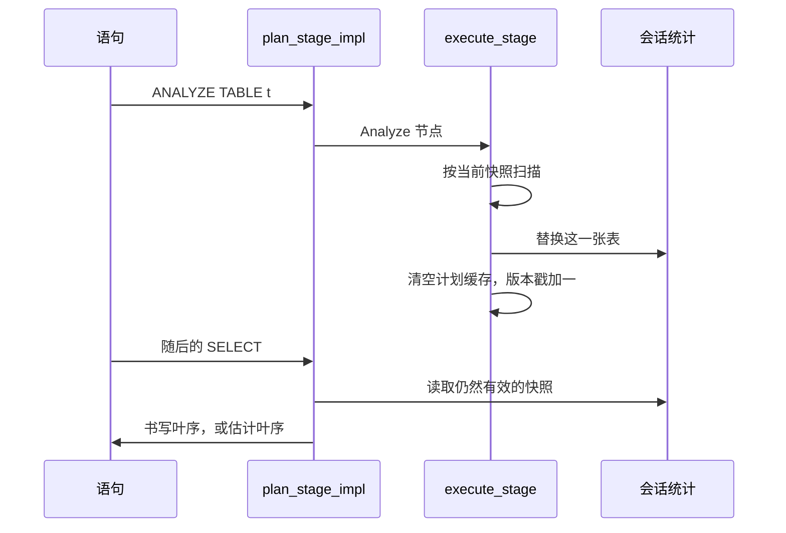

## Context

见 `proposal.md` 的 Why。这里只记实现所依赖的现状。

`build_from_clause_with_projection`（`src/parser/planner/query.rs`）按 `from[0].joins` 把连接收成左深树。右子节点是下一张表的扫描，左子节点是已经收好的前缀。纯等值内连接走 `PhysicalPlan::Join` 或 `PhysicalPlan::SortMergeJoin`；`integer_pk_base_scan_join` 只在左右都是基表扫描、且每个等值键都是写出的整数主键时选排序合并。外连接和非等值走 `NestedLoopJoin`。两表以上的链在最后一步之前携带全部列。有 `ORDER BY` 时，`build_query` 把 `carry_all_columns` 设为真，排序节点负责裁剪。

哈希连接构建右输入、探测左输入。这个接线在 MS40 之后保持不变。`join-executor-selection` 规定：没有 `ORDER BY` 时，行序按左输入探测。排序使用 `sort_unstable_by`。

`PlanBuilder` 只有目录元数据，没有行数。`Database` 的 `schema_version` 与 `plan_cache` 由 `bump_schema_version` 一起更新。预编译语句拿这个版本戳决定是否重计划。`EXPLAIN` 只渲染计划，不读取目标语句的行。

`Value` 的 `==` 把 `Float(-0.0)` 与 `Float(0.0)` 视为相等，DECIMAL 按规范形相等。`Hash` 对浮点使用 `to_bits()`，与 `==` 不一致。

计划时的基线是 master `97d183c9777716e5d54e5596ea857aab2c7821d1`。没有为这次计划运行 `cargo test`。

## Goals / Non-Goals

**Goals:**

- 会话内能保存并读回基表统计。失败路径不留下统计，也不推进版本戳。
- 左深代价可以在没有数据库的测试里算出规格中的整数。
- 合格查询的叶序由这个函数决定。最终列序仍是书写顺序。
- 整个变更只跑一次 M19 分批全量，放在最后一轮。

**Non-Goals:**

- 不把统计写入目录、WAL 或页。
- 不交换两表连接的左右输入，不重做构建侧的时间门。
- 不重排无 `ORDER BY`、外连接、非等值、派生表、视图、CTE、附加表，以及带 `LIMIT`、`OFFSET`、`FETCH` 或 `LIMIT BY` 的语句。
- 不把排序改成稳定排序。
- 不估算 I/O，不维护直方图，不在 DML 时更新统计。
- 不预建缺陷轮次。返工不再预算第二次全量。

## Decisions

### 1. 统计放在会话里

`Database` 增加一份由克隆共享的统计表。成功的 `ANALYZE` 替换这一张表的数字，然后清空计划缓存并把 `schema_version` 加一。这一次加一不使其他表的统计失效。

`bump_schema_version` 在原有缓存清空和版本加一之外，使全部已保存统计对计划不可见。DDL 与 CTAS 已经走这个函数，所以不必逐个 DDL 臂再写一遍。

关闭再打开后统计不在。DML 不改数字，计划可以继续用旧数字。结果仍按执行时的可见行计算。

被替代的做法：写入目录尾段。旧库打开路径会因此增加一种尾段，而验收允许没有统计时保持书写顺序。

### 2. 收集与保存分开

`ANALYZE` 先按当前快照取出与 `SELECT *` 相同的可见行，再计算计数。计算完成之前不替换统计。扫描开始时的 `schema_version` 到保存时已经变化，则丢弃这组数字并返回规格中的错误。

可见行沿现有扫描执行器读取，不从 `execute_sql` 递归进来，也不另写一套 MVCC 判断。不同值个数按 `Value` 的 `==` 累计。保留下来的不同值计入现有查询内存预算；上限为 0 时不因预算失败。

显式事务里的拒绝放在扫描之前，文案和 SQLSTATE 与 `CREATE INDEX` 的事务内拒绝同一形态：没有 `Plan error:` 或 `Execution error:` 前缀。

### 3. 代价只排左深叶序

搜索空间是「右子节点始终是一张基表扫描」的左深树。第一步才可能使用排序合并代价，因为只有这一步的左右都是基表扫描。其后左输入是中间结果，沿用现有规则，按哈希计价。

探测权 1、构建权 2、输出权 1。构建权大于探测权，叶序才会把大表留在左、小表放到右。权都为 1 时，规格里的星型例子打成平手，重排不会发生。这两个权不是耗时测量。

基数是左行数乘右行数，再对这一步新接上的每条等值边做一次向零的整数除法。除数是两端 `ndv` 的较大者，至少为 1。溢出 `u128` 的候选没有代价。书写顺序自己溢出，或者基表超过 8 张，就保持书写顺序。8 张表的全排列是 40320，计划时可以枚举。再大则落入「不足以重排」，不另写贪心。

字典序只在严格更便宜的顺序之间比较。与书写顺序代价相同就保持书写顺序，决定仍然是「已用估计」。

计划器调用 `src/table_stats.rs` 里的这一个函数。表数上限和溢出不在计划器里再实现一遍。

### 4. 先装配书写顺序，再决定是否替换

书写装配已经负责缺列、同侧 ON、外连接和错误文本。它失败时原样返回。它成功且查询合格、统计齐全时，才用选中的叶序重造左深树。

重造后的最外层连接，输出列序和声明限定符序与书写装配相同。`ORDER BY` 路径下最外层仍携带全部列。内层连接的行按选中叶序拼接各叶的列。`output_sides` 与 `column_index` 指向实际持有该列的子行。现有执行器已经按这两个字段取列。

选中叶序之后仍调用 `integer_pk_base_scan_join`。不因为代价函数使用了排序合并权重，就跳过或强制这个判断。

`JoinOrder` 行只在合格且每张表都有可用统计时出现。没有统计时，EXPLAIN 的节点行保持原字节。这样未统计的既有测试不用改断言。

### 5. 全量只留一次

000 与 001 只跑各自的定向测试，命令都带 `--test-threads=1`，目标分开依次执行。002 按 `.agents/runbooks/m19-batched-full-regression.md` 的等分批次跑一次。用户原话是「本次最多一次全量」。返工和重新计划不再安排第二次全量。

## 统计之后的计划

## Risks / Trade-offs

- 插入之后统计过期，可能留下较贵的叶序。结果多重集合仍与书写顺序相同。这是接受的代价。
- 最外层列如果按物理叶序输出，WHERE 会读错列。001 用 `WHERE fact.id = 1` 和 `SELECT *` 的表头拦住这件事。
- 浮点不同值若用 `HashSet<Value>`，负零会算成两个。000 的单元测试直接断言 `ndv` 为 1。
- 只读扫描如果写出 WAL 或让主文件变长，000 停止并回到计划，不把写入收进统计的语义。
- 全量失败后的修复只靠定向测试复核。第二次全量不在预算内。风险是修复再碰到另一批里的失败时，要等下一次被允许的全量。
- `Database` 会多一个会话字段。M21 里的字段个数要等收尾再改。本次不修改 `.agents/` 或 `openspec/specs/`。

## Migration Plan

没有文件格式迁移。已有库直接打开。回滚是放弃本分支：会话内的统计随进程结束消失，页和 WAL 保持原样。
