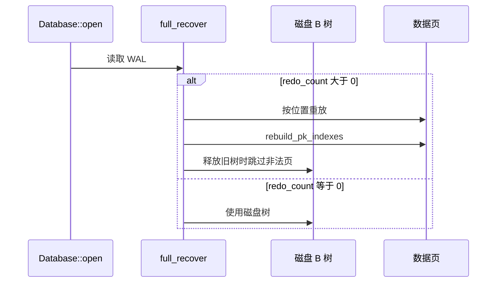

## 背景

起点是 `0019bf127df5304f26e89927e336150fc6472b11`。没有其他活跃变更。产品行为以该修订上的代码和下面这次测量为准。动机见 `proposal.md`。

默认缓冲池是 100 页（`src/database.rs` 的 `BufferPool::new(100, …)`）。`BufferPool::evict_one` 按时钟淘汰：脏页先 `write_page`，写完再移出池，不按树顺序。`flush_all` 先按 DashMap 的遍历顺序收集脏页，再逐页 `write_page`。检查点在 `src/wal/checkpoint.rs` 里调用这次 `flush_all`，然后写位点并截断 WAL。检查点完成且没有新的重放时，`redo_count == 0`，恢复使用磁盘树。

`redo_count > 0` 时，`src/wal/recovery.rs` 的重放不消费磁盘 B 树。数据页按 WAL 里的位置重放，索引在重放之后由 `rebuild_pk_indexes` 从最终数据页重建。旧树只在释放时用 `collect_all_pages_tolerant` 收集；页类型非法就跳过那棵子树。打开末尾的空闲页集合重建如果遇到非法页，会放弃这一次重建，打开仍然成功。这是 `database.rs` 里已有的失败安全路径。

读写打开对主文件取 advisory 独占锁，锁跟随文件描述符，`close` 不释放它。只读打开取共享锁。独占锁挡住共享锁。只读打开在拿到锁之后，若 `.wal` 仍有未决记录，会拒绝打开。M18 把「检查点那一次全量刷盘保证一致，运行期淘汰不保证」写成当前合同。

## 目标与非目标

**目标**

- 记下当前 release 上的不洁重开代价、检查点后再次打开的代价，以及持锁时只读 CLI 的等待结果。
- 刷盘、驱逐和文件锁维持测量前的合同。

**非目标**

- 不改 `evict_one`、`flush_all`、恢复重建门控、`try_lock` 或 `try_lock_shared`。
- 不实现脏页批量写、io_uring、索引页格式或节点锁。
- 不把重放改成增量维护索引。
- 不写跨进程快照、缓存失效或另一套检查点协议。
- 不预建缺陷修复轮次。

## 决定

### D1 恢复代价

负载与 `tests/cli_test.rs` 的 `build_big_wal` 相同：`create_table("t", [(id, INT)], "id")`，每 50 行一个显式事务，`INSERT INTO t VALUES (i)`，drop 且不 `close`。计时是同进程里 `Database::open` 的墙钟，构建是 `cargo test --release`。行数用 `SELECT COUNT(*)` 核对。检查点后的打开是 `close`、drop 句柄，再 `Database::open`。

这次观察在规划里做完，补丁只存在于那一次进程，随后已从工作区撤掉。仓库里的 `calibration_recovery_time` 仍然只打印不洁打开时间，不打印行数，也不做第二次打开。记录以下这一次带行数的运行，命令都带 `--test-threads=1`：

```text
RTSQL_CALIBRATION_ROWS=10000 cargo test --release --offline --test cli_test calibration_recovery_time -- --ignored --nocapture --test-threads=1
RTSQL_CALIBRATION_ROWS=40000 cargo test --release --offline --test cli_test calibration_recovery_time -- --ignored --nocapture --test-threads=1
```

| N | 构建 | 不洁打开 | 不洁行数 | 检查点后打开 | 再次行数 |
|---|---|---|---|---|---|
| 10000 | 885.910664ms | 536.642784ms | 10000 | 24.985182ms | 10000 |
| 40000 | 3.509424522s | 3.81395909s | 40000 | 100.101745ms | 40000 |

两次不洁打开都打印了旧索引页类型 `0x00`、跳过子树，以及 `free-page-rebuild` 因 `expected 0x1, got 0x0` 放弃。检查点后的打开没有这两行。10000 行的非法页是 `PageId(217)`，40000 行是 `PageId(1156)`。



### D2 维持刷盘和驱逐

不洁打开的多出来的时间在重放和重建上。检查点后的打开不走重建，10000 行是 24.985182ms，40000 行是 100.101745ms。改变 `flush_all` 的写出顺序，或改成不淘汰脏页，都不会拿掉 `redo_count > 0` 时的 `rebuild_pk_indexes`。已完成的检查点本来就会刷完全部脏页，顺序不影响那一次的一致性。

因此不改 `src/storage/buffer_pool.rs` 的 `evict_one` 和 `flush_all`，也不改 `src/wal/recovery.rs` 的重建门控。M18 保持原句。

不采用的做法：

| 做法 | 不采用的原因 |
|---|---|
| 按树后序刷盘 | 不洁恢复不读这棵磁盘树来回答查询，顺序不进入上表的不洁打开 |
| no-steal，脏页留到检查点 | 两次提交之间的 WAL 仍会让 `redo_count > 0`，重建仍在 |
| 每次提交都做全量检查点 | 能让提交之后的崩溃走检查点后那一列的打开时间，但每次提交都要刷池。本次没有测量这个提交成本，不能把它当成已经值得做的刷盘改动 |
| 重放时增量维护索引，跳过整棵重建 | 这是恢复合同，不是刷盘或驱逐。超出本里程碑点名的合同 |

### D3 跨进程场景不成立

判定用目标里的原句收成可执行条件：当前已经支持的入口里，要有一个写者仍持有数据库时，另一个进程必须读到已提交行。CLI 主命令在结束时 `close`，进程退出后描述符释放。仓库没有 `rtsql serve`。库里的长生命周期 `Database` 继续持有独占锁，这是 `database-file-lock` 和 `readonly-open-mode` 已经写明的互斥。

持锁观察用 release 二进制 `rtsql`，库由 `rtsql new`、`CREATE TABLE` 和一行 `INSERT` 建成。另一进程 `flock` 独占主文件期间：

```text
rtsql --busy-timeout 300 --readonly <path> "SELECT id FROM t"
```

退出码 4，耗时 306ms，stdout 为空，stderr 为 `{"error":"database is locked: <path>"}`。锁释放后同一条只读命令退出码 0，耗时 5ms，stdout 为 `{"columns":["id"],"rows":[[1]]}`。

另一次观察：`close` 之后、`Database` 尚未 drop 时再次 `open`，返回 `DatabaseLocked`。锁活到句柄结束，不到 `close` 结束。

读者若绕过这把锁去读活文件，会碰到已经写盘的非法索引页。本次不洁打开已经打出类型 `0x00`。淘汰写脏页时不看提交边界，未提交内容也可以先落盘。只读打开即使拿到锁，未决 WAL 仍会拒绝。所以维持 `FileStorage::open_with_lock` 的 `try_lock` 和 `open_readonly_with_lock` 的 `try_lock_shared`。

不采用的做法：

| 做法 | 不采用的原因 |
|---|---|
| 只把独占锁改成可与只读共享 | 读者会看到撕裂页，并且只读路径仍会因未决 WAL 拒绝 |
| 在本变更里写快照、缓存失效和检查点发布协议 | 场景条件不成立。协议只在条件成立时才写 |
| 用 I071 的长会话代替文件锁 | 长会话入口不在本里程碑 |

### D4 一个变更

两项都不进入产品实现，分裂信号不触发。不建第二个变更目录。后一项没有可依赖的实现变更；它依赖的是本决定：刷盘和文件锁都保持现状。MS54 可以按这个决定继续，不必再把撕裂树或跨进程读者当成未决前提。

### D5 验证怎么排

000 轮不重跑计时，也不改代码。001 轮按 M19 跑一次分批全量，这是整个目标里唯一的一次。返工不再预算第二次全量。定向测试不算这一次。000 轮不追加全量。

## 风险

- 墙钟换一台机器会不同。结论不靠某个毫秒阈值，靠重建门控仍在、行数仍等于插入数、持锁时退出码仍为 4。
- 空闲页集合在不洁打开时放弃重建，是现有失败安全路径。打开已经成功，行数已经对上。不为此另开缺陷。
- 全量若有一批失败，不能把整次分批再跑一遍。只保留失败目标，回到计划。

## 回滚

见 `proposal.md`。无格式迁移。
