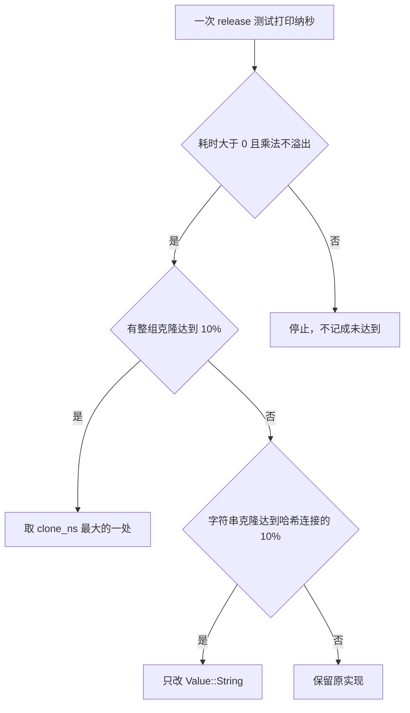

## 背景

MS53 要先测量复制、分配和行锁争用，再只改被证明值得改的一处。三处的观测对象不同：复制是执行器里的整组克隆，分配器是进程的全局分配器，行锁表不在 SQL 调用链上。同一次测量给不出三个可比较的数，所以按里程碑的拆分信号分成多个变更。本次是第一个，只处理复制。

当前起点是 `f940925831e5e78f201bd27a09173cbaa2bad2bc`。它的父提交是 `8063854d3c7dfd721bb018b35eb189c585006bad`。没有其他活跃变更。

## 当前行为

`Value::String` 的负载是 `String`（`src/executor/value.rs`）。`ValueRef::Text` 是对这块字符串的借用，不是另一个拥有所有权的变体。仓内没有 `#[global_allocator]`。`Cargo.toml` 没有 `jemalloc` 或 `mimalloc`。

哈希连接的探测在 `src/executor/join.rs` 用 `right_hashmap.get` 取桶，再按下标读行。这里不克隆整个匹配桶。I020 在 2026-10-18 写的「匹配集合通过 `.cloned()` 获取」和现在的代码不一致。键列和输出列仍然按单元格克隆。

嵌套循环在 `src/executor/nested_loop_join.rs` 对每一对左右行执行 `left_row.iter().cloned().chain(right_row.iter().cloned())`，拼成拥有所有权的组合行，再交给 `predicate.evaluate(&[Value])`。谓词返回 `bool` 或错误，调用返回后不再借用这行。`ConstantPredicate` 不读行，但克隆发生在求值之前。

排序在 `src/executor/sort.rs` 的 `next` 里对 `sorted_rows[position]` 做 `clone`，然后位置加一。排序合并在 `src/executor/sort_merge_join.rs` 的 `next` 里对 `outputs[output_index]` 做 `clone`。两处都只向前交出，不回读已经交出的槽位。

`RowLockTable::get_lock` 只在 `src/transaction/row_lock.rs` 的定义和该文件的测试里出现，另有 `src/transaction/mod.rs` 的再导出。SQL 执行路径不调用它。文件锁的 `DatabaseLocked` 是另一把锁。

诊断门面有语句阶段、等待类别和 `process_memory_peak_bytes`，没有克隆次数或克隆耗时。M22 要求诊断只观察、不改变 SQL 结果。本次不新增诊断指标。

变更前没有单独跑测试。上述结论来自当前起点上的源码。测量轮会第一次跑 `tests/ms53_copy_measure.rs`。

## 目标与非目标

目标：打印规定的纳秒数，按 10% 裁定，最多改一处复制，SQL 结果不变。没有任何一处达到时，产品代码保持测量前的状态。

非目标：分配器、`RowLockTable`、`DashMap`、可见性、锁等待的对外错误、JOIN 流水处理、诊断新指标、文件格式。这些不在本变更里测量，也不在本变更里实现。

后续变更要等本变更的 Review Result 成为 `accepted` 再开。本变更若已经改了一处复制，后续变更只测量分配器和行锁并写明保留原实现。本变更若保留了全部复制实现，下一个变更才可以在自己的门槛达到时改分配器；行锁变更再看分配器变更有没有改代码。本次不创建那两个变更。

## D1 测量口径

四个执行器负载和字符串循环的形状写在 `specs/avoidable-copy/spec.md`。测试文件是 `tests/ms53_copy_measure.rs`。命令是：

`cargo test --offline --release --test ms53_copy_measure -- --test-threads=1`

只用 release。debug 断言会抬高执行器的 CPU 时间。测试只跑这一次。打印的整数不断言大于或小于 10%。

哈希桶的 `hash_bucket_clone_ns` 写 0，因为探测不克隆桶。不要对空循环取时间再把它印成一个非 0 的纳秒数。若实施时发现探测改成了克隆整桶，停止并回到计划，不要在本轮里临时改口径。

克隆循环用一次 `Instant` 包住全部重复，并用 `std::hint::black_box` 使用每次克隆的结果。耗时取 `as_nanos()`，类型是 `u128`。

不采用的做法：

- 用诊断阶段的执行耗时代替克隆耗时。执行阶段里还有扫描、谓词和哈希，不能把整段算成克隆。
- 用 `process_memory_peak_bytes`。它是进程驻留峰值，不是某一处克隆。
- 在每一行克隆上调用 `Instant`。对整数克隆，取时间本身会盖过克隆。
- 用 criterion 或外部采样器。现有基准把建表和打开数据库算进计时，采样器的符号占比也不是这条测试的打印字段。

## D2 百分之十

达到门槛是 `clone_ns * 10 >= executor_ns`。字符串克隆的分母是 `hash_executor_ns`。等于 10% 时达到。乘法用 `u128` 的 `checked_mul`。溢出，或任一执行器耗时为 0，测量无效，不记成未达到，本轮停止。

整组四处里可以有多处同时达到。只取 `clone_ns` 最大的一处。绝对值更大的克隆循环去掉的复制更多；只比各自的比例，会让一个很短的执行器胜过一段更长的克隆。`clone_ns` 相等时依次取嵌套循环、排序合并、排序、哈希桶。

有整组克隆达到时，不改 `Value::String`，即使 `string_clone_ns * 10 >= hash_executor_ns`。I020 要求先处理整组复制。两处一起改，复制的收益就分不开。

四处都未达到，字符串克隆才可以成为唯一的改动。它仍未达到时，产品代码不改。

## D3 嵌套循环达到时怎么改

组合行仍是左行各列后面接右行各列，现有谓词签名不变。不要把左右两行克隆进一个新的 `Vec<Value>`。把左行和右行里的值移进这个向量，`evaluate` 返回后再按原列数移回去。

`evaluate` 的返回值是 `Result<bool, ...>`，返回后不能再持有行的借用。若某条谓词在返回后仍借用组合行，停止，不要改谓词 trait，也不要改错误文本。

输出列的单元格克隆保持原样。那是交出结果，不是每一对组合行的整组复制。

## D4 排序或排序合并达到时怎么改

交出时用 `std::mem::take` 把槽位里的行移走，留下空的 `Vec<Value>`。位置只加一，不回读已交出的槽位。若实施时发现交出之后还有读取，停止，不要改成别的容器。

排序次序、投影和排序合并的组间乘积不改。

## D5 字符串达到时怎么改

`Value::String` 的负载从 `String` 改为 `Arc<str>`。相等、哈希、顺序和显示仍按字符串内容。`ValueRef::Text` 继续借用这段字符。其他变体不改。

磁盘元组仍按现在的字符串字节写出和读回，标签不改。仓内构造 `Value::String(...)` 的位置要改到能编译，并且不改变写入值。不新增公共构造函数，除非现有调用不改签名就无法编译；那种情况停止并回到计划，不要顺手加一套新 API。

不把 `Blob` 改成 `Arc`。那不是这次测量的对象。

## D6 不改的边界

| 方案 | 不采用的原因 |
|---|---|
| 同一次 SQL 里同时看克隆、分配器和行锁 | 三个数不能互相代表，里程碑要求拆开 |
| 本次就换 `jemalloc` 或 `mimalloc` | 复制还没裁定，分配器的差异会和克隆混在一起 |
| 把 `RowLockTable` 换成 `DashMap` | 执行路径不调用它；换不换要等它自己的测量 |
| 给诊断加克隆计数 | 已有门面够用来排除「用执行阶段耗时冒充克隆」；新指标不是前置条件 |
| 改谓词 trait，让它直接接受两个切片 | 会碰到全部谓词实现和错误文本 |

## 风险

release 下某次排空耗时仍可能为 0。按无效测量停止，不为了得到非 0 再跑一次。

嵌套循环的移动在 `evaluate` 中途 panic 时可能来不及把值移回。现有克隆路径在 panic 时同样丢掉当前行。不为此加恢复协议。

`Arc<str>` 会让仓外按 `Value::String(String)` 构造的代码无法编译。本仓库的调用要在同一次改动里改完。SQL 结果用现有值测试和连接测试核对。

## 回滚

测量轮没有产品改动。实现轮不改文件格式。退回对应文件里的克隆或 `String` 负载即可。

## 实现顺序

1. 先写 `tests/ms53_copy_measure.rs` 并在 release 下跑通。产品代码不动。
2. 用打印的整数做一次比较，把裁定写进执行记录。
3. 只有裁定点名一处时，才展开下一轮。那一轮只改点名的那一处。
4. 未达到则不再改产品代码。
