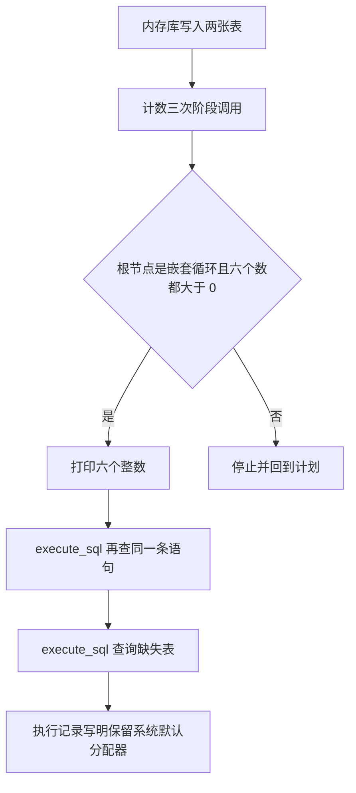

## 背景

MS53 要先测量复制、分配和行锁争用，再只改被证明值得改的一处。复制已经改过：嵌套循环组合行改为移入再移回，归档在 `openspec/changes/archive/2026-11-19-ms53-avoidable-copy/`。该设计写明，复制已经改过一处之后，后续变更只测量分配器和行锁，并写明保留原实现。

本次只测量分配器。行锁不在本变更。

当前起点是 `4ebbdfdf420b0c4eb6c59b5fef7814dc92523461`，分支 `changes/2026-11-19-ms53-system-allocator` 从这里切出。没有其他活跃变更。

## 当前行为

仓内没有 `#[global_allocator]`。`Cargo.toml` 的 dependencies 和 dev-dependencies 都没有 `jemalloc` 或 `mimalloc`。进程使用 Rust 默认的系统分配器。

`Database::execute_sql` 进入 `pipeline::execute`。计划缓存未命中时，`execute_staged` 依次调用 `parse_stage`、`plan_stage`、`execute_stage`。命中时跳过解析和计划，只调用 `execute_stage`。`plan_stage` 本身不读缓存；可缓存的 SELECT 在构建后 `plan_cache.put`。

`is_pure_equi_join_on`（`src/parser/planner/ddl_dml.rs`）只接受两侧都是列引用的等值，以及这种等值的 AND。`ON l.k > r.k` 得到 false。`src/parser/planner/query.rs` 因此构造 `PhysicalPlan::NestedLoopJoin`。两侧都是整数主键的纯等值才会改走排序合并；这条语句不走那条路径。`join_reorder_candidate` 要求 `joins.len() >= 2`，这一条 FROM 只有一个 JOIN，叶序替换不换计划。现有测试 `non_equi_on_routes_to_nested_loop_join` 对同类 ON 断言计划根节点就是 `NestedLoopJoin`。

缺表时，`register_table` 用 `format!("Table '{}' not found: {}", table_ref.flat, e)` 组成 `PlanFailure.message`。`e` 是 `StorageError::TableNotFound`，显示为 `table not found: {name}`。`object_name_parts` 把未加引号的表名收成小写。`SELECT * FROM missing` 的消息是 `Table 'missing' not found: table not found: missing`，SQLSTATE 取 `PlanError::TableNotFound` 的 `42P01`。

`DiagnosticsConfig` 的默认 `Collect` 三项都是 false，`diagnostics_collecting` 为 false。`is_profiling_enabled` 只在环境变量 `RTSQL_PROFILING` 存在时为 true。默认的 `execute` 不包语句阶段，也不包 profiling scope。

诊断门面的 `process_memory_peak_bytes` 在 Linux 上返回 `ru_maxrss * 1024`，是进程启动以来的驻留峰值。`benches/pipeline_stages_bench.rs` 用 criterion 测量三段墙钟，不计数分配请求。

`tests/ms53_allocator_measure.rs` 还不存在。

## 目标与非目标

目标：一次 release 测试打印这条非等值连接在解析、计划、执行三段上的分配请求次数和字节数，并用 `execute_sql` 核对同一行和缺失表错误。执行记录写明保留系统默认分配器。

非目标：行锁、节点锁、页 I/O、io_uring、导入攒批、再改嵌套循环的移动实现、新增诊断指标、引入 `jemalloc` 或 `mimalloc`。

## D1 测量口径

测试文件是 `tests/ms53_allocator_measure.rs`，函数是 `allocator_stage_counts_and_sql_results`。命令是：

`cargo test --offline --release --test ms53_allocator_measure -- --test-threads=1 --nocapture`

只用 release，并且只跑这一次。`--nocapture` 让通过的测试仍把 `println!` 留在命令输出里，执行记录才能抄写整数。

数据用 `Database::open_in_memory`：

- `CREATE TABLE l (k INT PRIMARY KEY, name TEXT)`
- `CREATE TABLE r (k INT PRIMARY KEY, v INT)`
- `INSERT INTO l VALUES (1, 'a')`
- `INSERT INTO l VALUES (2, 'b')`
- `INSERT INTO r VALUES (1, 10)`
- `INSERT INTO r VALUES (3, 30)`

被测语句是 `SELECT l.k, l.name, r.v FROM l JOIN r ON l.k > r.k`。四对组合里只有 `2 > 1` 成立，行是 `Int(2)`、`String("b")`、`Int(10)`。列名来自嵌套循环节点的 `output_columns`，依次是 `k`、`name`、`v`。

计数窗口先包住 `parse_stage`、`plan_stage(&db, sql, stmt, false)`、`execute_stage(&db, plan, false)`。这三次调用发生在这条 SELECT 的 `execute_sql` 之前。`plan_stage` 会写入计划缓存，随后的 `execute_sql` 走命中路径，行和列名必须与 `execute_stage` 相同。

然后 `execute_sql("SELECT * FROM missing")`，核对消息和 `42P01`。

打印行是 `name=value`，一行一个。名字是 `parse_allocs`、`parse_bytes`、`plan_allocs`、`plan_bytes`、`execute_allocs`、`execute_bytes`。类型是 `u64`。测试不断言这些数大于某个比例，也不读取它们来选择分配器。

次数或字节数为 0 的断言只检查计数器是否看见了请求。sqlparser 的解析、计划节点和这条带字符串的结果行都会向系统分配器要非零长度的内存。0 表示窗口没有包住这次调用，测量无效。

## D2 计数器

计数器实现 `std::alloc::GlobalAlloc`，四个方法都把请求转给 `std::alloc::System`：

- `alloc` 和 `alloc_zeroed` 在返回非空指针时，次数加 1，字节数加 `layout.size()`。
- `realloc` 在返回非空指针时，次数加 1，字节数加 `new_size`。
- `dealloc` 只转给 `System`，不计数。
- 空指针不计。

计数用原子整数。分配路径里不获取锁，不格式化字符串，不打印。否则计数器自己的分配会递归进入同一路径。

`#[global_allocator]` 只写在这个测试文件里。它替换的是测试进程的分配器，请求仍由系统分配器完成。库代码和 `rtsql` 二进制不增加这个属性。

窗口是阶段调用前后各读一次原子整数，用后一次减去前一次。建表和插入不在窗口里。

## D3 不采用的做法

| 方案 | 不采用的原因 |
|---|---|
| `cargo bench --bench pipeline_stages_bench` | criterion 报告墙钟。现有基准不打印分配次数和字节数，采样器的时间也不能分成这六个字段 |
| `process_memory_peak_bytes` | 它是进程驻留峰值，从进程启动起只增不减，不能分开三次调用，也不是某一次分配请求的字节数 |
| 测试里再链一个 `jemalloc` 或 `mimalloc` 做对照 | 对照需要新的依赖和另一个全局分配器。本变更的结论是保留系统分配器，数字不作为切换开关 |
| 在 `src/` 增加计数用的全局分配器 | 那会改产品代码，并让库的每次运行都经过计数器 |

## D4 保留系统分配器

上一变更已经改了嵌套循环的组合行。按该变更的设计，这一处只测量并保留原实现。本次目标同样要求写明保留系统默认分配器，不改依赖，不改产品代码。

因此不设「次数或字节数达到多少就引入新分配器」。六个整数原样进入执行记录，用来说明这条路径在系统分配器下发出了哪些请求。记录里的结论是保留系统默认分配器。

库继续没有 `#[global_allocator]`。`Cargo.toml` 不增加分配器依赖。

## D5 不改的边界

不修改 `src/executor/nested_loop_join.rs` 的移入再移回。不修改 `src/transaction/row_lock.rs`。不新增诊断阶段或计数字段。不改 SQL 结果、错误文本和 SQLSTATE。不改文件格式。

可见性或锁等待的对外错误若必须改变才能完成测量，停止并回报。

## 风险

release 下某段次数仍可能为 0。按无效测量停止，不为了得到非 0 再跑一次。

计数包含该次 `.await` 期间运行时发出的请求。不从打印值里扣掉这部分。扣减要另定窗口，本次没有这个划分。

测试进程的计数器不代表 `rtsql` 二进制已经换了分配器。产品路径仍是系统分配器。

错误文案若与 D1 写出的字符串不一致，停止。不改 `register_table` 或 `StorageError` 来迎合测试。

## 回滚

没有产品改动。删除 `tests/ms53_allocator_measure.rs` 即可去掉这次打印。

## 实现顺序

1. 先写 `tests/ms53_allocator_measure.rs`。产品代码不动。
2. 按 D1 的命令跑一次。退出码 0，六个字段都在，行和错误文本符合 D1。
3. 把六个整数的原文和「保留系统默认分配器」写入执行记录。不再改 `src/` 和 `Cargo.toml`。
