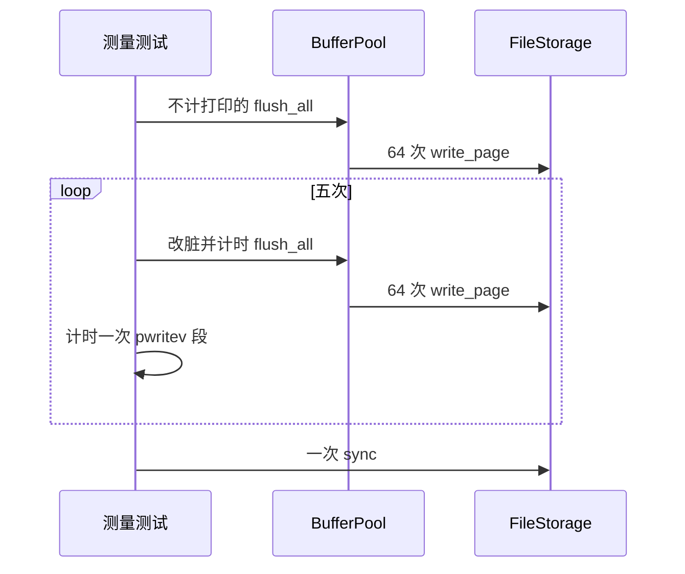
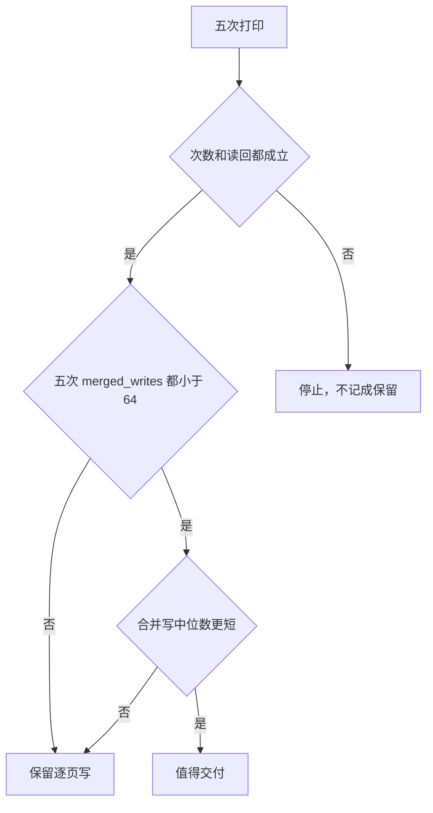

## 背景

起点是 `master` 的 `2a78e01b44b7275add1f1fe9d539a887e889e4ad`。本分支 `changes/2026-11-24-ms54-dirty-page-batch-io` 在其上增加了范围提交。没有其他活跃变更。`.agents/docs/SNAPSHOT.md` 仍写着 `04988dc`、ahead 25。本次不改 SNAPSHOT。

MS54 要求先测量连续脏页写入，值得做再交付批量写，其后才比较 io_uring。I026 里的「Checkpoint 5–10x」和 I028 里的「30–50%」都不作为采纳条件。

## 当前行为

`FileStorage::write_page`（`src/storage/file_storage.rs`）先拒绝只读，再消费 `IoFailPoint::DataWrite`。命中时在任何字节落盘前 `mark_write_failed`，并返回含 `injected io failure (write_page)` 的 `Io` 错误。未命中时一次 `spawn_blocking` 调用 `write_page_blocking`。成功则 `mark_write_succeeded`，失败则 `mark_write_failed`。

`write_page_blocking` 的偏移是 `HEADER_SIZE + page_id.to_offset(record_size)`。`HEADER_SIZE` 为 64，`Page::PAGE_SIZE` 为 4096。明文用 `write_all_at` 写 4096 字节。加密先 `encrypt_page`，再写 4124 字节的记录。`FileStorage::sync` 是另一次 `spawn_blocking` 里的 `sync_all`；只读实例直接返回。检查点不调用它。

`BufferPool::flush_all` 按 DashMap 的遍历顺序收集脏页。`claim_dirty_for_write` 在帧锁内复制页、置 `write_in_flight`、清脏位，然后放开锁。之后逐页 `await write_page`。某次失败时，从该下标到末尾的页都交还脏位，更早的成功页不再改回脏。`flush_all_except` 同样收集，只是跳过排除集。`flush_pages` 按调用方给出的顺序逐页写。`evict_one` 每次只 `write_page` 一页，失败则该页回到脏状态并留在池内。

`Catalog::flush_commit_point` 先 `flush_all_except` 提交页，再 `flush_pages` 按给定顺序写提交页。`CheckpointManager::checkpoint` 在 `flush_all` 前取样释放完成编号；成功则 `promote_free_releases`，失败则 `discard_free_releases`。下一步是 WAL `fsync`，然后写位点。数据文件没有 `sync_all`。

`Database::open` 的缓冲池容量是 100。新文件上 `allocate_page` 从页 0 递增。明文分配用 `set_len`，不经过 `write_page_blocking`。未分配的页 `read_page` 会短读失败，所以测量必须先分配。

本机规划时 `/proc/self/io` 不存在。`io_uring_disabled` 为 0，`io_uring_setup(8)` 返回了可用的文件描述符。内核是 `6.18.40.1-microsoft-standard-WSL2`。这只说明比较可以在本机尝试，不说明 io_uring 值得采用，也不把它放进第一轮。

## 目标与非目标

目标：用一次可重复的 release 测试打印连续脏页的提交次数、写次数和耗时；按中位数裁定；值得则只合并 `flush_all` 与 `flush_all_except` 的连续段；其后用同一负载比较 io_uring，默认构建仍不使用它。

非目标：索引页格式、节点锁、分配器、组提交、给数据文件加 `sync_all`、改 `evict_one` 的选页、改 `flush_pages` 的顺序、把 io_uring 放进默认 features、改 M18 的四条不变量。

## D1 测量口径

测试名 `storage::file_storage::tests::contiguous_dirty_page_write_measure`。命令：

`cargo test --offline --release --lib storage::file_storage::tests::contiguous_dirty_page_write_measure -- --test-threads=1 --nocapture`

负载和打印字段以 `specs/storage-io-optimization/spec.md` 的「连续脏页写入的测量」为准。计数是测试构建里的三个函数：`reset_page_io_counts`、`page_submit_count`、`page_write_count`、`sync_count`。提交在 `write_page` 确认要进入 `spawn_blocking` 时加一，注入失败提前返回时不加。写次数在 `write_page_blocking` 的 `write_all_at` 成功返回后加一。同步在 `sync_all` 成功返回后加一。非测试构建不编译这些语句。

合并写一侧是测试自己的 `pwritev`，不是产品代码。计时含从池中复制 64 页、一次 `spawn_blocking` 和写完这一段所需的全部 `pwritev`。逐页一侧只包住 `flush_all`。五次之前先做一次不计打印的 `flush_all`，写次数必须是 64。

不采用的做法：

| 做法 | 不采用的原因 |
|---|---|
| 读 `/proc/self/io` 的 `syscw` | 本机没有这个文件 |
| 用 strace 数 `pwrite64` | 裁定会落在测试进程外面 |
| 用 SQL 检查点的真实脏页混合做第一轮负载 | 有空洞的集合不会比页 0 到 63 这一整段更适合合并；容量 100 的池还会在装入过程中逐页驱逐 |
| 用 criterion | 现有基准把建库算进计时，不能给出这次要求的提交次数和写次数 |

## D2 裁定

五个 `baseline_ns` 和五个 `merged_ns` 各自升序，取第三个作为中位数。值得交付，当且仅当五次 `merged_writes` 都小于 64，且合并写的中位数小于逐页写的中位数。否则保留逐页写。任一次提交或写次数不是 64、耗时为 0、读回不一致，测试已经失败，不记成保留，也不记成值得交付。

不重跑。不用「5–10 倍」。`sync_ns` 只随执行记录留下，不参加比较。库运行时不读这些数字。

## D3 值得交付时的写入形状

只改三个位置：`AsyncStorage` 增加带默认实现的 `write_page_run`，`FileStorage` 覆盖它，`flush_all` 与 `flush_all_except` 在收集后按 `PageId` 升序切连续段。长度为 1 的段仍调用 `write_page`。更长的段调用 `write_page_run`。

`write_page_run` 接收已按页号升序排好的 `Vec<Page>`。页号不连续时，任何字节落盘前返回 `StorageError::Internal`，文本含 `non-contiguous page run`。只读拒绝文本与 `write_page` 相同。`DataWrite` 在 `spawn_blocking` 之前消费一次；命中时这一段每一页都 `mark_write_failed`，错误文本仍含 `injected io failure (write_page)`，不调用 `pwritev`。

未命中时，一次 `spawn_blocking` 里完成加密（若有）和 `pwritev`。明文每组 4096 字节，加密每组 4124 字节。偏移仍是第一页的 `HEADER_SIZE + page_id.to_offset(record_size)`。`pwritev` 短写则前进偏移继续调用；返回错误，或未写完就返回 0，则这一段每一页都 `mark_write_failed` 并返回错误。成功则每一页 `mark_write_succeeded`。`libc = "0.2"` 目前只在 `[dev-dependencies]`。产品代码调用 `pwritev` 时把它移到 `[dependencies]`，版本字符串不变。不新增别的依赖，不改 default features。

调用方在 `Err` 时把这一段的每一页和尚未尝试的页交还脏位，并清除这些页的 `write_in_flight`。已经成功返回的更早一段保持清洁，不进入这次的失败集合。默认实现按页 `write_page`；中途失败时，前缀页可能已经 `mark_write_succeeded`，帧脏位仍由调用方整段交还。

`flush_pages` 不排序，不调用 `write_page_run`。`evict_one` 和 `allocate_page` 不调用它。检查点不增加数据文件同步。`pipeline.rs`、`table_manager.rs`、`catalog.rs` 和 `checkpoint.rs` 继续调用原来的 `flush_all` 或 `flush_pages`，这些文件不改。

`write_page_run` 是 `async_trait` 上的默认方法，使 `Arc<dyn AsyncStorage>` 上未覆盖的实现仍按页调用 `write_page`。若编译器不能这样调用，停止并回到计划。不要改成每个实现都必须手写的方法，也不要在 `BufferPool` 里把存储向下转型成 `FileStorage`。

交付之后，测量测试改为 `#[ignore]`，理由写明打印已在 000 的执行记录里。不要为了让 `baseline_writes == 64` 继续通过而把 `flush_all` 改回逐页写。

不采用的做法：

| 做法 | 不采用的原因 |
|---|---|
| 一次 `spawn_blocking` 里仍逐页 `write_all_at` | 写次数不减少，接不住「`merged_writes` 小于 64」这条裁定 |
| 把一段拼成单个缓冲区再 `write_all_at` | 测量比的是 `pwritev`；交付换成另一种写，中位数对不上 |
| 合并 `flush_pages` 或按页号重排提交页 | `flush_commit_point` 依赖「其他页先落盘，提交页按给定顺序后写」 |
| 合并 `evict_one` | 驱逐仍是一页；M18 的选页规则不改 |
| 给检查点加上数据文件 `sync_all` | 当前耐久边界就是没有这一步；加上会改变检查点的 I/O，而不是保持它 |

## D4 对照恢复不变量

M18 的四条是：驱逐不按树序；`redo_count > 0` 时不消费磁盘索引，并从数据页重建主键索引；`redo_count == 0` 时磁盘树可信；数据页按 WAL 位置重放。本次对照的结果是这四条都保持。

`evict_one` 的时钟选择和单页 `write_page` 不动，所以「不按树序」不变。检查点仍要求 `flush_all` 成功才写位点，所以干净检查点的含义不变：成功返回时，当时取走的脏页都已写出。不洁关闭时 `redo_count > 0` 的重建门控不改。数据页的重放入口不改。

排序只发生在 `flush_all` 和 `flush_all_except` 已经取走的那一批里。MS52 已经说明，完整刷盘的写出顺序不改变检查点成功之后的一致性。失败时检查点丢弃这次释放样本，脏位按 D3 交还。目录提交点仍是两次调用，提交页不进入第一次的排序。

失败重试和释放耐久性也不改判定时点。注入失败仍在落盘前返回原错误文本。锚点页只有在失败集合里才挡住提升；一次失败的段不会把更早已经成功的段放进失败集合。

因此批量写不必改 M18，也不必改释放提升的时点。分裂信号不在这里触发。若实施时发现不把提交页并进同一次 `pwritev` 就无法完成合并，停止并回报，不继续改恢复路径。

## D5 io_uring

比较放在批量写的保留或交付已经写入执行记录之后。负载仍是页 0 到 63，五次中位数。一侧是当时的 `flush_all`。另一侧是测试里的 io_uring：`io_uring_setup` 失败就记录平台不适合并保留当时的后端；成功则提交覆盖这 64 页的写入并等到完成。页 64 和页 70 的字节条件与测量相同。只有 io_uring 中位数更短且字节一致，才记录值得采用。不用「30–50%」。

值得采用时才增加 Cargo feature `io-uring`，默认 features 不包含它。启用后，`write_page` 和 `write_page_run` 在原有的阻塞线程里提交 io_uring，等待完成后再返回。缓冲区活到完成队列返回。注入点仍在提交前消费，错误文本不变。读路径仍是 `read_exact_at`。不启用时，写入与比较前的裁定结果相同。不使用 `tokio-uring`。

不采用的做法：

| 做法 | 不采用的原因 |
|---|---|
| 在第一轮里比较 io_uring | MS54 要求先有批量写的去留 |
| 把 io_uring 放进默认 features | 分裂信号要求替换默认跨平台后端时退回范围审议 |
| 用 `tokio-uring` 换掉 `spawn_blocking` | I028 不预先锁定这个库；等待完成的阻塞线程保持现在的错误返回时点 |

## D6 验证怎么排

000 只跑测量那一条 release 命令。不跑全量。测量不改非测试写入行为，全量读不到这五行打印。

001 在值得交付时跑规格里的新测试，以及失败重试、释放、检查点和目录提交点的既有测试，每次一个 `cargo` 进程，都带 `--test-threads=1`。这一轮不跑全量。

收尾全量只跑一次，条件是非测试代码里已经有了合并写或 `io-uring` feature。只加测试计数不触发它。批量写保留且 io_uring 也保留时不跑。io_uring 记录为值得采用时，全量放在采用那一轮，比较那一轮不跑。批量写已交付而 io_uring 保留时，全量放在比较那一轮，因为它是最后一轮。

分批方式：`ls tests/*.rs | sort` 得到 N 个文件，文件批数 `B = ceil(N / 12)`，前 `B × 12 - N` 批各 11 个文件，其余各 12 个。每批 `cargo test --offline --test <文件名去掉 tests/ 和 .rs> ... -- --test-threads=1`。然后单独一批 `cargo test --offline --lib --bins -- --test-threads=1`。批间顺序执行。每一批退出码为 0，且 `^test result: ` 行里的 failed 为 0。缺一批不能算通过。

## 风险

- 五次耗时在 WSL 上会抖动。采纳看中位数，不追加第六次。
- 计数是进程内静态值。命令必须只跑这一个测试，并且 `--test-threads=1`。
- `flush_all` 改为按页号排序后，注入失败打中的第一页会变。既有测试只检查仍有脏页和错误文本。若某个测试断言了 DashMap 顺序下的特定页号，停止并回到计划。
- `pwritev` 可能短写，`merged_writes` 可以大于 1。只要五次都小于 64 且中位数更短，仍是值得交付。

## 回滚

见 `proposal.md`。无格式迁移。
