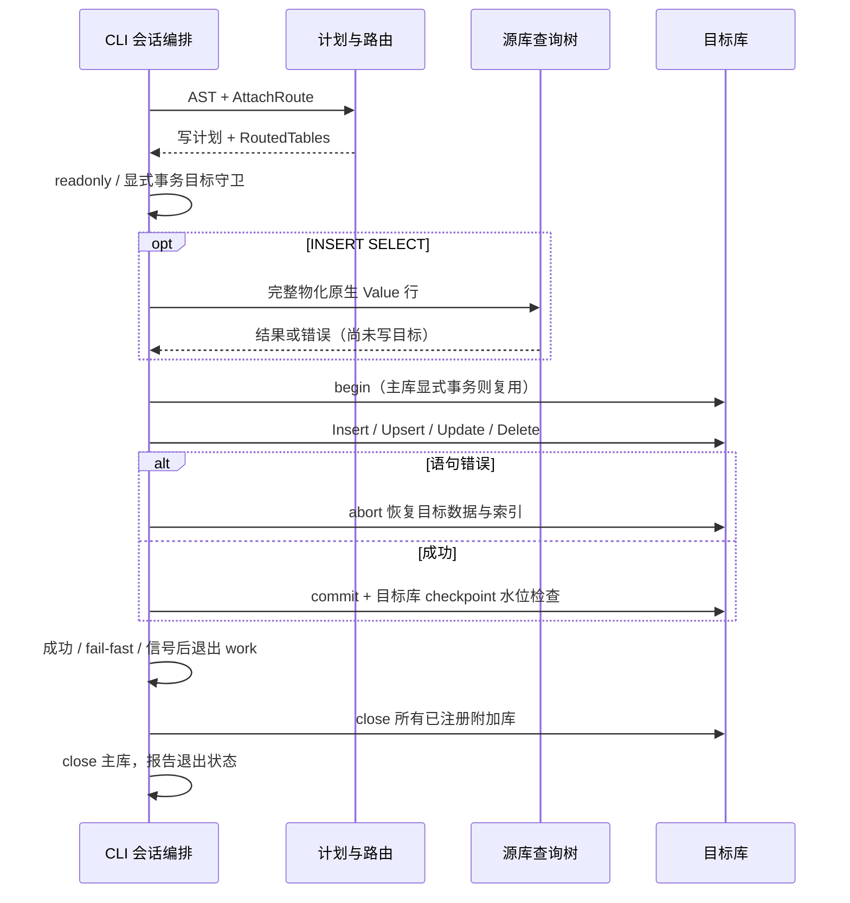

# 跨文件写入设计

## Context

需求与批准记录见 proposal.md。调查基线为 master `4e1944f` 加当前已有未提交的锁等待/导入/DEFAULT 批次；不得覆盖这些改动。只读检查来自本会话实际源码，基线验证见当前轮文件。

| 当前实现 | 事实与影响 |
|---|---|
| `src/cli/mod.rs::run_sql` | TransactionSession 只属于主库；AttachSession 存于 work future 内。正常循环尾 best-effort close 附加库，所有提前 return 和外层 select 信号取消均绕过该尾部 |
| `plan_stage_routed/register_table` | ObjectName 分段判定路由，RoutedTables 保存限定名→Database/local_name；目标 schema、PK 类型、DEFAULT、唯一列、二级索引信息已按限定名注入 |
| `ddl_dml.rs::build_insert/build_update/build_delete` | 三处拒绝附加写入。INSERT 只解析 VALUES；UPDATE 仅主键等值、单列字面量赋值；DELETE 仅主键等值，无子查询计划 |
| `execute_stage_routed` | DML begin/abort/commit 全使用参数主库；abort_tables 目前以计划表名查主库。写执行器四臂也全取主库字段；只解除 planner 拒绝会误用库与事务 |
| 写执行器 | Insert/Upsert/Update/Delete 的 WAL 表名及 record_version 取 TableMeta.name；因此需要目标库本地 metadata，不能改成限定名 |
| SELECT 路由 | 递归 create_executor_from_plan、Semi/Anti/SubqueryEval/DerivedScan 均传 RoutedTables；DataScan 使用每库自身 transaction_manager。CLI 全部 RR，statement_snapshot 返回 None；不引入跨文件快照 |
| `Database::commit/close` | commit 已 fsync 后才 maybe_auto_checkpoint，checkpoint 失败不等于提交失败。close 执行 checkpoint；只读/内存无操作 |

现行规格中的一期附加库 DML 禁止将被本变更增量规格替换。`sql-attach-session` 的锁拒绝措辞早于锁预算，现有代码与 `database-file-lock` 已采用预算；保持代码现有语义。`readonly-open-mode` 将拒绝阶段称计划期，代码实际在 execute 叶子前置守卫；本变更保持解析/规划后、源求值与写入前的拒绝边界，不为术语迁移另建层。

## Goals / Non-Goals

本设计复用现有会话注册、事务、执行器和查询树，增加必要的目标库选择及查询行映射。不得扩大 UPDATE/DELETE SQL 面、变更磁盘格式、加入依赖或多库公共会话 API。主库库参数一直保留为源查询的默认库，不能为了目标路由把整个查询树重新解释为目标库。

## Decisions

### D1：事务所有权与资源绑定到目标库

在 pipeline 的 DML 根节点使用既有 `routed_db` 取得 `(目标 Database, 本地表名)`；主库扁平名沿原路径。begin、abort_tables、abort、commit 均用目标库；abort 表键用 metadata 本地名，与 record_version/WAL 保持一致。create_executor_from_plan 的四个写节点同样经现有路由取得目标 metadata、buffer_pool、transaction_manager、table_manager、wal_buffer。主库参数不换，供随后 INSERT SELECT 源的裸名解析使用。

| 方案 | 判断 |
|---|---|
| 只移除 planner 禁止 | 事务、WAL 与 metadata 仍属主库，无法达到隔离与恢复验收 |
| 把附加目标 SQL 文本改写成裸名再执行 | 破坏 AST 解析与源裸名语义，引入 SQL 往返，拒绝 |
| 根节点选事务库 + 四个写构造臂复用已有路由 | 选择；不增加事务协调层、不改写 metadata |

仅去掉 INSERT/UPDATE/DELETE 三个 DML 构建点的 reject_attached_write；保留 attached_tables 标记、所有 DDL 与 CTAS 拒绝调用、view 拒绝。附加视图目标仍不可写；附加视图查询当前不支持的形态不扩展。

### D2：显式事务拒绝在两个 execute 叶子闭合

非显式事务执行先检查主会话及目标的 readonly，再在目标库 begin。显式事务执行优先 readonly；若写节点的目标在 RoutedTables 中，返回 `0A000`，文案点名附加目标及显式事务限制，发生于任何 executor 构造、源求值或 begin 之前。CLI 收到错误沿 rollback_session 主库路径处理。判断目标，不因 routed 非空误拒「主库目标 + 附加源」；主库显式事务仍可查询附加库。

备选「每库 BEGIN/COMMIT」需定义部分提交与多个事务状态；用户批准本期拒绝策略，故不引入该机制。

### D3：会话资源由取消边界外的编排器持有

把 AttachSession 的所有权移到 `execute_command_inner_mode` 中、阶段 2 select 外。私有 work 工厂增加对会话注册表的可变借用；主命令将其传入 run_sql；`execute_command_inner` 委托壳适配原单参数 work，lifecycle 的直接 mode 调用忽略该参数。生命周期命令无 ATTACH，原业务逻辑与公开 API 不变。run_sql 不再创建/关闭自己的注册表。

select 返回或取消 work 后，编排器遍历已注册附加实例，逐个 await close，全部尝试；保留实例到关闭完成，之后原主库 close 仍执行。不要使用异步 Drop、detach spawn、阻塞等待或复制整套 open/signal 编排。每个关闭错误报告别名/原错误；执行成功时转 exit 1，已有错误/信号保留原状态。运行顺序可沿现有注册表遍历，不新增排序协议；错误报告不能吞掉后续 close。未成功注册的在途 open 仍采用现有取消/恢复规则。

这是写入的必要后果：以前提前退出没有附加脏页，本期可写后必须关闭；不是全局清理。CLI checkpoint 水位配置在附加库打开成功后沿既有 checkpoint_bytes_from_env/设置器应用，保持每个提交库自身水位检查，不复制验证或 checkpoint 实现。

### D4：INSERT SELECT 先物化，再复用写面

新增最小 `PhysicalPlan::InsertSelect` 与节点：限定目标名、源 SELECT 子树、源宽度、目标位置映射、全宽 DEFAULT/NULL 填充以及可选既有冲突仲裁/动作。`build_insert` 改可变借用以调用已有 build_query；VALUES 分支保持原语义。目标映射与 VALUES 共享既有列清单验证，冲突语义复用 build_upsert_action；不能用虚拟数据行绕过空源时的结构验证。源以顶层查询上下文编译，完整消费其 WITH/DISTINCT，而不误用 building_subquery 抑制分支。

`extract_all_table_names` 的 INSERT 分支保留目标并补充完整 source Query 的实际源表，复用 CTE 感知提取函数；源视图沿现有主库视图注册/展开。source 查询与目标列/冲突参数全部计划期验证。新节点不进入 cache。

两个 execute 叶子先执行 D2/readonly 守卫，然后把 InsertSelect 原生 Value 源完整物化，逐行用预编译位置填成全宽目标行，归一为既有 Insert 或 Upsert 计划，再进入现有隐式或显式写执行路径。不得通过 Response JSON 重建 Value（会丢日期/数值类型），不得用循环逐行 execute_sql（会逐行提交），不得生成 SQL 值文本。实际执行时行宽不符作为错误，不截断 zip。空源生成零 values 的写计划，输出 affected_rows=0。

隐式路径在源物化成功后才 begin 目标事务；同目标源先冻结，消除边读边写重复消费。显式主库路径在物化时沿用主库 tx_id 与既有 statement_snapshot，插入复用该 tx_id，不另 commit；源各库仍按现有查询语义。通过常规写执行器统一类型/NOT NULL/唯一约束、索引、WAL 和回滚；自动 checkpoint 错误传播保留已提交数据。

补齐新枚举变体的执行根归一化、readonly、get_plan_output_columns（DML 无结果列）、plan_format（文本描述与源子树）、correlated walker（下探源）以及执行器穷尽分支。EXPLAIN 仍仅允许 SELECT，不借此扩展 DML EXPLAIN。若已有匹配通配分支无需为完整列表增加不可达分支。

| 物化方案 | 判断 |
|---|---|
| 复用 CTAS 的原生 Executor 行消费模式 | 选择；不调用 CTAS 建表/推导/清理流程，目标表已存在且有固定 schema |
| 新流式 InsertSelectExecutor | 扩大执行器状态与同表读写问题，当前没有流式 requirement |
| JSON/SQL 中转或每行 auto-commit | 类型损失/语句原子性破坏，拒绝 |

### D6：附加 FROM 项的隐式关联名（Iteration 002，R9）

`FROM t JOIN o.u` 后以 `u.tag` 引用——限定符 `u` 未注册，归一化回落扁平名 `u`，主库无此表即 `TableNotFound`（Iteration 001 Issue 候选，纯 SELECT 同面）。修复按标准 SQL 隐式关联名语义（SQLite 同型）：两段附加 FROM 项**无显式别名**时，尾段经既有 `register_table_alias` 登记为该项的关联名（`u → "o.u"`），在 FROM 基表臂与 JOIN 右臂两注册点生效；`resolve_table_qualifier` 单点归一化自然使全子句面（SELECT/ON/WHERE/GROUP BY/聚合参数/ORDER BY）可达，不新增解析通道。

| 方案 | 判断 |
|---|---|
| 尾段注册为隐式关联名（复用既有 alias 机制） | 选择；标准语义、零新通道、显式别名优先不变 |
| 解析失败时回退尝试「首段剥离」 | 引入第二解析序，歧义面不可控，拒绝 |
| 扩大 `resolve_table_qualifier` 就地匹配 | 逃避注册点，别名/表名遮蔽语义分散，拒绝 |

登记条件用 pipeline 既有附加标记（`mark_attached_table` 判定过的 flat 名）而非「含点」形状——字面含点主库表名（`"o.u"`）不得误登记。冲突语义沿用既有别名机制（同语句重复关联名后注册覆盖，与显式别名行为一致）；不改变输出表头、`OutputColumn` 真实表名或计划形状（sql-table-alias-resolution R1 既有不变量）。

### D7：redo 按 WAL logical_id 强制收敛（Iteration 002，R10）

Iteration 000 探针实证：多行语句前行已写（槽位与页内逻辑 id 已消耗）后行约束失败 → abort → 重插同键 → 崩溃（WAL 未 checkpoint）重开，`redo_tuple_at_row_id` 报 dense-assignment violation（`WAL slot_id=6 but page assigned logical_id=5`）→ `RedoFailed` → 库不可开；对照（无 abort / abort 后不重插）干净。

根因类：redo 的稠密落位校验假设「重放分配序列 == 运行期分配序列」，而重放对中止事务记录的幂等跳过/落位与运行期逻辑 id 消耗存在失配形态——一旦失配，后续记录按重放序列分配的逻辑 id 与 WAL row_id 错位，硬失败拒绝打开。安全收敛的依据是运行期不变量（本设计已核实）：页内 logical_id 由 `add_slot` 单调分配且**无任何运行期回收路径**（abort 仅原位 `mark_aborted` 中性化；DELETE 写独立墓碑槽；`gc_table` 无运行期调用者；drop_table 整页释放）——`(page, logical_id)` 唯一对应一个版本，WAL 记录受 CRC 保护。

| 方案 | 判断 |
|---|---|
| redo 按 WAL logical_id 强制落位（幂等命中跳过，未命中按记录 id 落位并推进页计数器） | 选择；对整个失配类收敛，重放结果与运行期 row_id 空间一致，索引/版本链 row_id 不错位 |
| 修运行期使「重放序列恒等于运行期序列」 | 需先穷举并封死全部 id 消耗/失配形态，且恢复正确性依赖脆弱的序列恒等，拒绝 |
| 放宽为容忍错位（重放按自然序分配、不强制 id） | 索引重建与版本链接用 WAL row_id，错位即链断裂，拒绝 |

实现：`SlottedPage::add_slot_with_logical_id`（给定 id 落位 + `next_logical_id = max(next, id+1)`）仅恢复面消费，运行期 `add_slot` 零变化；`redo_tuple_at_row_id` 删除 dense-assignment 硬失败；「重放无法落位时显式报错」（K05 语义）收窄为物理落位失败（页满/IO）。Act 先以既有 `WalReader` 固定探针 WAL 的失配记录作为诊断见证；若诊断发现违反「页内 id 唯一且不回收」不变量的运行期路径（收敛不安全形态），返回 Plan。

### D5：验证与现有测试迁移

第一期 `cross_db_query_test` 的 `attached_database_dml_rejected_at_plan_time` 改为成功路由见证；`write_rejection_leaves_both_databases_untouched` 改用仍拒绝的 DDL。只读附加写原先若断言一期通用拒绝文案，校准为 25006；不放宽行为断言。新增每用例独立 TempDir 的 `cross_db_dml_test` 与 `insert_select_test`，复用项目已有 CLI/数据库夹具形态；判断直接用 Rust 测试框架、原生 Response/退出码、SQL 查询与 WAL checkpoint 行为，无测试外判定层。

恢复测试可复用 upsert_test 的 checkpoint schema → routed DML → WAL shutdown → drop 不 close → 重开路径；该受控恢复夹具无需真实 SIGKILL、无 run-id/Hash/快照源码。信号关闭用现有私有工厂的 Notify 注入：附加提交后令 work 挂起并释放信号，断言关闭后数据、WAL 与锁。不新增产品测试开关、CLI 参数或身份字段。成功条件一次通过即采信；全量最终按 M19 目标字典序分批串行。

## Risks / Trade-offs

- 跨文件部分成功 → 文档与 S3 显式查询已提交库，禁止事后补偿或声称跨库原子。
- 所有库 tx_id 空间独立 → 目标事务/资源、本地表名一致绑定；用同名表、不同 tx 水位及恢复夹具观察误归属。
- cancellation 丢弃 work → AttachSession 必须由 select 外所有者持有，关闭测试覆盖已提交附加数据；不改变单库尚未提交时的既有保证。
- 大 SELECT 结果占用内存 → 沿项目当前物化形态，不以本期为由实现流式化或基准优化。
- 多库视图/quoted 含点名字存在现有表示边界 → 本期只覆盖已支持名字和主库视图源；遇新的必须可执行的语义冲突返回 Plan，不现场重构命名空间。
- 提交后 checkpoint 失败 → 返回原错误并保留提交；不把失败路径统一为 abort。
- 新枚举遗漏写守卫或 walker → T4/T5 编译和只读/显式事务目标测试覆盖可达面。

## Migration Plan

无磁盘格式迁移，无新依赖。先交付普通 DML 与关闭生命周期，再交付 SELECT 源及文档。升级后新增 SQL 可用；回退二进制后新增语法再次拒绝，已写数据仍为原 tuple/WAL 格式。实施不会提交已有未提交批次；最终由用户决定后续提交及收尾。
