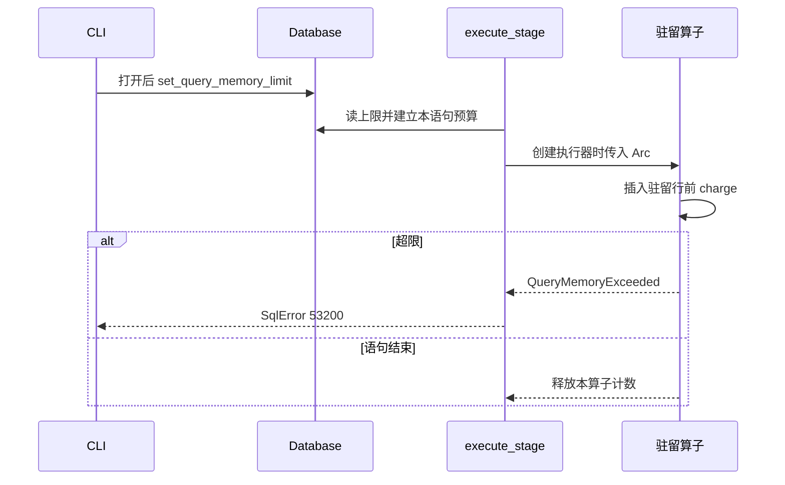

## Context

见 proposal.md 的 Why。以下是 2026-10-23 在工作区 `a0c1ed4` 读到的实现，计划按这些事实写。

`Executor`（`src/executor/executor_trait.rs`）只有 `async fn next`。`async-trait` 0.1 把每次调用装箱。33 个执行器实现该 trait，调用方持有 `Box<dyn Executor + Send>`。工厂是 `pipeline.rs::create_executor_from_plan`。

无 WHERE 的单表扫描在 `parser/planner/query.rs` 约 2354 行换成 `DataScan`。`DataScanExecutor::next` 按页按槽推进，不攒整表。`ScanExecutor::next` 第一次就把索引枚举的行放进 `results`。`execute_executor`（约 1576 行）把行放进最终 `Vec`，这份结果不计费。

`JoinExecutor::next` 先建右表哈希，再把左表全部放进 `left_rows`，输出时 `right_hashmap.get(&key).cloned()`。`NestedLoopJoinExecutor` 已经只物化右表。`SortExecutor::initialize` 收齐输入再 `sort_unstable_by`。`Limit` 在计划树最外层；`scan_cap` 只写进直接包住的 `DataScan`。`LIMIT 0` 时 `LimitExecutor::next` 不拉输入。

`SortNode` 的构造点：`query.rs` 约 1144 行（集合运算尾）和约 2979 行（普通 SELECT），以及 `plan_format.rs` 的测试。`DISTINCT` 的计划是 `Limit(Distinct(… Sort …))`，Limit 的直接孩子不是 Sort。

公共错误从 `StorageError` 转成 `SqlError`。`execute_executor` 给执行错误加前缀 `Execution error: `，`sqlstate` 现为 `None`。派生表在 `create_executor_from_plan` 的 `DerivedScan` 臂里先把子查询行收进 `Vec`。`materialize_insert_select_source` 在目标 `begin` 之前收齐源行。

CLI 在 `execute_command` 开头用 `checkpoint_bytes_from_env` 做打开前校验；打开成功后在两处调用 `Database::set_checkpoint_bytes_threshold`。

## Goals / Non-Goals

**Goals:**

- 默认 `next_batch` 与 `next` 同序；DataScan 批量实现只在 10% 时间门通过后进入生产抽取。
- 哈希 JOIN 左表逐行探测，匹配桶不整桶克隆。
- 直接受 `LIMIT` 约束的排序只保留 `offset + limit` 行。
- 按 spec 的字节口径做每语句上限，默认 0。

**Non-Goals:**

- 见 proposal 的「不做」。`EXPLAIN` 不渲染新的排序界。嵌套循环 JOIN 的组合行克隆不动。

## Decisions

### D1 默认批量方法，生产改写单独过时间门

`Executor` 增加默认方法：

```rust
async fn next_batch(&mut self, max: usize) -> Result<Vec<ExecResult>>
```

`max == 0` 返回空 `Vec` 且不调用 `next`。否则循环 `next` 直到满或结束。`async-trait` 0.1 的默认方法若不能编译，停止并回到计划，不改成每个执行器手写转发。

测量与去留：

1. 只落地默认方法后，在 `benches/data_scan_bench.rs` 增加对 10000 行 `DataScan` 调用 `next_batch(256)` 的基准，保存 criterion 基线 `before-ms32-batch`。此时批量方法内部仍是逐行 `next`。
2. 再让 `DataScanExecutor::next_batch` 在同一次调用里按现有页循环收集最多 256 行，且不经 `self.next`。`Filter`、`Projection`、`Limit`、`Having` 的 `next_batch` 改拉 `input.next_batch`。`execute_executor`、排序初始化、JOIN 两侧抽取、Distinct、集合运算、聚合、半/反连接、子查询、派生表物化、`INSERT SELECT` 与 `CTAS` 的收齐循环改为 `next_batch(256)`。
3. 同一基准对比基线。批量平均时间至少低 10% 才保留第 2 步。否则撤回第 2 步，默认方法保留。两个平均时间写入 Act Response。不新增分配计数器。

备选：无论快慢都改生产路径。未采用，因为用户要求先测量，I081 也要求不预设收益。

### D2 哈希 JOIN 的状态机

`BuildRight` 保持，右行和哈希键进入 `right_hashmap`。删除把左表推入 `left_rows` 的阶段。输出阶段每次持有当前左行，用键查桶，按下标取当前右行，只在 `build_output_row` 里克隆输出单元格。NULL 键跳过该左行。

`execute_sql` 遇到后续错误时仍走现有 `Err` 路径，不把已取出的行当作成功结果。执行器的 `next` 可以在左表耗尽前返回匹配行。这是与「先扫完左表再输出」的差别，公共入口的全有或全无不变。

JOIN 的 SELECT 列表不能放表达式（`query.rs` 约 1916 与 1948 行，计划期拒绝）。本轮的错误见证放在 JOIN 之上的 WHERE：`Filter` 逐行求值谓词，溢出消息是 `Predicate evaluation error: Integer overflow in abs(...)`。它守的是公共入口，不证明左表已经逐行。

备选：左表也建哈希并选较小一侧。未采用。代价选择属于 I016，本变更不改构建侧。

### D3 Top-N 的计划形态

`SortNode` 增加 `bounded: Option<usize>`，`None` 表示全量排序。只在两处包装 Limit 时赋值：输入是 `Sort`，或输入是恰好一层 `Projection` 且其输入是 `Sort`。值是 `offset.saturating_add(limit)`。`limit == 0` 不读输入，不靠这个字段。`plan_format` 不打印 `bounded`，既有 EXPLAIN 文本不变。`plan_format.rs` 里的测试构造补上 `bounded: None`。

有界排序用现有 `compare_rows` / `compare_values`（含 NULL 在末尾和表达式键）。保留 `offset + limit` 行后再按同一比较排序输出，并跳过 offset。相等键的次序不新增决胜规则。若既有测试因次序失败，停止并回到计划。

`Limit(Distinct(…))` 和聚合、集合运算不设置 `bounded`。集合运算尾部的 `Limit(Sort(SetOp))` 可以设置：集合运算本身仍全量物化，排序缓冲变成有界。

备选：在执行器里探测孩子是不是 Sort。未采用。计划期的形状是唯一事实，避免执行期再猜一层包装。

### D4 每语句预算对象

`Database` 增加 `query_memory_limit: AtomicU64`，默认 0。`set_query_memory_limit(bytes)` 只影响之后开始的语句。

每次 `execute_stage` 及其显式事务、预编译入口读取该值，构造一个语句内共享的预算，传入 `create_executor_from_plan` 的新增参数，子查询重建沿用同一个 `Arc`。上限为 0 时 `charge` 直接成功，不改计数。

```rust
fn value_bytes(value: &Value) -> u64 {
    match value {
        Value::String(text) => 16 + text.len() as u64,
        _ => 16,
    }
}
```

行字节是各值之和。驻留集合在插入时计费，集合丢弃时按相同字节释放。哈希键、`HashSet` 中的行副本单独计费。最终 `execute_executor` 的结果 `Vec` 不计。`INSERT SELECT` / `CTAS` / `DerivedScan` 的源行 `Vec` 要计，并在函数返回前释放。

超限返回新的 `StorageError::QueryMemoryExceeded { limit }`。公共消息固定为 `Execution error: query memory limit exceeded (limit {limit} bytes)`，`sqlstate` 为 `Some("53200")`。现有其他错误的文案和 `sqlstate` 不改。`execute_sql`、`execute_in_tx`、`PreparedStatement::execute` 三条公共路径都要落到这个消息。派生表在建执行器时超限，也走同一消息，不能因为现在的 `e.to_string()` 而丢掉前缀或 SQLSTATE。

CLI：在 `checkpoint_bytes_from_env` 同一提前返回处解析 `RTSQL_QUERY_MEMORY_BYTES`；非法则 `ExitStatus::Usage`。打开成功后，与 `set_checkpoint_bytes_threshold` 相同的两处调用设置器。不新增 flag。`:memory:` 和只读打开只要经过这两处，就同样生效。



备选：进程级一个计数，跨语句累加。未采用。并发语句会互相挤占，也和「下一条语句重新累计」冲突。

### D5 计费落点

上限大于 0 时，这些驻留点调用 charge / release：

- `ScanExecutor.results`（Iteration 003 Review 裁定改为**不计费**：spec R3「直接全表扫描不因结果大小被拒绝」与 R5「小右表加大左表」——JOIN 左腿即 Scan 物化——两场景共同唯一确定；顶层扫描的 results 即最终结果行，R3 豁免）
- `JoinExecutor` 的右行和哈希键；左行只作为当前探测行，不计
- `NestedLoopJoinExecutor.right_rows`
- `SemiJoin` / `AntiJoin` 的右表哈希和相关缓存
- `SortExecutor` 收齐的行，或有界堆里的行
- `DistinctExecutor` 的输出行和去重集合中的副本
- `SetOperationExecutor` 两侧及去重集合
- `AggregateExecutor` 拥有的 `Value`（分组键、状态里的值）；纯数值累加器不计
- `SubqueryEval` / `ScalarSubqueryFilter` 收齐并缓存的行
- `DerivedScan`、`INSERT SELECT`、`CTAS` 的源行缓冲

`DataScan`、`IndexScan`、`IndexScanAll` 若只持有当前行，不加整表计费。

## Risks / Trade-offs

- [10% 门因机器噪声误判] → 同一次 criterion 配置（`--sample-size 10 --measurement-time 2`）对比命名基线；数字写入 Act Response。误撤回只损失加速，不改变结果。
- [相等排序键的输出次序变化] → 不写决胜规则。既有测试失败则回到计划，不在实现里临时加序号。
- [计费漏一点就会让「应当失败」的语句成功] → spec 用派生表、右表 JOIN、无界排序、`DISTINCT` 四条形状锁住落点；漏计会让对应测试失败。
- [公共错误漏改一条转换臂] → 直接执行、建执行器期间（派生表）、`INSERT SELECT` 三条都断言同一消息和 `53200`。

## Migration Plan

无文件格式和数据迁移。默认上限 0，旧调用不必修改。

回滚批量生产路径：时间门失败时撤回 D1 第 2 步。回滚上限行为：不调用设置器即与变更前一致。已设置的上限只存在于进程内，重启后回到 0，除非环境变量再次传入。

## Open Questions

无。相等键次序已经规定为不保证；测试若因此失败，处理方式是回到计划，不是实现期再选。
