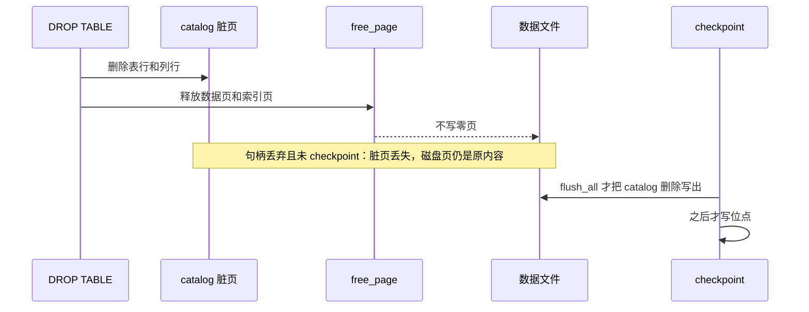

## 背景

`Catalog::delete_table`（`src/storage/catalog.rs`）只把 `__tables` 和 `__columns` 的删除留在缓冲池脏页里，不调用 `flush_commit_point`。`Catalog::remove_secondary_index` 同样只更新脏页。`FileStorage::free_page`（`src/storage/file_storage.rs`）在把页号放进内存 `free_pages` 之后，立刻 `write_page` 一张全零页。`BufferPool::free_page` 先从池里摘掉该页，再调用存储的 `free_page`。

`DROP TABLE`（`TableManager::drop_table`）的顺序是：catalog 删除、摘掉内存表项、再对索引页、溢出页和数据页调用 `free_page`。`DROP INDEX` 先 `remove_secondary_index`，再 `free_page`。`DROP VIEW` 只调用 `delete_table`，不释放数据页。

现有崩溃助手（`tests/ddl_crash_recovery_test.rs` 的 `crash`）是 WAL shutdown 后 drop 句柄，不 `close`。脏页因此丢失，已经 `write_page` 的零页还在文件里。下一次打开会看到 catalog 仍登记该表或索引，页内容已是零。这就是本轮要补上的缺口。

`ALTER TABLE DROP COLUMN`（`TableManager::alter_drop_column`）在写行 WAL 之前已经 `flush_all`。成功返回意味着 catalog 新列数已经写出，行重写在已提交的 WAL 里。本轮只为这条路径加崩溃测试，不调整它的刷盘位置。

加密库的 `CREATE TABLE` 走 `insert_table` → `flush_commit_point`。页写入经 `PageCipher`。`.wal` 与 `.checkpoint` 仍是明文（`FileStorage` 注释与 `tests/encryption_test.rs`）。没有加密库的 DDL 崩溃测试。

checkpoint（`CheckpointManager::checkpoint`）先 `flush_all`，再 fsync WAL，然后写位点。位点写失败发生在脏页已经写出之后。现有注入方式是把 `.checkpoint` 路径换成目录（`tests/insert_select_test.rs`）。数据文件没有「下一次写入失败」的开关。`allocate_page` 从 `free_pages` 取出页号时不写零页；新扩展的加密页才会写加密零页，因为首次读可能先于首次写。

全量测试的最近记录是 MS32 收尾的 2144/0/2（`.agents/docs/SNAPSHOT.md`）。本次没有重跑。工作区在 `acfd274`，`master` 比 `origin/master` 超前 8；`.agents/docs/tasks.md` 与 `.agents/memory/improvements.md` 已有未提交修改，本变更不改这两个文件。

## 目标行为

见 `specs/drop-persistence-boundary/spec.md`。实现上对应两条决定。

D1. `free_page` 只把页号推入内存空闲列表，不写盘。`allocate_page` 在弹出空闲页号时，先用现有 `write_page` 写一张全零页，成功后再把页号交给调用者。加密库走现有加密零页路径。写零失败时页号回到空闲列表，分配返回错误，不把未清零的页交给调用者。checkpoint 的九步、WAL 记录和位点格式不改。

D2. 测试失败开关是 `Database` 持有的一个共享单元，传入 `FileStorage` 和 `WalWriter`。开关按失败点类型设置：数据文件 `write_page` 或 WAL `fsync`，只让该类型的下一次调用在系统写入之前失败，然后自行清除；数据文件 `sync` 无生产调用点，不设开关位。未设置时这些函数的字节行为不变。半页写入不实现。

（2026-10-24 Iteration 001 规划修正：原文本把「WAL sync 失败」归入「回到 DROP 前状态」一类，与 checkpoint 九步事实矛盾——`flush_all` 是第 2 步、WAL fsync 是第 3 步（`src/wal/checkpoint.rs:191-197`），fsync 失败时脏页已写完、DROP 已生效。开关面同时移除无调用点的数据文件 `sync`。规格 delta 对应场景已同步修正。）

## 崩溃与失败的顺序

位点文件换成目录时，`flush_all` 已经返回，所以重新打开应当看到 DROP 已生效。写入开关若在 `flush_all` 的第一次 `write_page` 之前失败，catalog 删除还没到磁盘，重新打开应当看到 DROP 前的行。WAL fsync（第 3 步）同样发生在 `flush_all` 之后，其失败与位点失败同类：DROP 已生效，只是位点未推进、WAL 未截断。

## 备选

| 方案 | 结果 | 不选的原因 |
|---|---|---|
| D1：释放时不写零，下次分配时写零 | checkpoint 前崩溃仍能读到原行；同会话新分配读到空页 | 采用 |
| 语句返回前按 CREATE 的 commit point 冲刷 catalog 删除 | DROP 在返回时就永久生效 | 与现有规格「DROP 保持 checkpoint 边界」冲突，也超出用户确认的范围 |
| 释放时不再写零，分配时也不写零 | 实现更短 | `allocate_page` 的空闲页可能被先读后写，会看见旧行 |
| 让 checkpoint 把 catalog 删除和清零合成一次原子刷盘 | 可以覆盖半页写入 | 要改刷盘顺序或页格式。按停止条件不做 |
| 用文件系统配额制造磁盘满 | 更接近操作系统错误 | 当前环境没有不需 root 的配额装置 |

## 依赖与停止条件

Iteration 000 先改 D1 并钉住崩溃矩阵。Iteration 001 再加 D2 和位点失败。001 依赖 000：若释放时仍会写零，写入失败的恢复结果会和清零混在一起。

出现下面任一情况就停止，不改产品代码去迁就：

- 要改 checkpoint 九步的顺序、WAL 帧或位点字节布局。
- 要加密 `.wal` 或 `.checkpoint`。
- 只有写出半页再返回错误，才能让某条 I/O 场景失败。
- `ALTER TABLE DROP COLUMN` 的崩溃测试达不到规格，且修复要移动现有 `flush_all`。

## 验证

行为由 `cargo test --test drop_persistence_test` 直接观察打开、查询和 `check_integrity`。同会话再分配也在这个测试文件里。每个 Iteration 结束按 M19 分批跑一次全量：`--lib --bins` 一批，`tests/*.rs` 按文件名字典序每 10 个一批，每批 `--test-threads=1`。真实断电不跑。
