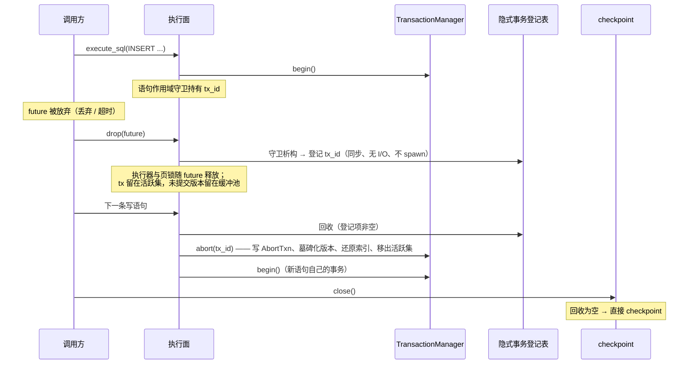

## 背景

`src/pipeline.rs` 的 DML 臂（`execute_stage_routed`，559-631 行）是库入口的隐式事务边界：`TransactionManager::begin()` 之后，语句要么在执行器返回错误时走 `abort`，要么走 `Database::commit`。**没有第三条路径**。语句 future 被调用方放弃时，559 行开的事务既不提交也不中止：`tx` 是局部变量，`Transaction` 只是 id + snapshot 的持有者（`src/transaction/manager.rs:24-37`），析构不做任何事。

放弃之后的三处状态：

1. `active_tx_ids` 里留着这条事务（`src/transaction/manager.rs:57-64`）。`Database::maybe_auto_checkpoint` 的 R3 顺延判定（`src/database.rs:526-535`）因此永远为真，自动 checkpoint 被无限顺延，WAL 不再被截断。
2. 缓冲池里留着这条事务的未提交版本和索引条目。它们对读者不可见（`commit_tx_id` 为空），但 `InsertExecutor` 的重复键预检只查索引是否存在、不查可见性（`src/executor/insert.rs:177-187`），所以同一个键再次插入会拿到 `DuplicateKey`。
3. WAL 里有 `BeginTxn` 和写记录、没有 `CommitTxn`/`AbortTxn`。下一次 checkpoint 会把未提交页写盘并截断 WAL（`src/wal/checkpoint.rs:190-213`），此后恢复期再也看不到这条事务的证据。

CTAS 路径（`src/pipeline.rs:971-1043`）有同形第二处隐式事务。

库入口之外，CLI 的信号停机（`src/cli/mod.rs:698-729`）在 `select!` 里放弃 work future 后调用 `db.close()`。既有 CLI 注释（`src/cli/mod.rs:607-609`）写的是「执行阶段取消只丢弃未提交 DML（恢复期 uncommitted 清理）」——按当前代码这句只在「进程被杀、WAL 未被截断」时成立：优雅关闭路径会先 checkpoint，checkpoint 会把未提交页写盘再截断 WAL。

`RowLockTable`（`src/transaction/row_lock.rs`）定义了行级写锁，但没有任何执行器使用它（全仓只有定义与自身单测）。真正在语句取消时可能被持有的锁是缓冲池的页锁（`BufferPool::with_page_data`，页锁只在闭包内持有，闭包不是 async，语句 future 不可能在闭包执行中被取消）与文件锁（进程级，不受语句影响）。

## 目标行为

见 `specs/statement-cancellation-outcome/spec.md`。实现上对应六条决定。

D1. **取消触发集合 = 语句 future 被放弃。** 丢弃、`tokio::time::timeout` 到期，在库入口是同一个事件：语句的 future 不再被驱动。客户端连接在结果送达前断开**不是**取消触发来源：连接处理器顺序执行（`src/network/connection.rs:18-35`：先 `await` 完语句再写响应），语句执行期间没有观察 socket 存活状态的点，断开只表现为结果未送达——语句照常执行完毕并提交，按 D3 的「提交已完成但调用方未收到结果」处理。本轮不新增取消或 deadline 公共 API：`Executor` 接口（`src/executor/executor_trait.rs:9-14`）不携带取消上下文，把取消上下文贯穿执行器树是一次接口变更加全量执行器改造，属于「完整取消系统」，命中 MS34 的拆分信号。

D2. **库属隐式事务登记表 + 延迟回收。** `Database` 持有一张「已被放弃的库属隐式事务」登记表（tx id 集合）。

**库属隐式事务的完整清单**（三处，2026-10-24 Plan Review 独立核对全仓 `transaction_manager.begin()` 后补记）：DML 臂（`src/pipeline.rs:569`）、CTAS 路径（`src/pipeline.rs:1002`）、ALTER TABLE DROP COLUMN 臂（`src/executor/alter_table.rs:95`）。三处同型：库自己 `begin`、自己 `commit`/`abort`，调用方不持有事务句柄。`Database::begin()` 与 `TransactionSession::begin` 是**调用方持有**的显式事务，正确地不登记、不回收。最初只枚举了前两处——第三处由 Act 在实现时按 requirement 的通用表述补入，Plan Review 裁定为 Plan 遗漏、Act 实施正确（不纳入反而留下一个真实的悬空事务泄漏口）。

**登记表的语义（2026-10-24 Plan Review 修正）**：登记项表示「其语句 future 已被放弃」的事务，而不是「库自己开的事务」。语句被放弃时登记项出现，库在三个自有同步点回收它：目标库下一次隐式写语句开始之前、`Database::checkpoint()` 之前（覆盖 `close()`、显式 checkpoint 命令与自动 checkpoint）、`Database::maybe_auto_checkpoint()` 的活跃集判定之前（否则被放弃的事务会让顺延判定永远为真）。回收走既有中止路径：写 `AbortTxn`、墓碑化未提交版本、还原索引条目、移出活跃集、清版本条目。

修正的原因：`Database` 是 `Clone` 且内部全是 `Arc`，`src/network/server.rs:46-58` 把每个连接 spawn 成独立任务、共享同一个 `Arc<Database>`——同一句柄上的并发语句是服务器端的常态。若登记项在 `begin()` 之后填入，回收按「是否仍在活跃集」判定，那么「被放弃的事务」与「仍在并发执行的事务」在该判据下完全同形，回收会把后者一并中止——未取消的语句被改变行为，违反 requirement「取消触发集合是语句 future 被放弃」的「SHALL NOT 因此改变未被取消的语句的行为」。因此登记时机必须落在「语句被放弃」这个事实上，而不是「事务被开出来」这个事实上。

回收点选在这三处而不是 `Drop` 里的 `spawn`，原因是 `TransactionManager::abort` 全程 async（`src/transaction/manager.rs:158-184`：WAL 追加、页写、索引还原、活跃集 RwLock 都是 await 点），`Drop` 里无法等待；`spawn` 出来的回收与调用方的下一条语句之间没有顺序保证，调用方会观察到「索引条目还在」的窗口。放在库自有同步点，回收在下一条写语句真正开始之前完成，调用方看到的顺序是确定的。「记录被放弃这一事实」与「执行回收」是两件事：前者可以是同步的（只往集合里插一个 tx id，无 I/O、不 spawn 任务），后者仍在三个库自有同步点按既有顺序保证发生。

**索引条目还原的边界（2026-10-24 Plan Review 修正）**：上面「回收走既有中止路径：…还原索引条目…」描述的是中止路径的既有语义，不是在取消场景下的无条件保证。取消若落在索引写入中途（`IndexManager::insert` 的 B 树条目写入与其后的反向映射写入之间的 await 点），该次写入可能只落下正向条目而未落下反向映射，中止路径按反向映射分桶时识别不出它——被取消语句的**行**不可见（墓碑化成立），但它的**键**仍占用主键索引（再插同键报 `DuplicateKey`）。该缺口对被取消语句的**首个键之外**的键成立（首个键的索引写入已完成），因此 Iteration 000 的「同键可再插」验收面限于首个键。键的释放不属本 change 的验收面（已从规格 delta 收窄并标注为已知边界），作为 Issue 候选 E2 由存储域的后续 change 承担。

D3. **三种结果的约定。** 提交前被取消 → 未提交（回收把它回滚）；提交已完成但调用方未收到结果 → 已提交（调用方靠重新读取判断，不靠「没有错误」推断）；显式事务 → 库不决定，继续还是回滚由调用方收尾时选择。

D4. **超时不代替回滚。** 超时是对语句的放弃。库在任何取消路径上都不代替调用方提交或回滚显式事务；调用方想要回滚效果就显式调用 `Database::rollback`。

D5. **后台 I/O 收尾结论。** WAL writer、WAL buffer、缓冲池是会话级对象（`src/database.rs:111-117`，`open_internal` 构造），语句取消不拆它们、不改变它们的生命周期；`src/executor/data_scan.rs:177-187` 的预取任务只读、自终止，随 future 丢弃后最多多活一次页读取，不写盘；`spawn_blocking` 里的写（`src/wal/writer.rs`、`src/storage/btree/index_manager.rs`）不可取消，会在语句被放弃后完成——这由 WAL 语义兜住：没有提交帧的事务在恢复期被标记为中止（`src/wal/recovery.rs:1420-1499`）。本轮不新增后台收尾逻辑。

D6. **回收的失败语义。** 回收按 `tx_versions` 解析受影响表（与 `Database::rollback` 同源，`src/database.rs:564-586`）。表已不存在（被放弃之后被 DROP）时，先把该事务在这些表上的版本条目从管理器里摘掉，再中止其余部分——表本身的数据与索引已经随 DROP 释放，没有可还原的东西，摘条目让中止能够进行到底。中止本身失败（I/O 错误）时，回收返回错误并保留登记项，由下一个触发点重试；触发方（下一次写语句 / checkpoint）收到点名错误。

## 取消与收尾的顺序

## 备选

| 方案 | 结果 | 不选的原因 |
|---|---|---|
| D1：把取消上下文贯穿 `Executor` 树，新增 deadline 公共 API | 语句能在执行中途协作式停下 | 改 `Executor` 接口加全部执行器改造，命中 MS34「升级为完整诊断系统」的拆分信号；本轮的约定靠 future 放弃即可成立 |
| D2-备选：在 `Drop` 里 `spawn` 回收任务 | 代码少 | 回收与调用方下一条语句无顺序保证：调用方可能先撞上未还原的索引条目（`DuplicateKey`），「句柄可继续使用」不可靠 |
| D2-备选：在 `Drop` 里只记「被放弃」这一事实（同步插一个 tx id，不 spawn 回收） | 回收时点仍在库自有同步点，顺序保证不变；登记表语义精确到「被放弃」 | **不排除——2026-10-24 Plan Review 采用**（D2 拒绝的是在 `Drop` 里 spawn 回收任务，不是禁止在 `Drop` 里记录放弃事实；同步插入无 I/O、无 await、不阻塞，不引入新的顺序问题） |
| D2-备选：只在 `close()` 回收 | 实现最少 | 放弃之后到 close 之间，悬空事务一直阻塞自动 checkpoint，且同键再插持续报 `DuplicateKey` |
| D2-备选：放弃时直接提交未完成的工作 | 不会出现悬空事务 | 与「提交前中断不提交」的约定相反，调用方无法区分「提交了」与「没提交」 |
| D3-备选：库在取消时自动回滚显式事务 | 调用方不用管 | 取消的是语句，不是事务；自动回滚会撤销调用方在同事务里的其他工作 |
| D5-备选：给语句加可取消的后台任务并统一 join | 收尾更彻底 | 会话级 WAL/缓冲池本就不随语句生死；`spawn_blocking` 写不可取消，改成可取消要改 WAL 写入路径，超出范围 |
| 用 `tokio::time::timeout` 在库内实现超时 API | 调用方有原生超时 | 同样是新增公共 API；库内超时的唯一增量是错误文案，约定内容与调用方自己包 `timeout` 完全一致 |

## 依赖与停止条件

Iteration 000 先做 D2 的回收机制与场景 1/2 的观察；Iteration 001 再钉住场景 3/4/5/6 的调用方可见约定并做收尾全量回归。001 依赖 000：场景 3/4/5 都要在同一会话里先制造一次放弃，回收机制决定了这些场景的现场是确定的。

出现下面任一情况就停止，不改产品代码去迁就：

- 要让回收在不等待的情况下完成（即中止路径必须改成同步）——那意味着改写 WAL 追加与页写路径。
- 要新增取消或 deadline 公共 API 才能让任一场景成立——那是完整取消系统，留在 I096。
- 要改 WAL 记录格式、checkpoint 九步顺序或页格式才能让未提交页不落盘。
- 场景 3 的「提交已完成但未送达」窗口无法在库入口稳定复现——回到 Plan 重新设计该场景的判定，不得用哈希、指纹、run-id 之类身份机制替代行为观察。

## 验证

行为由 `cargo test --test statement_cancellation_test` 直接从库入口观察：活跃事务集合、语句可见性、同键再插入（限被放弃语句的首个键，见 D2 的边界注记）、`close` 后重开。全量回归按 M19 分批串行：整个 change 一次，作为收尾验证放在最后一个 Iteration（Iteration 001）——`--lib --bins` 一批，`tests/*.rs` 按文件名字典序每 8-12 个一批，每批一次独立的 `cargo test --test <f1> ... -- --test-threads=1` 调用，批间顺序执行、同一时刻只有一批在跑；全量结论等价于「全部批次各自 0 failed」，并记录各批 passed/failed 计数做覆盖对账（配方见 `.agents/runbooks/m19-batched-full-regression.md`，R48）。真实断电不跑。
