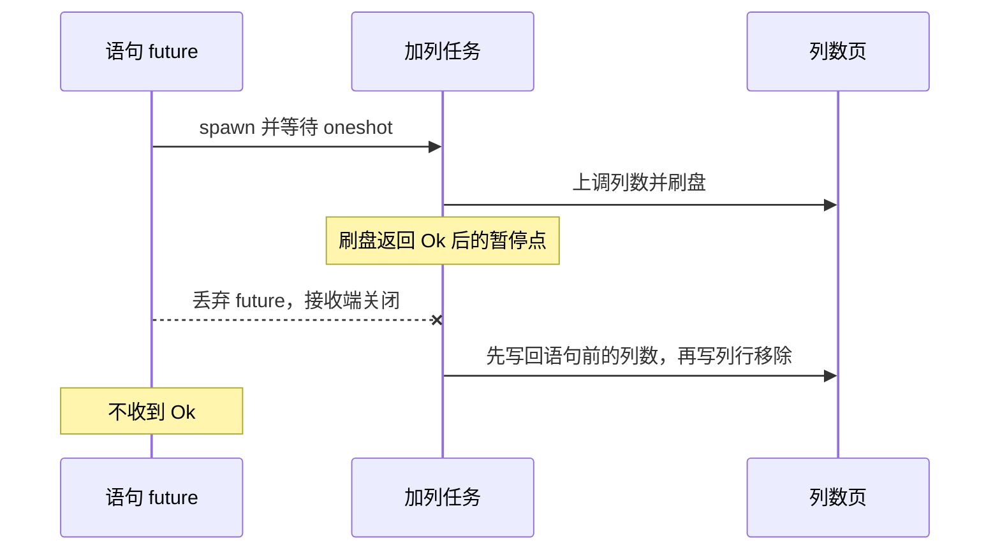
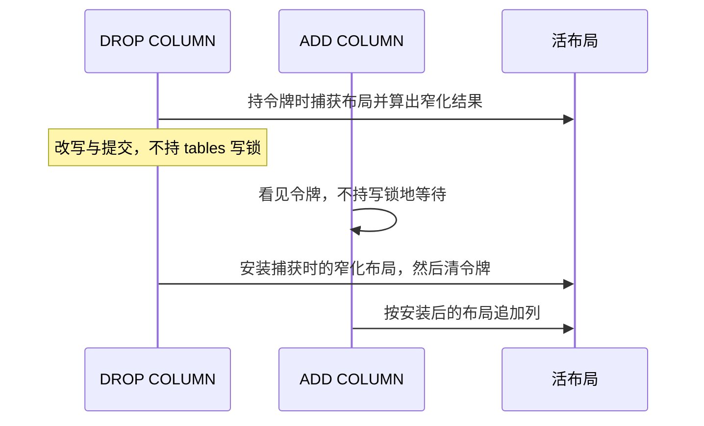

# Design: ADD COLUMN 目录面

## Context

见 `proposal.md`。调查以工作区当前源码为准（HEAD `e9cb9d3`，工作区有未提交产品改动）。Issue 正文里的行号是登记时的 Cycle 记录，不作为当前事实。

当前事实：

- `TableManager::alter_add_column`（`src/storage/data/table_manager.rs`）全程持有 `self.tables` 的写锁。列行写入失败或 `Catalog::update_table_column_count_ddl` 返回错误时调用 `compensate_column_add`。成功则换入新的 `TableMeta`。没有 `Drop` 补偿。
- `compensate_column_add` 先 `restore_table_column_count_no_flush`，再 `remove_column_row_at`。不刷盘。
- `update_table_column_count_ddl` 改缓冲池里的 `column_count`，再 `flush_commit_point`：先 `flush_all_except` 提交页，再 `flush_pages` 写提交页。`FileStorage::write_page` 用 `spawn_blocking`。调用方 future 在这次 `await` 上被丢弃时，阻塞写可以继续落盘，`compensate_column_add` 不会运行。
- `alter_drop_column` 在改写期间不持 `tables` 写锁。`publish_column_narrowing` 在改写列行和下调列数之后，`get_table` 取当前活布局，再 `narrowed_meta`。`alter_drop_column` 在取得令牌时已经算过一份 `new_meta`，但 `PendingColumnDrop` 没有把它交到发布入口。
- 恢复期 `src/wal/recovery.rs` 在重放之前调用 `publish_column_narrowing`。打开时的活布局来自 `open_or_init`，按目录 `column_count` 截断列行。
- 读路径在 `NarrowingState::published` 为真时 `ensure_readable` 点名拒绝。`tables` 是 `tokio::sync::RwLock`：写锁独占，读锁共享。同一任务持有读锁再要写锁会死锁。
- `ADD COLUMN` 的唯一生产调用者是 `AlterTableExecutor`。该臂没有隐式事务守卫。删列臂在提交之后、`apply_column_drop` 之前调用 `pause_at_ddl_commit_window`。

## Goals / Non-Goals

**Goals:**

- ISS40 与 ISS39 的可观察结果按 delta spec 落地。
- 失败路径补偿继续不刷盘。成功加列继续跨 `close` 持久。
- 在途读拒绝、同表第二条删列的立即拒绝、恢复期发布、删列的 WAL 意图记录保持。

**Non-Goals:**

- Join、SMJ、Hash 构建侧、ISS36。
- 其他目录面行为：删列的数据面改写、检查点对未发布意图的处理、`rewrite_column_rows_drop` 的非幂等性、`write_page` / `flush_pages` 对其他调用方的取消语义。
- 磁盘格式、公共 API、新的错误类型。
- 为还不存在的缺陷预建 Iteration。

实施过程中新登记的实质缺陷留在 MS40，不新建里程碑。与本变更故障域相同的，由后续 Iteration 承载；不属于本变更故障域的，仍留在 MS40。发现它们的那个 Cycle 不扩范围去修尚未纳入该 Iteration 的缺陷。本条不修改 `.agents/memory/project-model.md` 的 M20。

## Decisions

### D1. 列数刷盘的放弃由拥有该次尝试的任务收尾

`AlterTableExecutor` 的 `ADD COLUMN` 臂把 `alter_add_column` 放进 `tokio::spawn` 的任务。语句 future 只等待 oneshot 交回的 `Result`。语句 future 被丢弃时接收端关闭，任务继续跑完，不被这个丢弃取消。

`update_table_column_count_ddl` 返回之后、决定是否换入活布局之前，任务看接收端是否已关闭：

| 刷盘结果 | 接收端 | 动作 |
|---|---|---|
| `Ok` | 未关闭 | 换入活布局，交回 `Ok`。此后再丢弃 future，语句已提交 |
| `Err` | 未关闭 | 现有 `compensate_column_add`（不刷盘），交回原始错误 |
| `Ok` | 已关闭 | 不换入活布局。内存中恢复列数并移除本次列行，然后先把恢复后的列数页写盘，再写列行页 |
| `Err` | 已关闭 | 现有 `compensate_column_add`（不刷盘） |

写锁在任务内取得，直到上表的动作结束才释放。语句 future 被丢弃不会提前放开这把锁。

选择理由：丢弃 future 会丢掉 `write_page` 里的 `JoinHandle`，阻塞写仍可能落盘，错误分支上的补偿不会跑。把尝试放到不会随语句 future 一起丢弃的任务里，刷盘结果和「调用方是否还在等」可以一起看。oneshot 的关闭状态在调用方已经丢弃之后为真，避免用 `Drop` 里的标志和任务采样赛跑。

不用的办法：

- 只在 `Err` 上补偿。这是当前缺陷。
- 放弃路径也调用不刷盘的补偿。列数页已经写成功时，崩溃会重新打开到上调后的列数。
- 改 `write_page`，让所有调用方的取消都等待阻塞写结束。影响面超出本变更。

回退刷盘顺序与提交点相反。提交点是列行先于列数页。回退先写恢复后的列数页：中途崩溃时磁盘列数已是语句前的值，多出来的列行被 `open_or_init` 按列数截掉。不得用 `flush_commit_point` 做这次回退，它把提交页放在最后。

`__tables` 与 `__columns` 是两条链，列数页和列行页不是同一页。列数页是 `update_field_in_chain` 返回的那一页，列行页是 `delete_from_chain` 返回的已修改页。`remove_column_row_at` 现在丢掉这份页号列表，回退路径要留下。不写死 `TABLES_PAGE_ID` 或 `COLUMNS_PAGE_ID`。

这次回退在同一次 `Catalog.lock` 里做完内存恢复和两次 `flush_pages`。锁在两次写都返回之后才放开。`scan_tables` 与 `scan_columns` 用的是这把锁，所以测试里的 `catalog_shape` 要到刷盘返回之后才能看见恢复后的列数。锁顺序与今天的 `alter_add_column` 相同：先持有 `tables` 写锁，再取 `Catalog.lock`。不把 `compensate_column_add` 补一次刷盘当成这条路径；那条路径仍是两次分开加锁、自己不刷盘。

回退的 `flush_pages` 返回错误时，不换入活布局，不交回 `Ok`，不重试，也不再调用不刷盘的补偿。调用方已经不在，没有新的错误接收者。检查时接收端仍开着，就换入并发送 `Ok`。发送随后失败，不再回退：语句已经提交，沿用「提交已完成但调用方未收到结果时语句已提交」。

暂停点放在刷盘返回 `Ok` 之后、关闭检查之前，只在 `ADD COLUMN` 这条路径上。默认不生效，按库路径一次消费，不携带 hash、指纹、revision、run-id 或时间证明。未布防时该调用立即返回。删列对 `update_table_column_count_ddl` 的调用不经过这个暂停点。

### D2. 发布安装取得令牌时的窄化布局，加列在令牌期间等待

正常路径（`apply_column_drop`）安装的活布局，是 `alter_drop_column` 在 `try_acquire` 成功时已经算好的那份 `narrowed_meta` 结果。发布当时不再 `get_table` 后重算。这份布局随 `PendingColumnDrop` 交到发布入口。交给发布的是改写结束时那同一个 `Arc`：`data_page_tail` 已在 `alter_drop_column` 返回前同步过，列清单仍是取得令牌时算出的那份。目录列数已经等于目标列数时，保持现在的幂等返回，不替换活布局。

恢复期 `publish_column_narrowing` 仍从打开时载入的布局推导。那里没有同进程的 `ADD COLUMN`。

同表 `ADD COLUMN` 在令牌持有或在途窄化已发布时不得开始目录写入。等待条件是 `NarrowingState` 的 `owner != 0` 或 `published` 为真。只读判断，不把令牌值交给加列，也不用 `try_acquire` 探测：`release` 会走 `clear_narrowing`，把 `published` 清掉。等待时不得持有 `tables` 写锁，否则发布末端的写锁与等待互相堵住。等到令牌清除后重新读取活布局，在写锁下再查一次令牌；仍被持有则放开写锁继续等。令牌清除发生在捕获布局已经安装之后。

同表第二条 `DROP COLUMN` 仍在 `try_acquire` 失败时立即拒绝，不改成等这把锁。另一张表的 `ADD COLUMN` 不看这张表的令牌。

读路径继续只看 `published`。删列不在整段改写上持有 `tables` 写锁，读者仍能 `get_table` 并得到拒绝。

不用的办法：

- 加列也走令牌并被拒绝。既有场景禁止。
- 只改发布数据源，仍允许加列在窗口内把列数刷上去。发布再把列数写回窄化后的值，已经返回成功的加列会丢掉新列。
- 删列从取得令牌到发布一直持有 `tables` 读锁，靠写锁把加列挡住。发布末端同一任务还要写锁，`tokio` 的 `RwLock` 不能升级，会死锁。读锁放开到写锁拿到之间，加列仍能插进来。

### D3. 两个 Iteration 的顺序

先做 D1，再做 D2。D2 的等待必须包住 D1 的任务：等待发生在任务取得写锁并写入目录之前，写锁下的复查在任务内、目录写入之前。D2 不改变 D1 的四行决策表。

全量回归只在最后一个 Iteration 跑一次。方式见 `tasks.md`。缺一批即未通过。规划阶段不跑全量。

## Risks / Trade-offs

- 放弃发生在刷盘返回 `Ok` 之后、关闭检查之前时，列数会先落盘再被写回。这是 ISS40 要消掉的窗口，测试用暂停点把它固定住。处理结束前崩溃，仍可能看见上调后的列数。验收看的是处理结束之后的崩溃重开。
- 回退两次刷盘之间崩溃：列数已回到语句前，列行可能还在。`open_or_init` 按列数截断后，`SELECT` 看不见新列。直接扫描 `__columns` 的读法不截断，仍可能看见该列行。验收等待两次回退刷盘都返回，不把这个中间崩溃当作通过条件。
- D1 的任务在刷盘和回退期间持有该表的 `tables` 写锁。这与今天 `alter_add_column` 在函数存活期间持有写锁相同。语句 future 丢弃之后，锁延续到回退结束，读者会多等这一段，而不是立刻看见上调后的列数。
- 新增测试各自使用独立 `TempDir`，不依赖用例顺序、并发度或批次边界。

## Migration Plan

无磁盘格式变化，无在线迁移。回滚产品改动后，已有库文件仍按现有打开路径读取。

## Open Questions

无。交错结果已由既有规格闭合，见 `proposal.md` 的场景草图。
