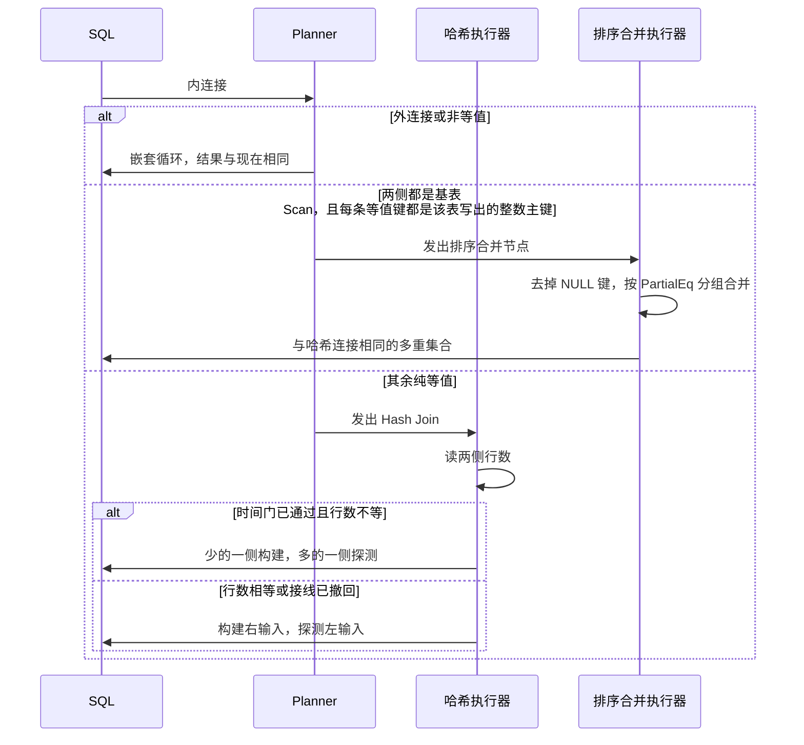

## Context

见 proposal.md 的 Why。调查以工作区当前代码为准。提交基线是 e9cb9d3，工作区有未提交产品改动（`.agents/docs/SNAPSHOT.md` 的「仓库现场」）。目录和索引代码不在本变更里；那些未提交改动只作为测量时两侧共同的底，不能混进「只差构建侧接线」的对比。加列变更正在改产品代码，本设计不把它的行为算进需求。

当前计划期规则在 `src/parser/planner/query.rs` 的 `build_from_clause_with_projection`：`OuterJoinKind::None` 且 `is_pure_equi_join_on` 为真时构造 `PhysicalPlan::Join`，否则构造 `PhysicalPlan::NestedLoopJoin`。`is_pure_equi_join_on`（`src/parser/planner/ddl_dml.rs`）只接受 AND 连接的列=列等值。外连接三态都走嵌套循环，右外连接在计划期交换输入后按左外连接执行。

`JoinExecutor`（`src/executor/join.rs`）固定先读完右输入建成哈希表，再按左输入逐行探测。键含 NULL 则该行不匹配。输出列按 `output_sides` 从左右行取值。没有表级行数、不同值个数或选择率可供计划期读取。

基表臂在这一步装配成 `PhysicalPlan::Scan`。无 WHERE 时把顶层 `Scan` 换成 `DataScan` 的改写不走进连接的子节点，所以两表连接的两侧仍是 `Scan`。`ScanExecutor` 对有整数键的表调用 `IndexManager::scan_all`。`Value::to_key` 只为 `Int` 生成大端字节。`Key::cmp` 比较固定 32 字节字典序。CTE、视图和派生表包在 `DerivedScan` 里，并按空主键登记。组合主键在 `extract_primary_key` 被 `MultiplePrimaryKey` 拒绝，目录里的主键是单列。

`compare_values`（`src/executor/sort.rs`）对不兼容类型和 NaN 会返回 `Equal`，而 `Value` 的派生 `PartialEq` 不会把它们当成相等。哈希表用的是后者。

`PhysicalPlan` 增加变体后，下列位置的 `Join` 与 `NestedLoopJoin` 臂必须同时补上新臂，否则不能编译，或会漏掉与哈希连接相同的列、类型和拒绝行为：

- `pipeline.rs`：`plan_type_slots`、`collect_scan_tables`、`create_executor_from_plan`、`collect_join_key_pairs`、`extract_column_indices`、`plan_output_names`（该函数对 `Join` 落入 `_ => None`，新节点保持同一回落即可）
- `parser/planner/query.rs`：`get_plan_output_columns`、结果表名 `"join_result"`、别名改路由、表达式项拒绝的两处、`join_combined_columns`
- `executor/plan_format.rs` 的下探与 `describe`
- `executor/correlated.rs` 的 `inject_correlated_values`
- `parser/planner/subquery.rs` 的 `get_subquery_first_column`：新节点与 `Join` 一样返回 `InSubqueryJoinUnsupported`（文案 `IN subquery with JOIN is not supported`）。落进末尾 `_` 会误报多列。

## Goals / Non-Goals

**Goals:**

- 排序合并连接在被执行时与哈希连接多重集合相同。
- 两侧都是基表扫描且每个连接键都是该表写出的整数 `PRIMARY KEY` 时，计划发出排序合并节点。隐式首列整数键仍发出哈希节点。其余纯等值仍发出哈希节点。
- 哈希连接在时间门通过后按输入行数选择构建侧；不通过则生产路径仍构建右输入。
- `Float(-0.0)` 与 `Float(0.0)` 在哈希连接和排序合并中都命中，与 `PartialEq` 一致。输出单元格保留输入的原始值。
- 全量回归只做一次，放在最后一个 Iteration，命令符合 M19。

**Non-Goals:**

- 完整代价模型、统计信息和连接重排（I016 剩余部分）。
- 结果流式化（I065）。
- ISS39、ISS40、ISS36 和其他 DDL 缺陷。
- 改嵌套循环、半连接、反连接的算法。
- 改主键编码或扫描顺序。
- 用 `ORDER BY` 是否覆盖连接键来选择算法，或因此去掉 Sort。
- 改 `Value::Hash`、`ValueRef::Hash`，或因此改变聚合、半连接、反连接和相关缓存对负零的分桶。
- 改浮点 NaN 的排序比较。Iteration 000 已接受的实现保持不变。
- 为还不存在的缺陷预建 Iteration。

ISS41 已登记，由计划期选择之后、较小构建侧之前的 Iteration 承载。当前 Iteration 不扩范围修它。其后新登记的实质缺陷：与连接执行器、哈希构建侧或本变更选择规则同一故障域的，由后续 Iteration 承载。其他故障域仍留在 MS40，不新建里程碑。

## Decisions

### D1 排序合并执行器自己排序，再按组合并

执行器读完两侧，丢掉键中含 NULL 的行，按连接键排序后合并。相等组做乘积。相等使用 `Value` 的 `PartialEq`。哈希连接要和这个相等一致；`Float(-0.0)` 与 `Float(0.0)` 的归一直到 D6 才补上，在那之前 `to_bits()` 与 `PartialEq` 不一致。排序比较先看类型标记，同类型再用与 `compare_values` 一致的同类型次序；只有 `PartialEq` 成立才算同一组。不把 `compare_values` 对异类型或 NaN 的 `Equal` 当成命中。

驻留行通过现有 `QueryBudget::charge` 入账，规则与 `SortExecutor` 收集输入时相同：保留到语句结束的行按 `row_bytes` 入账。因 NULL 键丢掉、不保留的行不入账。输出列复用 `JoinExecutor` 的 `output_sides` 取法。计划节点携带与 `JoinNode` 相同的左右输入、等值条件和输出列。

未采用「只合并已经有序的输入」。`scan_all` 的整数键序是 `i64::to_be_bytes` 的字典序，非负整数上与有符号升序一致，负数排在全部非负数之后。执行器自己排序后，多重集合不依赖这个差别。组内顺序不稳定，规格只要求多重集合。

### D2 较小侧指行数，在执行器内比较

没有目录行数。引入统计信息属于 I016 的完整代价模型，不在本变更。构建侧按两侧已经读出的行数比较：少的一侧进入哈希表，多的一侧逐行探测。行数相等时保持现在的右构建、左探测，使现有等行数用例的行序不变。

子执行器是一次性的 `next()`。`ScanExecutor` 在第一次 `next` 时已经把可见行放进自己的缓冲。哈希执行器为了比较行数，会把两侧行都取出再选择。这比现在多保留一侧。时间门衡量的就是这笔代价是否换回至少 10% 的平均时间。

行数按读出的 `ExecResult::Row` 计数，含 NULL 键行。NULL 键行不进入哈希表，也不留在探测侧缓冲里，不计费。构建侧的非 NULL 键行仍经 `charge_bucket_insert` 入账。探测侧的非 NULL 键行是驻留副本，每行再按 `row_bytes` 入账一次，并且在产出第一行之前入账。上限为 0 时 `charge` 仍短路。输出行仍按原来的左右行和 `output_sides` 组装，不把构建侧和探测侧对调进输出。

因此接线保留后，`tests/query_memory_test.rs` 的 `small_right_large_left_join_succeeds_under_small_limit` 不再成功。该用例右表 1 行、左表 20 行、上限 64 字节。右表更小，仍构建右表，但左表 20 行作为探测侧驻留，20×32 字节已经超过 64。断言改为期望错误含 `query memory limit exceeded (limit 64 bytes)`。接线撤回后，这条测试继续期望成功，左表不整表驻留。不改 16 字节的计费口径。行数相等时行序仍是左探测，但接线保留后左输入同样已经驻留并计费。

未采用不同值个数或选择率。I016 把它们写成是否值得做完整代价模型的评估项，里程碑正文要的是「较小侧」。

### D3 时间门的工作负载和撤回范围

现有 `benches/scale_bench.rs` 的 `scale_join` 对 customers 和 orders 各插入 `n` 行，语句是 `orders.customer_id = customers.id`。两侧行数相等，D2 的规则不会换边。它也不是本变更要改走排序合并的语句。

新增一项，语句固定为：

```sql
SELECT * FROM customers INNER JOIN orders ON orders.customer_id = customers.id
```

表形与 `benches/common/mod.rs` 的 `create_join_tables` 相同：`customers(id INT PRIMARY KEY, name STRING)`，`orders(id INT PRIMARY KEY, customer_id INT, amount INT)`。左表 1000 行，右表 100000 行，`customer_id` 覆盖左表的 `id`。`customer_id` 不是 orders 的主键，D5 不把它改成排序合并。语句经 `execute_sql`。

在接上 D2 之前保存基线 `before-ms40-build-side`，此时仍构建右输入。接线后用同一基准 ID 对比。criterion 参数放在 `--` 之后：`--sample-size 10 --measurement-time 2 --noplot`。通过条件是对比运行打印的平均时间 ≤ 基线平均时间的 90%。两个平均时间写入 Act Response。`target/criterion` 可重跑，不抄进变更目录。

未通过时撤回 D2 的生产接线，以及只为「行数不等时行序改变」写的测试。D1 的执行器和 D5 的选择留下。基线与对比之间不得再改其他产品代码；工作区里已有的未提交改动两侧都在，不单独归因。

### D4 新计划臂与哈希连接对齐

新变体的列名、类型槽、关联参数注入、限定键和 `IN` 子查询拒绝与 `Join` 臂相同。`EXPLAIN` 在计划里真有该节点时出现 `SortMergeJoin` 和等值条件。没有被 D5 选中的语句保持现有 `Join [Inner]` 或 `NestedLoopJoin` 文本。

### D5 写出的整数主键走排序合并

用户先选定「已声明的整数主键」，随后收窄：只有写出 `PRIMARY KEY` 的整数主键才走排序合并。隐式首列整数键仍走哈希。依据仍是 `scan_all` 对整数主键给出升序。`orders.customer_id = customers.id` 这种非主键列不满足，仍走哈希。字符串主键不在此结果里。外连接和非等值仍走嵌套循环。其余纯等值仍走哈希。不改成 `ORDER BY` 与连接键一致才走排序合并。

`primary_keys` 不能做这个区分。`extract_primary_key` 在 SQL 没有 `PRIMARY KEY` 时返回 `None`，`CreateTableNode.primary_key` 就是这个 `Option`。`CreateTableExecutor` 在 `None` 时仍把第一列写入 `pk_column`。`register_table_schema` 再把该列名和 `Int` 类型放进 `PlanBuilder`。查询计划读不到当时的 `Option`。

因此增加 `explicit_primary_key: bool`。`CreateTableExecutor` 把 `node.primary_key.is_some()` 传给 `create_table_with_constraints` 的最后一个参数。CTAS、`create_table` 和其余现有调用传 `false`。该位写入 `TableMeta` 和 `CatalogRow`。序列化在 kind 段之后追加一个 `u8`，View 的 SQL 写完再追加；`1` 为真，`0` 为假，缺字节读为假。`open_or_init` 把它抄回 `TableMeta`。`register_table_schema` 仅在该位为真时调用 `set_explicit_primary_key`，表名进入 `PlanBuilder.explicit_primary_keys`。`register_table` 的签名不变。重新组装 `TableMeta` 的路径从旧值复制该位，避免加列或换索引之后丢掉。

判定放在 `build_from_clause_with_projection` 里已经确认为纯等值内连接的那一臂。五条同时成立才构造排序合并节点，否则仍构造 `PhysicalPlan::Join`：

1. 左子计划和右子计划都是 `PhysicalPlan::Scan`。上一层连接、`DerivedScan`（CTE、视图、派生表）、`Filter`、`DataScan`、`IndexScan` 都不算基表扫描。
2. 每一条条件的左列都是左扫描表的主键，右列都是右扫描表的主键。列名与 `PlanBuilder.primary_keys` 中该表的列名相等。限定列的 `ColumnRef.table` 已是归一后的真实表键，必须等于该侧 `ScanNode.table_name`。裸名列的 `table` 为 `None`，按已经归位的左右侧检查。主键登记为空字符串则不成立。
3. 两侧表在 `PlanBuilder.primary_key_types` 里都是 `Some(crate::storage::page_format::ColumnType::Int)`。未注册（`None`）不成立。字符串是 `String(u16)`。`pk_type_known_non_int` 在类型未注册时返回假，不能用它的否定充当本条件。`convert_data_type` 把整数别名收成 `Int`，写出 `PRIMARY KEY` 的这些声明都算整数主键。
4. 条件列表非空。多一条非主键等值腿时，这一步整步仍走哈希。
5. 左右扫描表都在 `explicit_primary_keys` 里。只写出一侧时，整步仍走哈希。隐式首列满足第 2 条和第 3 条，不满足第 5 条。

隐式首列继续写入 `pk_column`。索引、唯一性和冲突仲裁不改。`create_table_sql` 仍对每个整数 `pk_column` 渲染 `PRIMARY KEY`；dump 再 restore 之后，恢复语句里的关键字会使该位变成真。本设计不改那条渲染。缺尾字节的旧行读为假，连接保持哈希。

`ORDER BY` 和 `WHERE` 包在连接节点之外。它们不改变上面的判定，也不删除连接之上的 `Sort`。自连接的两个 `Scan` 表名相同、主键相同，条件成立时走排序合并。三表链的第二步左输入已是连接节点，不走排序合并。

未采用「本层 `ORDER BY` 与连接键一致才走排序合并，并去掉 Sort」。用户明确不选那一条。

### D6 哈希连接键把负零收成正零

`Value` 派生 `PartialEq`，所以 `Float(-0.0) == Float(0.0)`。`src/executor/value.rs` 的 `Hash` 对浮点调用 `to_bits()`。`-0.0` 的位模式是 `0x8000_0000_0000_0000`，`0.0` 是 `0`。`Eq` 是空实现，比较仍走派生的 `PartialEq`。

`JoinExecutor` 的 `right_hashmap` 类型是 `HashMap<Vec<Value>, Vec<Vec<Value>>>`。`build_hash_key_right` 把右行键插入这个表，`build_hash_key_left` 的结果交给 `HashMap::get`。两个键的哈希不同时，查找不会进入对方的桶。`SortMergeJoinExecutor::compare_floats` 对两个非 NaN 浮点使用 `partial_cmp`，`-0.0` 与 `0.0` 得到 `Equal`；`merge_product` 还要求键向量 `==`。这对键在排序合并里会乘积。

修复只改这两处交出的键：键向量里每个 `Value::Float`，若 `f == 0.0`，换成 `Value::Float(0.0)`。`f == 0.0` 对两个零为真，对 NaN 为假。插入表中的行和输出行仍是输入行，不改写单元格。`compare_floats`、`compare_join_value` 和 `sort.rs` 的 `compare_values` 不改。`Value::Hash` 与 `ValueRef::Hash` 不改。

未采用修改 `Value::Hash`。`aggregate.rs` 的分组、`semi_join.rs` 和 `anti_join.rs` 的哈希表都以 `Vec<Value>` 为键。改 `Hash` 会让这些路径把两个零收成同一键。本变更不改那些算法。

负零漏匹配还没有用这对键跑过。承载它的 Iteration 的先行测试必须在修改前观察到哈希连接缺这行、排序合并有这行。`HashMap` 使用 `RandomState`。两个不同哈希的 7 位标签若碰巧相同，查找可能因为 `Eq` 为真而命中。先行测试在修改前若一次就通过，停止并返回计划，不把这次通过当成缺陷不存在。

### D7 旧库升级断言对齐已写出的尾字节

`serialize_catalog_row` 在 kind 字节之后固定再写一个 `u8`。`update_table_tail` 先 `deserialize_catalog_row` 再 `serialize_catalog_row`。缺字节的旧行读成 `explicit_primary_key == false`，重写时该字节为 `0`。唯一根计数、二级索引计数都为 0 且表类型为 Table 时，当前代尾段是 10 字节，不是此前测试锁定的 9 字节。

`tests/legacy_compat_test.rs` 只有两处把升级后的长度写成 `g1_tables_row_len + 9`：`legacy_db_write_upgrades_touched_table_row_to_current_layout` 期望 40、实际 41；`legacy_g2_db_opens_queries_and_writes` 期望 41、实际 42。紧随其后的尾段字面量仍是 `00×8 01`，少了末尾的 `0`。全库没有第三条这样的长度断言。未被写到的表仍按 G1 或 G2 长度断言，那些断言不改。

因此改这两条测试的长度和尾段字面量，不改序列化。去掉这 1 字节会撤销已经接受的尾字节。`legacy_row_without_explicit_primary_key_byte_reads_false` 继续要求缺字节读成假；`catalog_row_explicit_primary_key_roundtrip` 继续要求写出的 `1` 能读回。

## Risks / Trade-offs

- [右表更大时先把两侧都取出，探测次数从左表行数变成右表行数] → 用 D3 的 1000 对 100000 测量。达不到 10% 就撤回接线，结果回到现在的构建右输入。
- [接线保留后，小右表加大左表的 64 字节用例从成功变为超限] → 这是探测侧驻留的计费。不把上限调高来保住成功。时间门不过则撤回，该用例保持成功。
- [工作区未提交改动进入基准] → 基线和对比使用同一工作区，中间只加入或撤回 D2 接线。
- [异类型比较被当成相等] → D1 规定命中用 `PartialEq`，不用 `compare_values` 的兜底 `Equal`。
- [负零与正零哈希不同] → D6 只归一哈希连接的键，不改 `Value::Hash`，也不改 NaN 排序。
- [负数主键的扫描序不是有符号升序] → 不因此收窄 D5，也不因此让执行器跳过自己的排序。规格不要求无 `ORDER BY` 的行序。
- [新枚举漏臂，编译失败或 `IN` 子查询报错变了] → 任务列出已定位的匹配点；编译失败就补臂，不改这些语句的现有结果。
- [既有测试把写出整数主键的等值连接断言成以 `Join` 开头] → `tests/explain_test.rs` 的 `explain_compound_nodes` 两侧都写出了 `PRIMARY KEY`。断言保持 `SortMergeJoin`，并保留其上的 `Sort`。没有写出 `PRIMARY KEY` 的 `equi_on_keeps_hash_join_shape`，以及 `r.rid` 没有写出的 `outer_join_routes_to_nested_loop_join`，保持哈希。
- [旧目录行无法分辨当年有没有写出关键字] → 缺尾字节读为假，连接保持哈希。新的 `CREATE TABLE ... PRIMARY KEY` 写入真。
- [升级测试仍按 9 字节尾段收尾] → 断言改为 10 字节，末字节为 0。不从 `serialize_catalog_row` 去掉该字节。

## Migration Plan

无数据迁移，无 SQL 语法变化。目录表行在 kind 段之后多一个显式主键字节；旧行缺该字节时读为未写出，不重写旧文件。时间门未过时按 D3 撤回哈希接线。若整变更放弃，删除排序合并节点、执行器和对应测试，计划臂恢复为只有 `Join` 与 `NestedLoopJoin`，并去掉这个尾字节的读写。


