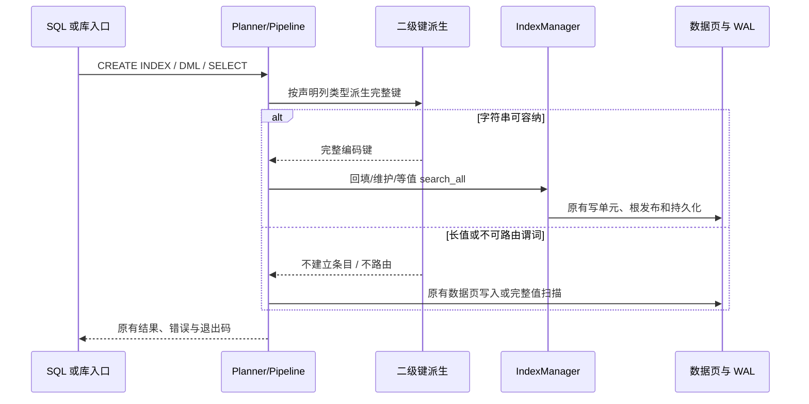

# 索引键评估及字符串索引设计

## 状态与适用范围

2026-10-27，用户已确认 proposal 的范围假设和场景，Gate 1 通过；随后回复「批准」，首轮详细计划审计通过。Iteration 000 已执行并 accepted。生产布局按本次执行 goal 关闭为 fixed32。001 的执行依据在 `iterations/001-fixed32-string-index-lifecycle/000-initial.md`，Review Result 为 accepted。002 的执行依据在 `iterations/002-sql-declaration-and-equality/000-initial.md`，Review Result 为 accepted。003 的执行依据在 `iterations/003-fault-boundary-and-closeout/000-initial.md`，Plan Context 为 ready。

## 已调查的当前实现

| 入口或状态 | 当前事实与影响 |
|---|---|
| `src/storage/page_format/key.rs::Key` | `[u8;32]` 加 `len:u8`；序列化写满 32 字节；Eq/Ord 比较完整填零数组；反序列化按最后一个非零字节推断长度。裸 UTF-8 直接装入会混同空串与零字节尾缀，超过 32 字节还会 assert。 |
| `src/executor/value.rs::Value::to_key` | 仅 Int 走 `i64::to_be_bytes()`，String/NULL/其他类型返回 None。该入口同时被 PK、唯一索引与二级索引消费，不得全局开放 String。当前整数物理字节顺序跨负数/非负数不等于 SQL 有符号数值顺序；本变更不顺带重写旧整数索引。 |
| `src/storage/btree/node.rs` | Leaf 固定 `32+RowId::SIZE=38` 字节，Internal 固定 `32+4=36` 字节；多处插入、拆分、合并和重建复制固定格式。 |
| `src/storage/integrity.rs::check_tree_page` | 与树读写共用页级校验入口，分别按 38/36 字节检查条目；读取、释放与完整性扫描处置不同。不能只替换 Key 而不更新消费端。 |
| `src/storage/page_format/slotted_page.rs` | 页头 16 字节、槽 6 字节、页 4096 字节；支持变长槽、压实、有界读与结构化 PageFull。评估复用这些原语，不另造页缓存或测试数据库。 |
| `src/parser/planner/ddl_dml.rs::build_create_index` | 单列/非唯一等修饰守卫之后检查声明类型，仅 ColumnType::Int 放行。`convert_data_type` 把 TEXT、VARCHAR、CHAR、CLOB 等归为 ColumnType::String，其他未知类型已有 String 回退；不新增类型系统。 |
| `src/parser/planner/query.rs::extract_secondary_index_equality` | 仅裸列与字面量的 Eq，正反两种位置；参数位不路由，AND/OR/限定列不扩展；当前调用 to_key。路由节点 IndexScanAll 的 columns 恒基表全列、projection 唯一决定输出形状。 |
| `src/executor/create_index.rs::backfill_tree` | 走数据页链，收集未被存活链接指向的非墓碑尾版本；在页闭包之外装配 overflow 与 deserialize_row/default overlay，再派生列键。先回填，后 register_secondary_index；失败释放未登记树。 |
| `insert.rs`、`update.rs`、`delete.rs`、`upsert.rs` | 各自维护全部 secondary_indexes，当前均调用 to_key。非唯一删除/换版本用 delete_exact(key,rid)，不得换成歧义的 delete/update。 |
| `src/wal/recovery.rs::extract_index_keys` | 一次行解码分别派生 PK、唯一和二级键；事务 manager 的 read_prev_index_keys 与 restore_tombstone_index_entries 共用。仅二级分支扩展，PK/keyless 桶与唯一分支保持。 |
| `src/storage/data/table_manager.rs` | SecondaryIndexMeta = 名称、列号、IndexManager；register_secondary_index 先 catalog 追加再挂 root 上下文并换入 TableMeta。旧树打开用 from_root；索引在活页重建与释放路径均可达。 |
| `src/storage/btree/index_manager.rs` | 同一 spawn_blocking 写单元内改结构、发布原子 root、更新 row_to_key；write_gate 串行化。目录根同步在该闭包之外。新键路径必须复用此原子性边界。 |
| `src/storage/buffer_pool.rs` | get_page 命中返回缓存帧，miss 经 Semaphore/loading lock 后调用 AsyncStorage::read_page。没有 hit/miss 计数 API；容量可设置、存储可注入。 |

当次运行：`cargo test --offline --lib storage::page_format::key::tests -- --test-threads=1`：6 passed/0 failed；`cargo test --offline --test secondary_index_test -- --test-threads=1`：27 passed/0 failed。只证明当前定长 Key 和既有 INT 二级索引基线，不证明任何候选或字符串索引已可用。M19 全量预算未消耗。

## 选择一：先用真实页原语筛选，保留实际树采用门

首轮的产物是可复现的编码与页级比较及其适用范围，生产键、页类型、文件头、catalog 和 SQL 行为均不变。复用 SlottedPage、BufferPool、MemoryStorage/FileStorage 与 Criterion，新增代码仅在 tests/support、集成测试与一个 bench 目标中。

候选算法和页装配在 `tests/support/index_key_encoding.rs` 共享，测试与 bench 使用同一实现。它是待测编码原型，不是外置验收脚本，不写独立 CLI、报告协议或身份字段。不复制整棵 B-Tree、不创建第二套数据库。

| 方案 | 定义 | 取舍 |
|---|---|---|
| fixed32 基线 | 当前整数 BE 字节或长度可容纳的完整字符串编码填零到 32 字节；Leaf/内部条目尾部分别追加真实 RowId/u32 | 复用当前布局成本与实际 Key；不声称当前 SQL 已支持字符串。 |
| ordered-variable | 整数按符号和有效长度编码；字符串转义零字节并以终止符结尾；槽内带 u16 编码长，后接完整键和 RowId/child | 无跨条目依赖；长度字段避免恢复时推断长度；不预定每个 Key 堆分配。 |
| prefix-restart | 对 ordered-variable 逻辑键按排序后的相邻键压缩；每 16 个条目完整重启，记录公共前缀长与后缀长，后接后缀与 RowId/child | 评估空间与最多 15 次前缀重建的随机读成本；页间与重启点之间不依赖前页。 |

整数候选：0 编为 `[0x80]`；正数使用最短无符号 BE 幅值，首字节 `0x80+L`；负数取 `unsigned_abs()` 的最短 BE 幅值、逐字节取反，首字节 `0x80-L`。覆盖 i64::MIN、-256、-1、0、1、255、256、i64::MAX，不对 MIN 做有符号 abs。整数与字符串分属声明类型索引，不定义本批不需要的跨类型排序。

字符串候选按 UTF-8 字节序：非零字节原样，零字节写 `00 FF`，结束写 `00 00`。空串、前缀关系和真实尾零可区分；按 Rust 字符串的既有比较基线验证，不增加 Unicode 归一化或 collation。

生产 fixed32 整数跨符号物理顺序与候选数值顺序不同是已确认的旧布局边界。正确性测试分别刻画旧 BE 顺序与候选 SQL 数值顺序，不要求旧基线通过它并未承诺的数值保序断言，也不通过修改旧 Key 来让评估通过。

首轮页记录是测试原型：用现有 SlottedPage 的 0x03 容器承载候选记录，叶/内部分别测量，不把这些原型页登记成产品索引。所有条目头、长度、RowId/child 和 6 字节槽开销都计入占用。序号生成的 RowId 与 child 是实际测试数据，不是采集身份。

超过单槽容量的键标为该候选物理布局不可容纳，保持原输入并报告支持域，不截断、不把遗漏键计入完成吞吐。首轮不实现索引键溢出页。字符串长值行为在生产阶段采用下面的回落约定，因此物理边界不成为行值长度限制。

## 选择二：测量口径与决策条件

固定负载各 16384 项、以固定种子 38 洗牌以复现输入，种子不参与运行归属或验收身份：

1. short-int：1..=16384；另测带负数对称集合，不混淆旧物理顺序与逻辑顺序。
2. wide-int：种子产生的全域 i64，覆盖边界值。
3. common-string：UTF-8 编码长度 8/24 的字符串，包含公共前缀与重复值，完整转义键不超过 32 字节，三方案同域比较。
4. long-string：32/64/256 字节，包含公共前缀和 UTF-8；只在可容纳候选之间比较，不制造 fixed32 的虚假吞吐分母。4096 字节与约 1 MiB 输入仅覆盖容量边界与不截断行为，不强行装入页。

逻辑值序列保持一致，候选各自按正确物理顺序装页。先核对回读全部 (值,RowId) 的多重集合，再测量。固定布局的短字符串输入也用完整转义编码，因此可比较条目字节与页数，但不代表当前 SQL 字符串能力。

测试直接输出各方案的 Leaf/内部页数、有效负载字节与缓存读数。缓存通过 tests 内 AsyncStorage 委托器仅计 read_page，使用真实 FileStorage；预先写好页并释放旧 BufferPool，测量时新建池，容量分别为 16 和 64 页。每个阶段单线程已知请求序列，每次只调用一次 get_page，读取该页中确定的记录并解码；记录 requests 与底层 reads，hit = requests-reads。分开测量一次完整顺序页读，以及同一热点集合重复 4 遍；不把预热或装页 IO 计进读阶段，不用页数或 OS 缓存猜命中率。

Criterion 分别测编码/解码、实际 SlottedPage 装页、预建页经 BufferPool 的查找/解码。写吞吐含编码与装页，并单列 `write_page`+sync 的文件写入批次；读吞吐含页读取与解码。每轮使用独立 TempDir，所有 IO 错误直接失败；不测临时目录创建或输入生成。页级写入不冒充 SQL 提交吞吐，原型没有树下降、分裂与 WAL 的成本不得省略披露。

命令：`cargo bench --offline --bench index_key_encoding_bench -- --sample-size 10 --warm-up-time 1 --measurement-time 1`。每个配置运行一次 Criterion 测量，使用其同一次采样给出的时间区间；不重复通过的测量追求稳定结果。

拟议筛选门（随本计划供用户审计）：在同域 short-int 与 common-string 上，页数至少降低 10%；读/写吞吐均不下降超过 5%，缓存命中率不降低超过 2 个百分点；wide-int 必须单独披露代价，不能用全正小整数均值掩盖。点估计达标但区间跨越容许退化边界时结论为不确定，不重复测到通过，保留现布局作为默认并交用户决定。prefix 相对非压缩变长方案另列其页数收益和随机重建代价，不因组合均值而自动优先。

这个门只筛选候选。即使原型达标，也必须在后续实际 B-Tree 上验证完整读写、分裂/合并、等值重复键与恢复，再用相同收益/退化口径确认采用；原型数据不能单独授权更换生产格式。没有达标方案时走 fixed32 字符串方案，里程碑仍交付最小字符串能力。

## 选择三：字符串路径与长值的共同合同

生产阶段只扩展已归一为 ColumnType::String 的二级索引。保留 Value::to_key 的 Int-only 语义；新增二级键派生入口，由回填、DML、recovery::extract_index_keys 的 secondary 分支和 planner 单源消费，禁止各处自行写字符串编码。

对完整转义编码可由所选物理布局容纳的字符串，创建、维护和查询索引条目。超出该布局容量的字符串不进入该树，查询该完整字面量时走 DataScan；行的写入仍合法，重开、恢复、回滚在同一派生规则下处理。这个回落不截断、不建立碰撞桶、不引入摘要或哈希键。只有非 NULL 且物理可容纳的值才要求入树，查询必须在计划期验证同一可容纳条件，不能对未入树的值走索引。

- fixed32 是已选生产分支：仍用现 38/36 字节条目，字符串的零转义加终止符总长度 <=32 时索引化，否则扫描。非零 UTF-8 最多 30 字节，零字节各额外占一字节；这不是表字段长度限制。至少覆盖空串及常见短字符串。
- ordered-variable 与 prefix-restart 不进入生产。001 不实现这两种条目，也不为它们补实际树测量。

默认不开放范围谓词、参数位路由、限定列等额外形式；已有参数查询仍走扫描且值语义相同。与其他类型比较不走字符串树；NULL 不入树，三值语义不变。用户可通过 EXPLAIN 看到短值索引/长值扫描，不添加专用控制参数。

## 生产阶段调用边与责任

回填与恢复继续在页闭包外装配 overflow，使用 DEFAULT overlay，改写窗口拒绝读取；回滚共用 recovery::extract_index_keys。DROP INDEX、DROP TABLE、TRUNCATE、GC 及活页重建必须识别实际采用的树布局。附加库 DML 经现有路由消费目标库的 TableMeta，不放开附加库索引 DDL。只读创建拒绝、内存库零文件与加密页步长不变。

## 验证与预算

首轮只跑候选测试、相关当前 Key/索引回归及指定 Criterion，不跑全量；完整套件预算整个变更一次，放在最后一轮，按 M19 确定性分批且各批 `--test-threads=1` 串行执行。最终另检查 format、clippy 和本变更 OpenSpec；已登记的格式/lint 现场问题只定向核对，不清理无关代码以凑通过。

ISS36 记录全局 `cargo fmt --check` 与 `cargo clippy --all-targets -- -D warnings` 的既有失败，Status 仍为 open。本变更不改这条缺陷的处置，不把它标成已关闭，也不用它掩盖新编辑上的格式或 lint 问题。003 已经跑过这两条命令。失败留在 `iterations/003-fault-boundary-and-closeout/000-initial.md` 的 Blocker Handoff：fmt 退出码 1，deny clippy 退出码 101。2026-10-27 用户原话「这个后续解决，直接收尾吧」：该失败不再作为本变更的完成条件，本变更也不修这两条命令，不把 ISS36 收成新的 Iteration。

`tests/secondary_index_test.rs::create_index_on_non_int_column_rejected` 的当前样本是 VARCHAR，开放字符串时必然需要语义校准。T6 将该拒绝样本改为 FLOAT/BOOLEAN 等仍不支持的声明类型，同时新增字符串成功断言；其他既有拒绝边界保持，不通过删除拒绝用例放宽语法。

001 的测试名和任务定义在 `iterations/001-fixed32-string-index-lifecycle/000-initial.md`。001 的 Act 按该 Cycle 执行，不回读本文件重建设计。002 的类型门、错误文本和等值路由见下方专节，执行依据在 `iterations/002-sql-declaration-and-equality/000-initial.md`。

首轮 Persisted Evidence = none：命令、页数、请求/读取计数、Criterion 关键区间与解释可写入 Act Response，原型可低成本重跑，无不可再生现场，不保存整套输出或另造报告。后续默认继续 none，只有实际满足公共规则的必要性条件才调整。

## 已关闭的布局选择

2026-10-27，本次执行 goal 批准：

保留现有 32 字节固定键，采用 fixed32。两种候选的热读没有同时守住已批准的 5% 吞吐线；页数和写、冷读收益不能单独切换生产格式。不采用 ordered-variable 或 prefix-restart，不降低筛选门槛，不重跑 Criterion。

依据是 Iteration 000 的 Act Response 与 accepted Review：short-int 与 common-string 上，两种候选的页数降幅都超过 10%，写和冷读快于 fixed32，命中率没有下降超过 2 个百分点；ordered-variable 的 short-int 叶热读整段区间慢于 fixed32 的 95% 吞吐，prefix 的四组热读都低于这条线。初筛未通过。页级结果也不覆盖实际树的分裂、合并和恢复。

因此 001 保持叶条目 38 字节、内部分隔条目 36 字节和页类型 0x01/0x02，不修改 `FORMAT_VERSION`。字符串沿用评估原型的转义：非零字节原样，`00` 写成 `00 FF`，结尾 `00 00`；编码长度不超过 32 字节才放入现有 `Key`，否则不入树。合法长字符串仍写入行，查询按完整字面量扫描。

## 002：SQL 类型门与等值路由

001 已 accepted。`Value::secondary_index_key` 和回填、DML、恢复在 002 之前已经消费它。002 动手前，SQL `CREATE INDEX` 只放行 `page_format::ColumnType::Int`，`extract_secondary_index_equality` 对字面量调用 `Value::to_key`，字符串等值走扫描。这些计划期限制已由 002 改掉。

002 只改这两处计划期判定，加上因此会失败的既有断言。

类型门放行 `ColumnType::Int` 和 `ColumnType::String(_)`。`String` 的声明长度不参与判断。TEXT、VARCHAR、CHAR、CLOB 今天都经 `convert_data_type` 变成执行器 `ColumnType::String`，再由 `ColumnDef::to_schema_column` 存成 `String(255)`。002 不改这条映射。其他声明类型仍是 `PlanError::UnsupportedStatement`，用户可见文本改为：

`Unsupported statement type: INDEX ON UNSUPPORTED COLUMN '{column}' (only INT and string columns)`

`{column}` 是计划期已经小写化的列名。SQLSTATE 仍是 `0A000`。修饰、缺表、缺列和重名的拒绝顺序保持：类型门仍在重名检查之前。

等值路由在现有裸列与字面量、左右两种位置都匹配之后，用该列在 `tables` 中的位置读取 `table_column_types`，再调用 `secondary_index_key`。得到 `Some(Key)` 时，把这个 `Key` 放进现有 `IndexScanAllNode`。`None`、类型表缺失、参数占位、限定列、AND/OR、范围和其他非单条件等值都返回 `None`，沿用现在的扫描或过滤，不另报错。整数列因此仍得到与 `to_key` 相同的字节。字符串列上的整数或 NULL 字面量、整数列上的字符串字面量，以及编码超过 32 字节的字符串，都不进树。

`pipeline` 已经对 `IndexScanAll` 使用 `key.as_bytes()`，并在 CREATE/DROP INDEX 之后清空计划缓存。002 不改执行器、缓存和字节提取。

## 003：故障边界与运行形态

002 已 accepted。SQL 已能创建字符串二级索引并做等值路由。001 的重开、未决 WAL 和旧库证据走的是 `CreateIndexExecutor`。003 把同一合同放到 `Database::execute_sql` 或 CLI 上，并补上 001 明确留出的取消、超时、内存、只读、加密和附加库组合。

取消不新增 API。语句 future 不再被驱动（显式丢弃，或 `tokio::time::timeout` 到期）仍是唯一取消事件。隐式 DML 在下一条隐式写、`checkpoint` 或 `close` 时经 `reclaim_abandoned_implicit_transactions` 回收。`CREATE INDEX` 不登记这条隐式事务，本轮不给它补回收协议。显式事务仍由调用方 `rollback` 或 `commit` 收尾，超时不代替回滚。提交已经离开活跃集、但 commit future 被丢弃时，该字符串行保持可见。

失败语句用同一条隐式事务的 `abort`。`extract_index_keys` 的二级分支已经调用 `secondary_index_key`，所以中途 `Duplicate key` 之后，已写入的字符串键要随行一起消失。可见错误文本是 `Execution error: Duplicate key`，SQLSTATE 仍为空。

附加库只测 DML。索引先在附加文件自己的会话里用 SQL 建成。主会话经 CLI `ATTACH` 做 INSERT、UPDATE、DELETE 和等值查询。对附加表的 `CREATE INDEX` 仍由 `reject_attached_write` 拒绝，文本含 `WRITE TO ATTACHED DATABASE`，SQLSTATE `0A000`，CLI 退出码 3。

只读会话可以查询已经存在的字符串索引。`CREATE INDEX` 与 `INSERT` 仍是 `25006`，消息分别含 `cannot execute CREATE INDEX in a read-only session` 和 `cannot execute INSERT in a read-only session`。内存会话用 `open_in_memory`，没有 WAL writer、WAL buffer 和 checkpoint manager，也不产生 `:memory:` 文件。加密会话用 `open_with_key`。文件头 64 字节，其后每条记录 4124 字节。错钥仍是 `InvalidKey`。

`DEFAULT` 与溢出页的组合是：被索引的短字符串来自默认值，同一行的另一列长到走溢出页。回填和之后的 INSERT 都按 `name = 'def'` 走 `IndexScanAll`，长列原样返回。被索引列本身放 5000 字节时不入树，查询走 `DataScan`，行仍在。

用户文档只改 `README.md` 与 `README.zh-CN.md` 里二级索引那一条：单列非唯一索引接受 INTEGER 和字符串声明；完整转义超过 32 字节的字符串仍可写入，等值查询扫描完整字面量，不截断，不限制行字段长度。主键和 UNIQUE 仍只接受整数。

全量只在 T8 跑一次，分批方式见 `tasks.md` 的 Iteration 003。这次全量已经跑完，不重跑。全局 fmt/clippy 的失败按「验证与预算」留在父 Cycle，不据此清库，也不再挡住 T8 完成。

## 003 收尾验收边界

2026-10-27，用户原话：「这个后续解决，直接收尾吧」。

ISS36 保持 open，以后另行处置。本变更不修全局 `cargo fmt --check` 和 `cargo clippy --offline --all-targets -- -D warnings`，也不把 ISS36 收成新的 Iteration。字符串索引工作按已完成的定向测试、13 批全量、两份 README 和 OpenSpec 检查收尾。这两条命令的失败是已记录的既有缺陷，不再阻塞本变更的验收和收尾。批准不是 Gate 跳过。执行依据是 `iterations/003-fault-boundary-and-closeout/001-replan.md`。

## 决策边界及恢复条件

fixed32 已关闭生产格式选择。若要改用 ordered-variable、prefix-restart、不兼容页格式，或要求超容量字符串也入树，须回需求批准。001 不得用重跑 Criterion 或放宽 5% 线重新打开这个选择。

回滚原则：首轮删除新增原型和 bench 注册即可回到原产品。fixed32 不改变文件格式，也不改变已有整数索引字节。回退本轮代码后，字符串二级索引不再被维护；已经写入的字符串树仍是现有 0x01/0x02 页，升级说明必须指出这些树不再被语句维护。本轮不引入新页格式，因此不需要产品版本拒绝或导出迁移。
