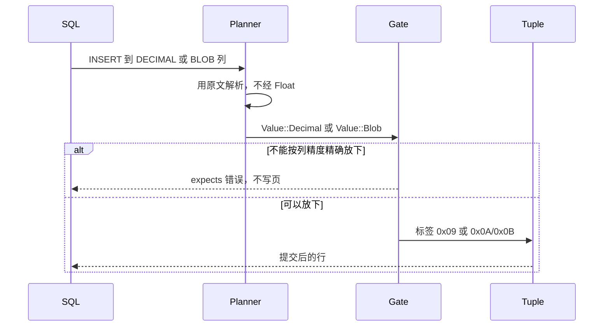

## Context

执行层 `ColumnType` 在 `src/executor/value.rs`，没有长度参数。存储层 `ColumnType` 在 `src/storage/page_format/tuple.rs`，String 带 `u16` 最大长度。`ColumnDef::to_schema_column` 把执行层 String 写成存储层 `String(255)`。catalog 列行的类型是一个 `u8` 标签；String 后再跟 `u16`。现有标签到 `COL_TAG_TIMESTAMP = 0x06`。

tuple 值标签到 `TAG_LONG_STRING = 0x08`。溢出定位字节是 `0xFF`，`overflow.rs` 写明它不在 `0x01..=0x08` 里。超页行整行走 locator 和 `0x04` 溢出页，SQL 不感知。

`PlanBuilder::convert_data_type` 对未列出的类型返回 `ColumnType::String`。因此今天的 `DECIMAL` 和 `BLOB` 会建成字符串列。`value_from_sqlparser` 把非整数数字先解析成 `Float`。

比较在 `ComparisonPredicate::evaluate_ternary`。Date 或 Timestamp 出现时，两侧必须是同一变体，否则 `ValueError::TypeMismatch`，显示文本 `Type mismatch`。`Value::to_key` 只对 Int 有键。主键类型不是 Int 时，`pk_type_known_non_int` 让等值走数据页。

文件头 `FORMAT_VERSION` 为 1。规格要求产品不声明、也不按更旧的版本号去读。目录代际是 `__tables` / `__columns` 的尾段形态，不是值标签。

旧库样本是 `tests/fixtures/legacy/legacy_g1.db`。`legacy_db_opens_queries_and_writes` 打开它，读到 `(1, alice, 9.5)` 等三行，再插入 `(4, dave, 6.0)`。

## Goals / Non-Goals

**Goals:**

- 两种类型可以声明、精确写入、同类型比较、查询读回、重开读回。
- 旧库样本仍能打开、查询和写入。
- 格式版本和目录代际保持。

**Non-Goals:**

- 结果游标。
- DECIMAL 加减乘除、索引键编码、BLOB 长度上限。
- 导入攒批。把历史上因兜底而建成 String 的列改写成新类型。
- 提高格式版本，或增加 G4。

## Decisions

### 一个变更，两种类型

验收查询是同一类：建表、写入、比较、读回、旧库打开。拆成两个变更会把同一套标签和写入门做两遍。

被替代的方案：DECIMAL 与 BLOB 各一个变更。没有单独的格式依赖，所以不拆。

### 不改代际

`FORMAT_VERSION` 保持 1。列行不追加无条件尾段。DECIMAL 的精度和小数位跟在它自己的类型标签后面，和 String 的 `u16` 一样，只有这个标签才读。旧行没有这个标签，解码路径不变。

新标签：

| 用途 | 值 | 负载 |
|---|---|---|
| `TAG_DECIMAL` | `0x09` | `u8 scale` + `i128` 小端 |
| `TAG_BLOB` | `0x0A` | `u16` 长度 + 字节，长度 ≤ 65535 |
| `TAG_LONG_BLOB` | `0x0B` | `u32` 长度 + 字节 |
| `COL_TAG_DECIMAL` | `0x07` | 后接 `u8 precision`、`u8 scale` |
| `COL_TAG_BLOB` | `0x08` | 无额外字节 |

`0xFF` 仍是溢出定位，不进入值标签。`overflow.rs` 里的上界注释改到 `0x0B`。超页 BLOB 仍是整行溢出，不新增页类型。

被替代的方案：把格式版本改成 2。头规格禁止再把版本 1 当成可嗅探的旧版本来读。被替代的方案：给 `__columns` 加一段新尾部。那会变成新的目录代际。

旧构建读到新标签时，仍是现有的 `unknown tag` / `unknown column type tag` 错误。这和 Date 标签相同，不单独立项迁移。

### 中止夹具不占用值标签

`tests/mvcc_abort_test.rs` 的 `test_abort_update_reverts_to_previous_version` 把前版本写成没有值标签的 8 字节，首字节原来是 `0x0A`。`read_prev_index_keys` 在 tuple 不能按表解码时返回 `Ok(None)`，中止清理沿手写键把索引指回前版本。`0x0A` 成为 `TAG_BLOB` 之后，这 8 字节能解成空 BLOB。BLOB 的 `to_key` 是 `None`，清理改成删除索引项。查找结果从 v1 的 `RowId` 变成 `None`。

标签保持上表。不改 `deserialize_tuple_width`，也不改 `abort_cleanup_versions`。该夹具的首字节改为 `0x0C`，前版本继续不可解码。真实的 DECIMAL 与 BLOB 行仍由 `serialize_tuple` 写入 `0x09`、`0x0A` 或 `0x0B`。

被替代的方案：把 `TAG_BLOB` 改到别的字节。标签已经按 `0x08` 之后的空位排定。被替代的方案：按列类型拒绝不匹配的标签，或让不可键控的前版本走回退更新。前者改掉自描述 tuple。后者改掉 NULL 与不可键控前版本只删除、不回插的中止语义。

### 数值

执行层和存储层的 DECIMAL 都带 `precision` 和 `scale`，经 `to_schema_column` 原样传递。BLOB 两侧都没有长度。

比较和哈希用规范形：符号、整数位、去掉尾部 0 的小数位。因此 1.50 与 1.5 相等，哈希也相同。显示和落库保留写入时的 scale，`DECIMAL(10,2)` 读回 `1.50`。

被替代的方案：把系数乘到同一 scale 再比。scale 差为 38 时 `i128` 乘不开。被替代的方案：引入十进制 crate。现有整数和字符串足够完成比较。

### 字面量与写入

`value_from_sqlparser` 的普通数字路径保持先 Int 后 Float，避免改变现有 FLOAT 列。目标列是 DECIMAL 时，INSERT、UPDATE、UPSERT 和 DEFAULT 使用记号原文或字符串解析成 `Value::Decimal`，不经过 Float。十六进制字面量解析成 `Value::Blob`。

写入门在现有 `ColumnTypeMismatch` 之前把可精确缩放的值收成列的 scale。缩放要舍入、或位数超过精度时，返回已有的 `column '{column}' expects {expected}, got {actual}`，并且不写页。Float 到达 DECIMAL 列、字符串到达 BLOB 列，走同一错误。

CAST 只增加这两类目标。字符串与 DECIMAL 按同一精确规则互转。DECIMAL 到 Int 只在小数位全是 0 且放得下 `i64` 时成功。BLOB 与字符串、DECIMAL 与 Float、以及其余跨类都是 `Type mismatch`。不实现 DECIMAL 的 `+`。

### 键与计费

`to_key` 和 `secondary_index_key` 对两种类型返回 `None`。主键等值靠现有的非 Int 分流，不新增键编码。

`value_bytes`：DECIMAL 走固定 16 字节。BLOB 在通配臂之前按 `16 + 字节长度` 计。Int 和 String 的现有公式不改。

PG 消息里 DECIMAL 的 OID 用 1700，BLOB 用 17，长度都是 -1。已有类型的 OID 不改。

JSON：DECIMAL 用显示字符串；BLOB 用小写十六进制、不带 `X'`。表显示和 dump 中 BLOB 写成 `X'6869'`，空值显示 `X''`。

### 兼容结果

打开样本或任何不含新标签的库，成功条件与现在相同。写入旧表不会为了新类型去重写其他表的目录行。曾经因兜底存成 String 的列保持 String，打开时不识别成 DECIMAL。

## 写入序列

## 风险

- 穷尽匹配漏一处时，编译会先失败。实施以编译错误清单补臂，不改变已有变体的臂。
- 5000 字节是否走溢出，由现有 `INLINE_SLOT_MAX` 决定。若单行仍小于该上限，加大字节数直到超过，而不是新写一套溢出。

## 迁移与回滚

无迁移程序。回滚后，不含新标签的文件与现在一致。含新标签的文件由未知标签错误拒绝。
