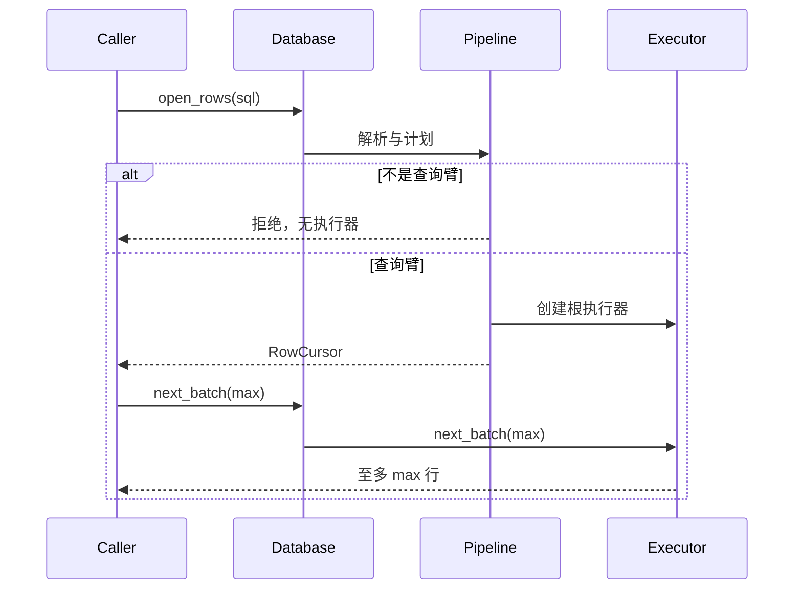

## Context

`Database::execute_sql` 进入 `pipeline::execute`，查询臂在 `execute_stage_routed` 的 `_` 分支创建执行器，再由 `execute_executor` 循环 `executor.next()`，把全部 `ExecResult::Row` 放进 `Vec<Vec<Value>>`，然后 `attach_column_metadata` 填列元数据。显式事务的对应位置是 `execute_stage_in_tx_routed` 的 `_` 分支：`statement_snapshot(Some(tx_id))`，`create_executor_from_plan(..., Some(tx_id), snapshot, ...)`。

`Executor::next_batch` 是执行器 trait 的默认方法。规格 `executor-batch-interface` 要求它与逐行同序。生产上的整段收集仍调用 `next()`。CLI（`src/cli/mod.rs`）和 `network::protocol::to_response` 消费的是已经收齐的 `SqlOutcome::Rows`。

列类型的值推导在 `derive_types_from_rows`，发生在整段行已经收齐之后。声明类型来自 `get_plan_output_columns` 和 `resolve_type_slots`，在执行之前就有。

诊断的首行等待在 `execute_executor` 收到第一行时调用 `diagnostics::note_first_delivered_row`，结束时调用 `finish_delivered_rows`。查询内存预算在语句入口用 `QueryBudget::new(database.query_memory_limit())` 构造。规格规定最终交回调用方的结果行不计费，无 WHERE 的整数全表扫描在上限 16 字节时仍然成功。

## Goals / Non-Goals

**Goals:**

- 调用方可以按自己给出的批量拿走查询行。
- 不拉则根执行器不继续产出，一次拉取不预取下一批。
- 整段入口、CLI、协议和诊断定义保持。

**Non-Goals:**

- DECIMAL、BLOB、页格式和目录代际。
- 代价模型、JOIN 重排、导入攒批。
- 把排序、聚合、连接改成流式算子。
- 预编译语句的游标、CLI 边输出、协议边输出。
- 为游标新增诊断指标或修改首行等待的定义。

## Decisions

### 新的公共游标

调用方使用 `result::RowCursor`。`columns()` 返回计划元数据。`next_batch(max)` 返回 `Result<Vec<Vec<Value>>, SqlError>`。空 `Vec` 表示这一批没有行：`max == 0` 时不推进，结果耗尽后再次拉取也是空 `Vec`。

四个 `Database` 方法委托到 pipeline。`src/lib.rs` 与 `SqlOutcome` 一起导出 `RowCursor`。

被替代的方案：

- 把 `Executor` 或 `next_batch` 作为公共 API。执行器交回的是 `ExecResult`，还带着事务和预算，不是结果消费接口。
- 把 `SqlOutcome::Rows` 改成流。`typed-library-results` 和全部现有调用方都依赖一次拿全。
- 让 `execute_sql` 改成抽干游标。整段路径会改走诊断计点，违反「不为流式改诊断口径」。

### 只打开查询臂

计划成功之后，先做与 `execute_stage_routed` 相同的 `readonly_rejection`。然后只接受两个 `_` 查询臂今天会执行的计划。其余计划返回：

```text
message: streaming consumption requires a row-producing statement
sqlstate: None
```

不创建执行器，不开始隐式事务。只读写计划仍返回既有 `25006`。

解析、多语句、参数个数和计划错误沿用 `execute_with_params` / `execute_in_tx_with_params` 已经产生的 `SqlError`，不另写一套文本。

### 拉取与背压

查询臂用与今天相同的参数创建执行器：自动提交路径 `tx_id = None`、`statement_snapshot(None)`；显式事务路径 `Some(tx_id)` 和 `statement_snapshot(Some(tx_id))`。预算对象按同一上限构造。

`next_batch(max)` 对根执行器调用一次 `next_batch(max)`，只收集 `ExecResult::Row`。查询臂出现 `AffectedRows` 或 `RowId` 时停止并回到计划，不把它们当成数据行。执行错误包装与 `execute_executor` 相同：`Execution error: {storage error}`，SQLSTATE 沿用 `storage_error_sqlstate`。

失败后游标记住这个 `SqlError`，后续拉取直接返回它。丢弃游标只丢弃执行器。显式事务的提交和回滚仍由调用方的 `Transaction` 决定。

无排序、无聚合的 `DataScan` 按数据页槽位顺序产出。新建表上三次短行插入落在第一页的插入顺序。`SELECT CAST(s AS INTEGER) FROM t` 的投影在每次 `next` 时求值（`ProjectionExecutor` 或 `DataScan` 自己的投影，二者都是拿到一行才算这一行）。因此前两批不能包含第三行的 CAST 失败。

`ORDER BY`、聚合、哈希连接仍会在产出第一行之前驻留输入。这是算子语义，不是结果缓冲。验收查询避开这些算子。

### 列元数据与计费

游标使用 `get_plan_output_columns` 和 `resolve_type_slots` 的结果，不调用 `derive_types_from_rows`。`execute_sql` 继续调用它。

交回的批不计查询内存。算子内部该记的驻留照旧记。上限 16 字节的整数全表扫描两条路径都成功。

游标不调用 `note_first_delivered_row` 和 `finish_delivered_rows`。

## 序列



## 风险

- 查询臂的计划形态若比「最终交回行」更宽，打开游标可能拿到非行结果。任务要求这时停止并回到计划。
- 全表扫描的页顺序是当前存储行为。验收表必须是新建的、只有三行短记录的表。

## 迁移与回滚

无磁盘格式。回滚删除游标和四个方法。
